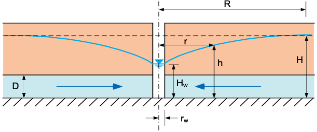
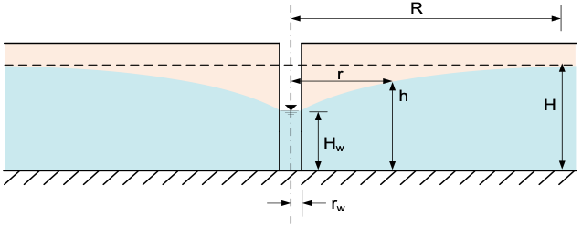

# Exercise - Well Equations

## Part 1 - Radius of Influence

The radius of influence of a well is the distance from the well at which the drawdown is negligible. The radius of influence can be estimated using the following equations:

| Name      | Type | Equation                         |
|-----------|------|----------------------------------|
| Lembke    |Semi-Empirical| $R = H\sqrt{\frac{k}{2N}}$       | 
| Weber     | Semi-Empirical | $R = 2.45\sqrt{\frac{Hkt}{n_e}}$ |
| Kusakin   | Semi-Empirical | $R = 1.9\sqrt{\frac{Hkt}{n_e}}$  |
| Siechardt | Empirical | $R = 3000s_w\sqrt{k}$            |
| Kusakin   | Empirical | \(R = 575s_w\sqrt{\frac{H}{k}}\) |

Where:

>>H = initial thickness (B for confined aquifers, h for unconfined aquifers) [m] 
k = hydraulic conductivity [m/sec] 
$s_w$ = drawdown at the well [m] 
\(n_e\) = effective porosity (storativity S, for confined) [-] 
t = time since pumping began [sec] 
N = accretion from rainfall [m/sec]

The following spreadsheet a sample set of calculations for each of the equations above.

Excel file: [radius_of_influence.xlsx](files/radius_of_influence.xlsx)

## Part 2 - Confined Aquifer

In this exercise, you will calculate the water level at the center of the well and as a function of distance from the well for a confined aquifer.

The following equations can be used to calculate the head (h) as a function of distance (x) from the well:

>>$h =  H = \dfrac{q}{2\pi k D} \ln\left(\dfrac{r}{R}\right)$

Where:

>>h = head [L] 
H = initial head prior to pumping [L] 
q = flow rate [L³/T] 
k = hydraulic conductivity [L/T] 
D = thickness of the confined aquifer [L] 
r = distance from the well [L] 
R = radius of influence of the well [L]

Assume the following values for the confined aquifer:

| Parameter | Value | Units |
|-----------|-------|-------|
| H         | 50    | m     |
| Q         | 0.2   | m³/s  |
| k         | 1e-3  | m/s   |
| D         | 15    | m     |
| R         | 500   | m     |
| \(r_w\)   | 0.1   | m     |

a) Calculate the head at the center of the well (r = \(r_w\)).

b) Let r vary from rw to R. Calculate and plot the head as a function of distance (r) from the well.

Excel starter file: [confined.xlsx](files/confined.xlsx)

Excel solution file: [confined_KEY.xlsx](files/confined_KEY.xlsx)

Python starter file: 

Python solution file:  

## Part 3 - Unconfined Aquifer

In this exercise, you will calculate the water level at the center of the well and as a function of distance from the well for an unconfined aquifer.

The following equations can be used to calculate the head (h) as a function of distance (x) from the well:

>>$h = \sqrt{H^2 - \dfrac{q \ln\left(\dfrac{R}{r}\right)}{\pi k} }$

Where:
>>h = head [L] 
H = initial head prior to pumping [L] 
q = flow rate [L³/T] 
R = radius of influence of the well [L] 
r = distance from the well [L] 
k = hydraulic conductivity [L/T] 

Assume the following values for the unconfined aquifer:

| Parameter | Value | Units |
|-----------|----|-------|
| Q         | 0.2 | m³/s  |
| k         | 1  | cm/s  |
| H         | 50 | m     |
| R         | 500 | m     |
| \(r_w\)   | 0.1 | m     |

a) Calculate the head at the center of the well (r = \(r_w\)).

b) Let r vary from rw to R. Calculate and plot the head as a function of distance (r) from the well.

Excel starter file: [unconfined.xlsx](files/unconfined.xlsx)

Excel solution file: [unconfined_KEY.xlsx](files/unconfined_KEY.xlsx)

Python starter file: 

Python solution file:  

## Part 4 - Transient Drawdown, Confined Aquifer

Parts 2 and 3 are steady: the well has pumped long enough for the cone of depression to stop growing at $R$. When the pump starts, the water comes out of storage instead, and the cone spreads with time. For a confined aquifer, the Theis equation gives the head:

>>$h = H - \dfrac{q}{4\pi T}W(u), \qquad u = \dfrac{r^2 S}{4Tt}$

Where:

>>$T$ = transmissivity, $kD$ [L²/T] 
$S$ = storativity [-] 
$t$ = time since pumping began [T] 
$W(u)$ = the Theis well function

$W(u)$ is the exponential integral. In Python it is `scipy.special.exp1(u)`. In Excel, use this formula, with your own cell for `X1`:

`=IF(X1>10,0,IF(X1<0.01,-0.5772-LN(X1)+X1-X1^2/4,-0.5772-LN(X1)-SUMPRODUCT((-X1)^ROW($1:$40)/(ROW($1:$40)*FACT(ROW($1:$40))))))`

At late time, the Theis equation becomes the Thiem equation with $R = 1.5\sqrt{Tt/S}$.

Use the confined aquifer of Part 2 with a storativity of $S$ = 2e-4.

The starter and solution files for Parts 4 and 5 are at the end of Part 5.

a) Calculate the head at the well and $R$ after 1 minute, 10 minutes, 1 hour, and 1 day of pumping.

b) Plot the head against $r$ from $r_w$ to 1000 m for each time, along with the steady curve from Part 2 ($R$ = 500 m).

c) How long does it take for $R$ to reach 500 m? Compare the head at the well at that time with the steady head at the well from Part 2.

## Part 5 - Transient Drawdown, Unconfined Aquifer

For an unconfined aquifer, the Theis equation works in the same $H^2 - h^2$ form as the steady equation, with $T = kH$ and the specific yield, $S_y$, in place of $S$:

>>$h = \sqrt{H^2 - \dfrac{q}{2\pi k}W(u)}, \qquad u = \dfrac{r^2 S_y}{4kHt}$

At late time, it becomes the steady unconfined equation with $R = 1.5\sqrt{kHt/S_y}$.

Use the unconfined aquifer of Part 3, but with a lower hydraulic conductivity, $k$ = 0.05 cm/s, and a specific yield of $S_y$ = 0.2.

a) Calculate the head at the well and $R$ after 1 hour, 1 day, 10 days, and 100 days, and plot the head against $r$ for each time with the steady curve for $R$ = 500 m.

b) How long does it take for $R$ to reach 500 m? Compare this time with the time you found for the confined aquifer in Part 4. Why is the difference so large?

c) Look back at the time-based formulas for $R$ in Part 1 (Weber and Kusakin). How do they compare with $R = 1.5\sqrt{kHt/S_y}$?

Excel starter file: [transient.xlsx](files/transient.xlsx)

Excel solution file: [transient_KEY.xlsx](files/transient_KEY.xlsx)

Python starter file: 

Python solution file: 
