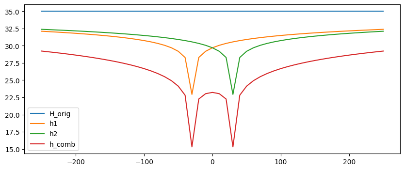

# Homework - Well Equations

**1.** A **12** inch diameter well was installed in a thick layer of sand. The water table was at elevation **2039** ft before pumping of the well began. The well was then pumped at a rate of **30** gallons per minute and the water level in the well dropped to **2014** ft after a steady-state condition was reached. The radius of well influence is **2000** ft. The elevation of the bottom of the sand layer = **2000** ft.

a. Calculate the permeability of the sand [ft/day] assuming the aquifer is **confined** and D = **10** ft.

b. Calculate the permeability of the sand [ft/day] assuming the aquifer is **unconfined**.

**2.** A well fully penetrating a confined aquifer **20** m thick is pumped at a constant rate of **10** L/s. The drawdown is recorded at an observation well **40** m from the pumping well:

| Time since pumping began (min) | Drawdown, s (m) |
|------:|------:|
| 1 | 0.09 |
| 2 | 0.22 |
| 3 | 0.33 |
| 4 | 0.42 |
| 5 | 0.49 |
| 7 | 0.60 |
| 10 | 0.73 |
| 15 | 0.87 |
| 20 | 0.98 |
| 30 | 1.14 |
| 40 | 1.25 |
| 60 | 1.41 |
| 90 | 1.57 |
| 120 | 1.68 |
| 180 | 1.84 |
| 240 | 1.95 |
| 360 | 2.11 |
| 480 | 2.23 |
| 720 | 2.39 |
| 1,000 | 2.52 |
| 1,440 | 2.66 |

For small $u$, the Theis equation reduces to the Cooper–Jacob approximation, a straight line on a plot of drawdown against log time:

>>$s = \dfrac{q}{4\pi T}\ln\left(\dfrac{2.25\,Tt}{r^2 S}\right), \qquad u = \dfrac{r^2 S}{4Tt} < 0.05$

The slope of the line gives the transmissivity and its intercept gives the storativity:

>>$T = \dfrac{2.3\,q}{4\pi\,\Delta s}, \qquad S = \dfrac{2.25\,T t_0}{r^2}$

Where:

>>$\Delta s$ = change in drawdown over one log cycle of time [L] 
$t_0$ = time where the straight line crosses s = 0 [T] 
$r$ = distance from the pumping well to the observation well [L]

a. Plot the drawdown against time with a log scale for time. Which points don't fall on a straight line, and why?

b. Fit a straight line through the later points. Find $\Delta s$ and $t_0$, and calculate $T$, $S$, and $k$ [cm/s].

c. Calculate $u$ for the earliest point you used in the fit. Is the Cooper–Jacob approximation valid there?

d. Using the Theis equation, $s = \dfrac{q}{4\pi T}W(u)$, with your $T$ and $S$, predict the drawdown at the observation well after 30 days of pumping. What is $R = 1.5\sqrt{Tt/S}$ at 30 days?

$W(u)$ is the exponential integral. In Python it is `scipy.special.exp1(u)`; the Excel starter file gives a formula for it.

Excel starter file: [pumping_test.xlsx](files/pumping_test.xlsx)

Python starter file: 

**3.** Two wells are installed a distance of **60** feet apart in an unconfined aquifer **40** feet thick. The water table is **5** 
feet below the ground surface. The hydraulic conductivity of the aquifer is **0.02** ft/min. The following information is also known for the wells:

| Parameter | Value | Units |
|-----------|-------|-------|
| Radius of well influence | 3000 | ft |
| Diameter of well | 6 | inches |
| Pumping rate per well | 35 | gallons per minute per well |

Compute and plot the drawdown surface produced by pumping the two wells under steady state conditions. Use a 
cross-section which passes through both wells. Let x range from 
-250 to +250 ft with increments of 10 ft assuming x=0 exactly halfway between the wells. At each x location, 
calculate the distance from x to each well (r1 and r2). Then calculate  and head for each well independently (h1 
and h2) using the unconfined aquifer well equation:

>>$h =  \sqrt{H^2 - \dfrac{q \ln\left(\dfrac{R}{r}\right)}{\pi k} }$

Finally, calculate the head resulting from both wells pumping simultaneously (h_comb) using the superposition equation:

>>$h = \sqrt{H^2 - \dfrac{1}{\pi k}\sum_{i=1}^n{q_i \ln\left(\dfrac{R}{r_i}\right)}}$

Combine the original head, h1, h2, and h_combined all on the same plot. If you have done it correctly, it should 
look something like this:

Solve in either Excel or Python.

Excel starter file: [two_wells.xlsx](files/two_wells.xlsx)

Python starter file: 

## Submission

If you completed the second or third part of the problem using Google Colab, use the "File|Download|Download .ipynb" command to download your notebook as an .ipynb file.

Combine your PDFs, spreadsheets, and *.ipynb notebook files into a single zip archive and upload it on Learning Suite.

!!! note "Do not put your name or NetID in the file"
    Learning Suite records who submitted each file, so your name is not needed
    inside the file itself. Leaving it out means your work can be graded
    anonymously, which keeps grading fair. This applies to scans and photos
    too — please don't write your name on the page.

## Grading Rubric

**Total: 30 points**

| Criteria | Points |
|----------|:------:|
| Problem 1a: Permeability for confined aquifer | 5 |
| Problem 1b: Permeability for unconfined aquifer | 5 |
| Problem 2a: Drawdown vs. log time plot | 3 |
| Problem 2b: T, S, and k from the straight line | 5 |
| Problem 2c: u check for the fit | 2 |
| Problem 2d: Drawdown and R after 30 days | 2 |
| Problem 3: Two-well drawdown calculation and plot | 6 |
| Documentation and work shown clearly | 2 |
