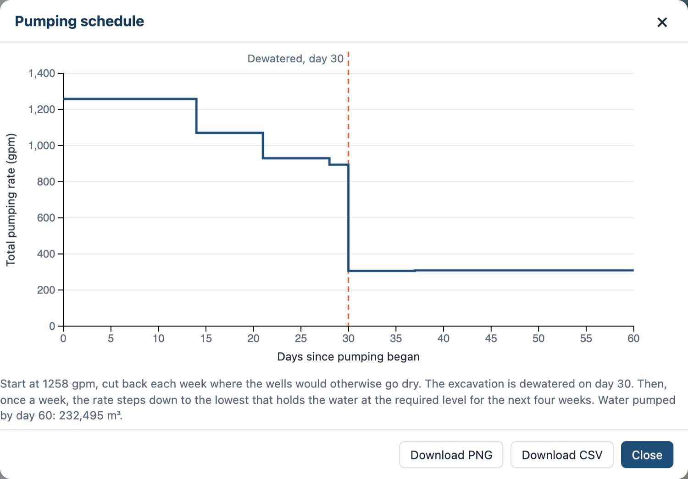
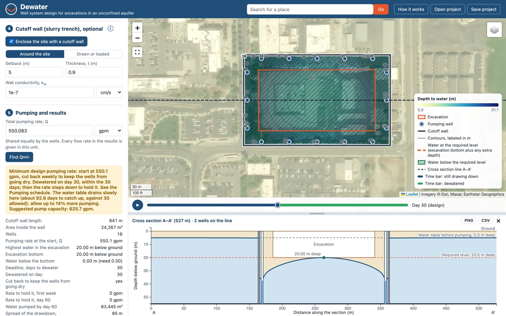

# Exercise - Construction Dewatering

A contractor has 30 days from the day the pumps start until excavation must begin. In this exercise you design the well system for that deadline with the **Dewater** web app: how many wells, where they go, how hard to pump and for how long, how big the pumps must be, how much water must be discharged, and whether a cutoff wall pays for itself.

## How the App Computes

The site is a uniform, unconfined aquifer on a low-permeability layer, with the heads measured up from that layer. Each well follows the Theis solution in the $H^2 - h^2$ form, and the drawdowns of the wells add:

>>$H^{2} - h^{2} = \displaystyle\sum_{i=1}^{n} \dfrac{q_i}{2\pi k}W(u_i), \qquad u_i = \dfrac{r_i^{2}S_{y}}{4kHt}$

Where:

>>$h$ = water level above the low-permeability layer at a point, at time $t$ 
$H$ = initial saturated thickness 
$k$ = hydraulic conductivity 
$S_y$ = specific yield 
$q_i$ = pumping rate of well $i$ 
$r_i$ = distance from well $i$ to the point 
$W(u)$ = the Theis well function 
$t$ = time since pumping started

A change in the rate at time $t_j$ starts a Theis term of its own, and the terms add in time as well:

>>$H^{2} - h^{2} = \displaystyle\sum_j \dfrac{\Delta q_j}{2\pi k}W(u_j), \qquad u_j = \dfrac{r^{2}S_{y}}{4kH(t - t_j)}$

The app checks the water level on a grid of points over the excavation and along its edge. A design works when the water is at or below the required level at every point by the deadline, and no well has gone dry along the way. With a cutoff wall, the app solves the flow on a finite-difference grid instead.

The cone of depression keeps growing as long as the wells pump. A steady solution, with a radius of influence $R$, describes the cone after it has stopped growing, which never happens on a construction schedule. Everything in this exercise is transient.

Open the app here:

<a href="https://jonesgeo.com/dewater/" target="_blank"><b>Dewater: https://jonesgeo.com/dewater/</b></a>

It runs in your browser; there is nothing to install. **How it works** at the top of the app summarizes the equations and the steps. The app keeps your work if you reload the page, and **Save project** writes it to a file you can open later.

## Part 1 - The Site

The excavation is a rectangle at the site of the Brewster Building on the east side of BYU campus:

GEOJSON File: [byu_brewster.geojson](files/byu_brewster.geojson) (right-click and select "Save Link As")

!!! Note
    An excavation at this location would not likely require dewatering, as the water table is well
    below the site. The site is for illustration only.

Click **Load GeoJSON** in step 1 and select the file. (The same polygon also loads with the **Load the class example (BYU)** link.) Then enter the site in step 2:

| Parameter | Value | units |
|----------|-------|-------|
| Depth to the water table | 5  | m |
| Depth to the bottom of the aquifer | 55 | m |
| Excavation depth | 20 | m |
| Extra depth below the bottom | 0 | m |
| $k_h$      | 5e-4  | cm/s  |
| Flow     | Transient | |
| Days to dewater, $t$ | 30 | days |
| Specific yield, $S_y$ | 0.2 | |
| Anisotropy, $k_h/k_v$ | 1 | |

In step 5, set the pumping rate unit to **gpm**. The app shows the initial saturated thickness, $H$ = 55 − 5 = 50 m, and the target head inside the excavation, 55 − 20 = 35 m above the bottom of the aquifer:

## Part 2 - A Design for the Deadline

In step 3, open **Generate a ring of wells**, enter an offset of 15 m and 16 wells, and click **Generate wells**. Then click **Find Qmin** in step 5, and in step 7 click **East–west** for a cross section through the excavation:

$Q_{min}$, the minimum design pumping rate, is the smallest pumping rate at the start that gets the water down to the required level everywhere in the excavation by day 30. The map and the section show the water on day 30. The hatching is where the water is below the required level, and the dashed orange contour is where it is right at it. The bar under the map plays the design through time: press play and watch the cone of depression grow, in the contours and in the section.

1. What is $Q_{min}$, in gpm? On day 30, where in the excavation is the water highest, and why there?
2. Read the status. Why does the app cut the rate back weekly, and what does that tell you about how hard the wells can pump early on compared with later?

## Part 3 - The Pumping Schedule

Click **Pumping schedule**:

Up to the deadline, the rate starts high, while the cones are shallow and the wells can take it, and is cut back each week where a well would otherwise go dry. After the excavation is dry, the rate steps down each week to the lowest rate that holds the water at the required level for the next four weeks.

1. Report the rates week by week, the holding rate on day 60, and the water pumped by day 60.
2. The pumps must be sized for one rate and the discharge permit written for another. Which rate sets each, and why?

## Part 4 - What the Deadline Costs

In step 8, plot the design against **Days to dewater**, from 1 to 365 days:

Each point is a full design, with everything else as on the map.

1. What is the fastest these 16 wells can dewater the excavation? Why can't any rate, however large, do better?
2. How do $Q_{min}$ and the water pumped before the excavation is dry change with the deadline? Why does a longer deadline pump more water?

## Part 5 - Number of Wells and Layout

Plot the design against **Number of wells**, from 4 to 40, for the 30-day deadline.

1. What is the fewest wells that can meet 30 days? Past what number do more wells barely help?
2. The curve zigzags. Generate rings of a few neighboring well counts and look at where the wells land on the long and short sides. What causes the zigzags?

Now go back to 16 wells and click **Optimize the layout** in step 3, then **Find Qmin**. The app tries the ways of splitting the wells between the long and short sides, and the spacing along each, and keeps the layout that needs the least pumping.

3. How much less pumping does the optimized layout take than the even ring? Where did the wells go, and why there?

## Part 6 - Uncertainty in the Soil

The design rests on an estimate of $k$. Click **Generate wells** to go back to the even ring of 16, and plot the design against **Hydraulic conductivity, k**, from 1e-4 to 1e-2 cm/s.

1. If the real $k$ is twice the estimate, what happens to $Q_{min}$? If it is half?
2. Which mistake in $k$ is the dangerous one? Consider what can be fixed after the job starts: adding pump capacity, or adding wells.

Soil is often layered, with the horizontal $k$ several times the vertical. The water in the pores then drains slowly down to the well screens, and the water table lags behind the heads at depth. Set the anisotropy, $k_h/k_v$, to 10 and click **Find Qmin**.

3. What does the app warn, and what pump capacity does it suggest? Compare the drainage time, $4S_yH/k_v$, with the deadline. Set the anisotropy back to 1.

## Part 7 - Cutoff Wall

In step 4, turn on **Enclose the site with a cutoff wall**, a slurry wall keyed into the low-permeability layer, with a 5 m setback, 0.9 m thick, and $k_w$ = 1e-7 cm/s. Click **Find Qmin**:

1. Compare $Q_{min}$, the holding rate, and the water pumped by day 60 with the wells alone.
2. Plot the design against **Days to dewater** and against **Number of wells** again. How do the fastest day and the fewest wells change?
3. Look at the cross section on day 30 and on day 60. Why is the water inside the wall a mound on day 30, and why does it keep falling after the pumps cut back?
4. Outside the wall, how far does the drawdown reach compared with the wells alone? Why might that matter to the neighbors?

!!! Note "In practice"
    Start from the deadline: the days until digging starts set the pumping rate. Check first what
    the wells can do, since no rate beats their fastest day, and add wells, move them, or enclose
    the site if the deadline is shorter. Size the pumps for $Q_{min}$ plus the margin for
    slow drainage, and plan the discharge for the holding rate, which runs through construction.
    Get $k$ from a pumping test, and when in doubt design for the lower value: more pump capacity
    can be added on site, but more wells are much harder to add once the job has started.
