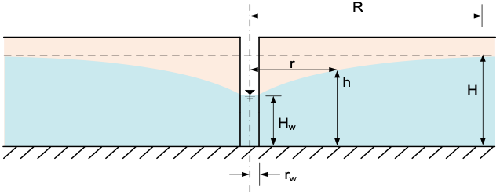
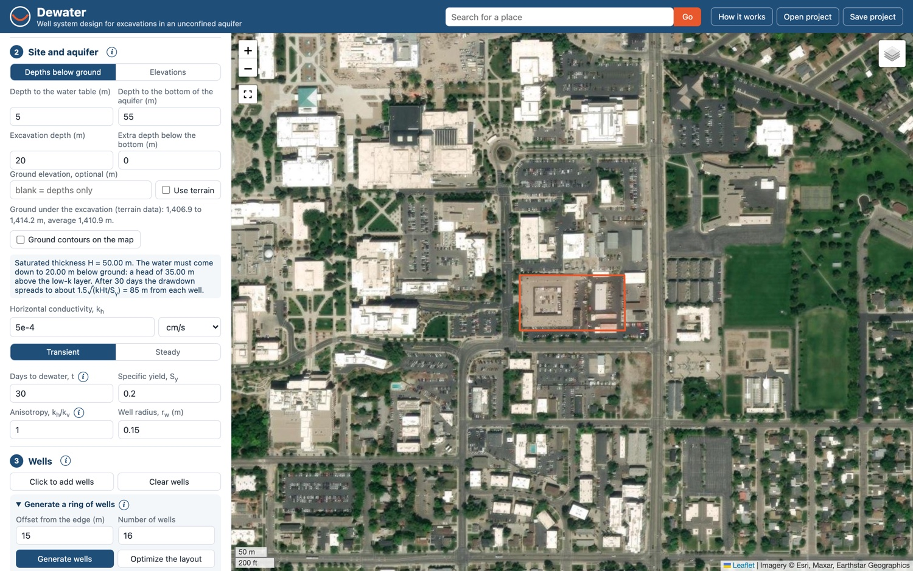
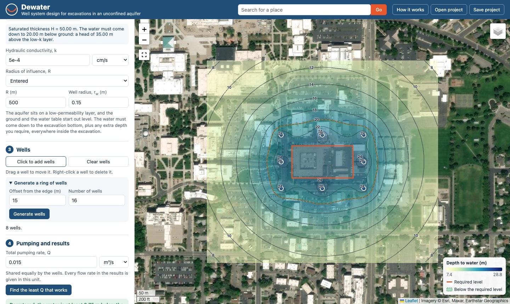
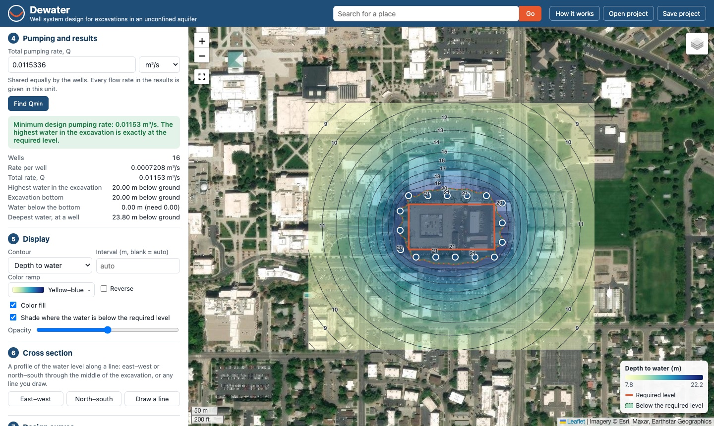
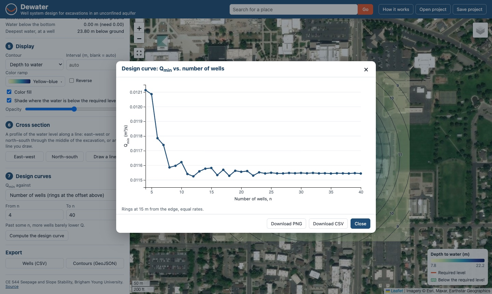
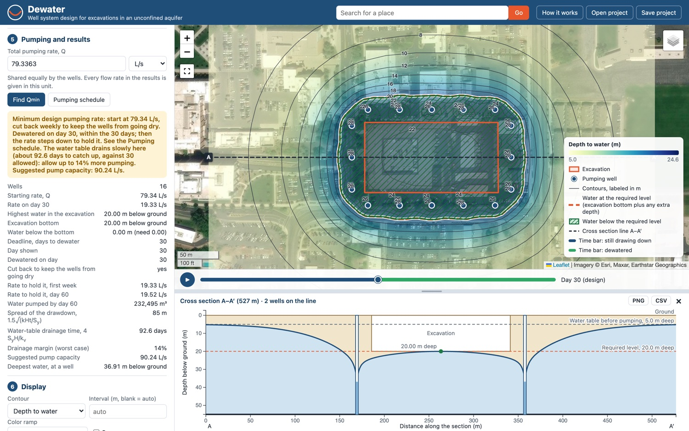

# Exercise - Construction Dewatering

In this exercise, we will use the **Dewater** web app to design a well-based dewatering system for a construction site. The app calculates the drawdown from a set of wells and the pumping rate required to lower the water table to a desired level. We will assume unconfined conditions and apply the superposition principle to calculate the water level using the following equation:

>>$h = \sqrt{H^{2} - \dfrac{1}{\pi k} \sum_{i=1}^n q_{i}\ln\left(R/r_i\right)}$

Where:

>>$h$ = water level at a given location (m) 
$H$ = initial water table elevation (m) 
$k$ = hydraulic conductivity of the aquifer (m/s) 
$q_{i}$ = pumping rate of well $i$ (m³/s) 
$R$ = radius of influence (m) 
$r_i$ = distance from well $i$ to the point in question (m) 
$n$ = number of wells

This assumes we have a simple, uniform isotropic aquifer underlain by a low K unit. The heads are measured from the top of the low K unit.

When dealing with an excavation, we create a grid of points that covers the excavation and calculate the water level at each point resulting from a set of dewatering wells that surround the excavation. At each point, we calculate the distance ($r_i$) from each well to the point and apply the equation above. The well spacing and pumping rate can be adjusted until the water level at all points inside the excavation is below the target depth of the excavation.

Open the app here:

<a href="https://jonesgeo.com/dewater/" target="_blank"><b>Dewater: https://jonesgeo.com/dewater/</b></a>

It runs in your browser; there is nothing to install. The **How it works** button at the top of the app summarizes the equations and the steps. The app keeps your work if you reload the page, and **Save project** writes it to a file you can open later.

## Part 1 - Define the Excavation Site

The excavation size and location are defined by a polygon. You can draw it directly on the map (zoom to the site, click **Draw outline**, and click the corners), or load it from a GeoJSON file. For this problem, we will use the following GeoJSON file:

GEOJSON File: [byu_brewster.geojson](files/byu_brewster.geojson) (right-click and select "Save Link As")

This file contains the coordinates of a polygon that represents an excavation site. For this problem we will assume that BYU intends to build a new building to replace the Clyde Building and has decided to build the new building at the location of the current Brewster Building on the east side of campus. The GeoJSON file contains the coordinates of a rectangular excavation site that represents the footprint of the new building.

!!! Note
    An excavation at this location would not likely require dewatering as the water table is well below the
    elevation of the site. This is for illustrative purposes only.

Click **Load GeoJSON** in step 1 and select the file. (The same polygon also loads with the **Load the class example (BYU)** link.) The app zooms to the site and outlines the excavation in orange:

Then enter the following parameters in step 2:

| Parameter | Value | units |
|----------|-------|-------|
| Depth to the water table | 5  | m |
| Depth to the bottom of the aquifer | 55 | m |
| Excavation depth | 20 | m |
| Extra depth below the bottom | 0 | m |
| $k$      | 5e-4  | cm/s  |
| Flow     | Steady | |
| $R$      | 500   | m     |

Parts 1 to 6 use steady flow, with the radius of influence entered; Part 7 turns to time. The app converts the depths to the quantities in the equation and shows them under the inputs: the initial saturated thickness, $H$ = 55 − 5 = 50 m, and the target head inside the excavation, 55 − 20 = 35 m above the bottom of the aquifer. (You can also enter the levels as elevations with **Elevations**; the app then reads the ground elevation from terrain data.)

## Part 2 - Drawdown Calculations

In step 3, click **Click to add wells** and click the map to place wells around the excavation. They should be outside of the footprint of the excavation. Drag a well to move it, and right-click a well to delete it. Click the button again when you are done.

In step 4, enter a total pumping rate of $Q$ = 0.015 m³/s. The total pumping rate is divided equally among the wells. The app computes the water level on a grid surrounding the excavation and draws contours on the map as soon as anything changes:

The orange contour is the required water level (here, the excavation bottom). The area where the water is below the target is shaded green, and the panel reports the highest water level inside the excavation and whether the excavation is dewatered. If it isn't, a red circle marks the point where the water is highest. In step 5 you can switch the contours to the depth to water, drawdown, or the water below the required level, which is negative where the excavation is still wet. In step 6, **East–west** and **North–south** draw cross sections through the excavation showing the ground, the excavation, and the water table.

Play with the pumping rate and the well locations to determine when the water level is below the target at all points in the excavation.

## Part 3 - Rectangular Well System Design

Next, use **Generate a ring of wells** in step 3 to automatically place wells around the excavation, based on an offset distance from the excavation boundary and a number of wells. The wells are spaced evenly along a line offset from the edge of the excavation.

Use an offset of 15 m and 16 wells. Play with the number of wells, the offset distance, and the pumping rate. Compare your results to the previous section where you manually placed the wells.

## Part 4 - Minimum Design Pumping Rate

Click **Find Qmin** in step 4. The app finds the minimum design pumping rate, $Q_{min}$: the smallest total pumping rate that brings the water down to the required level everywhere inside the excavation. At that rate the water is just at the target at the highest point and below it everywhere else. With 16 wells at a 15 m offset, the result should look like this:

Because the wells share the pumping equally, $Q_{min}$ can be computed directly rather than by trial and error: the highest water is always at the point in the excavation where the wells have the least combined effect, and the rate is the one that brings that point exactly to the target. The app also checks that $Q_{min}$ doesn't pump any of the wells dry. If it does, you need more wells, or wells farther from the excavation.

What is $Q_{min}$ in gpm? The rate actually specified for a project is usually $Q_{min}$ plus a margin.

## Part 5 - Qmin vs. Number of Wells

In step 7, with **Number of wells** selected, enter a range for the number of wells (for example, 4 to 40) and click **Compute the design curve**. For each number of wells, the app generates a ring of wells at the offset distance from step 3 and finds $Q_{min}$. The results are presented in a design curve of $Q_{min}$ vs. the number of wells:

The design curve will help you determine the optimal number of wells and pumping rate required to dewater the excavation. In other words, at some point, adding more wells will not significantly reduce the pumping rate required to dewater the excavation. Use **Download CSV** to save the curve.

Try a few different offset distances. How does the offset affect the required pumping rate?

## Part 6 - The Radius of Influence

So far we have entered the radius of influence, $R$ = 500 m. In practice, $R$ is usually estimated with an empirical formula such as Sichardt's, $R = 3000\,s\sqrt{k}$ (with $s$, the drawdown, in m and $k$ in m/s). For a ring of wells, the ring is treated as one large well with the excavation's equivalent radius, $r_e = \sqrt{A/\pi}$, where $A$ is the area of the excavation. The drawdown $s$ is the drawdown the excavation needs (here 15 m, from the water table down to the excavation bottom), and $R$ is measured from the center of the large well: $R = r_e + 3000\,s\sqrt{k}$. In step 2, change **Radius of influence, R** from **Entered** to **Sichardt**, and click **Find Qmin** again. The app reports $r_e$ and $R$. How does $R$ from Sichardt compare to 500 m, and how much does it change the pumping rate?

Then, in step 7, select **Hydraulic conductivity, k** and compute the design curve for $k$ from 1e-4 to 1e-2 cm/s. The plot shows $Q_{min}$ with $R$ from Sichardt and with $R$ fixed. With a fixed $R$, the pumping rate is simply proportional to $k$. Why is the curve with $R$ from Sichardt different, and what does that tell you about how much the choice of $R$ matters?

!!! Note "In practice"
    When a pumping test is available, $R$ comes from it: the drawdowns at the observation wells are
    plotted against the log of distance, and the line is extended to zero drawdown. Without a test, an
    empirical formula such as Sichardt's gives an estimate, usually computed once from the drawdown the
    design calls for. Because the pumping rate depends on $R$ only through $\ln(R/r)$, designers often
    run the design for a range of $R$. $R$ also grows the longer the wells pump, so a steady-state $R$
    stands for some period of pumping. Around a compact excavation, a ring of wells behaves much like
    one large well with a radius of $\sqrt{A/\pi}$, which is why $Q_{min}$ for a small site
    barely changes with the number of wells.

## Part 7 - Dewatering on a Schedule

$Q_{min}$ from Part 4 is a steady rate: it holds the water down once the cone of depression has spread out to $R$. It says nothing about how long that takes, and the contractor wants to start digging soon after the pumps start. With transient flow, each well follows the Theis solution in the same $H^2 - h^2$ form,

>>$H^{2} - h^{2} = \dfrac{q}{2\pi k}W(u), \qquad u = \dfrac{r^{2}S_{y}}{4kHt}$

where $W(u)$ is the Theis well function, $S_y$ the specific yield, and $t$ the time since pumping started. At late time it becomes the steady equation with $R = 1.5\sqrt{kHt/S_y}$, so a steady $R$ stands for a pumping time. Wells still add in $H^2 - h^2$, and $Q_{min}$ is still exact: now it is the smallest rate that dewaters the excavation by day $t$.

In step 2, set **Radius of influence, R** back to **Entered** and switch to **Transient**, with $S_y$ = 0.2 and 30 days to dewater. Generate a ring of 16 wells at a 15 m offset, enter the steady $Q_{min}$ from Part 4 as the pumping rate, and draw the east–west cross section.

1. The results give the time to dewater at this rate. How long does the steady $Q_{min}$ take? What $R$ does it correspond to, from $R = 1.5\sqrt{kHt/S_y}$?
2. Press play on the bar under the map to watch the cone of depression grow, in the contours and in the cross section. Drag the bar to scrub through time; **Design day** returns to day 30.
3. Click **Find Qmin** to find the rate that dewaters the excavation by day 30. What happens to the wells? Increase the number of wells until the design works. How much does $Q_{min}$ change, and why does adding wells fix the problem?
4. Once the excavation is dry, the wells only need to keep it dry. After day 30 the app steps the rate down once a week, each step the lowest rate that holds the water at the required level for the next four weeks. Click **Pumping schedule**. How much lower is the rate in the first week after dewatering, and on day 60? How much water is pumped by day 60?
5. In step 7, compute $Q_{min}$ against the days to dewater, from 1 to 365 days. How much more pumping does a 30-day schedule take than a 180-day schedule?
6. Go back to 16 wells and enclose the site with a cutoff wall (step 3, **Cutoff wall**: a 20 m offset, 0.9 m thick, $k_w$ = 1e-7 cm/s). Find $Q_{min}$ for 30 days. Compare it with the wells alone, and with the leakage that holds the water down after day 30.

!!! Note "In practice"
    Start the design from the schedule: the days until digging starts set the pumping rate. Then
    check that no well runs dry, and consider a cutoff wall when the rate is too high. Once the
    excavation is dry, the pumps are throttled back to hold it there through construction; with no
    boundary the cone keeps spreading, so the holding rate keeps falling slowly. A river or other
    recharge boundary stops that growth; there the steady solution with $R$ set by the boundary is
    the better model.
