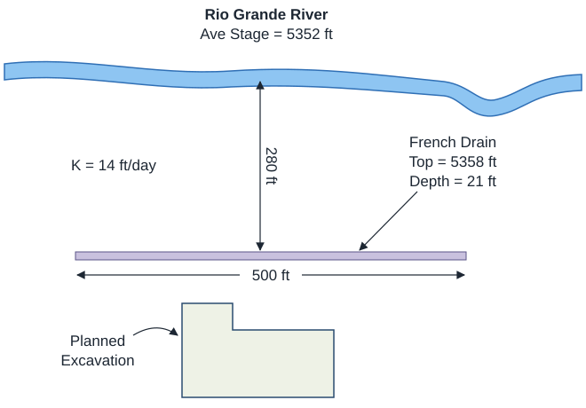

# Homework - Construction Dewatering

In this exercise, we will design a dewatering trench using the Dupuit analytical solution and we will design a 
dewatering system for the Provo City Center Temple excavation site using the Dewater web app.

## Exercise 1 - Dewatering Trench Design

The Los Pollos Hermanos Corporation is planning to build a new manufacturing facility near the Rio Grande River in the outskirts of Albuquerque, New Mexico. The facility will include a hermetically-sealed underground unit with state-of-the-art ventillation and chemical-processing equipment. In order to dewater the site during construction and to ensure that it stays dry while in operation, the company decides to build a french drain between the river and excavation as follows:

A pump will be attached to the drain and the water will be returned to the river. Calculate what capacity will be required (gpm) for the pump. To simplify your calculations, assume that there is a lower permeability layer at the elevation of the bottom of the drain. Use a spreadsheet for your calculations.

!!! Note
    Be careful with the values for Ho and HD in the equation. They should be measured from the datum, which is the bottom of the trench. Don't use the elevations.

## Exercise 2 - Provo City Center Temple Dewatering

The Provo City Center Temple is a temple of The Church of Jesus Christ of Latter-day Saints in Provo, Utah. The 
temple is located on the site of the former Provo Tabernacle, which was destroyed by fire in December 2010, leaving 
only the outer brick facade intact.

The Church of Jesus Christ of Latter-day Saints announced during the October 2011 general conference that the structure 
woud be rebuilt as the 
Provo City Center Temple. This is an architect's rendering of the planned temple:

The engineers in charge of the reconstruction faced a difficult task. As a temple, the structure would need to have a basement to house a baptismal font. Furthermore, there was a need to ensure that the reconstructed building is supported by an adequate, modern foundation. This would have to be done without damaging the fragile brick facade. To this they designed an elaborate system of piles:

The excavation went down to a depth of 30 feet below the original ground surface, and the water table in this part of Provo is shallow, so the site had to be dewatered before the excavation could start. You are the dewatering engineer. The general contractor needs the excavation dry 10 days after the pumps start, and wants your recommendation on the number of wells, the pumps, and whether a cutoff wall around the site is worth building. Use the Dewater web app from the in-class exercise:

<a href="https://jonesgeo.com/dewater/" target="_blank"><b>Dewater: https://jonesgeo.com/dewater/</b></a>

**(a) The Site**

Download the footprint of the excavation:

GEOJSON File: [temple.geojson](files/temple.geojson) (right-click and select "Save Link As")

Click **Load GeoJSON** in step 1 and select the file. Choose **Feet** for the length units at the top of the panel, then enter the site in step 2, with $k_h$ in ft/day, and set the pumping rate unit in step 5 to **gpm**:

| Parameter | Value | units  |
|----------|-------|--------|
| Depth to the water table | 13.5 | ft |
| Depth to the bottom of the aquifer | 46 | ft |
| Excavation depth | 30 | ft |
| Extra depth below the bottom | 0 | ft |
| $k_h$      | 20 | ft/day |
| Flow | Transient | |
| Days to dewater, $t$ | 10 | days |
| Specific yield, $S_y$ | 0.2 | |
| Anisotropy, $k_h/k_v$ | 1 | |
| Well radius, $r_w$ | 0.5 | ft |

Report the initial saturated thickness, $H$, and the target head above the bottom of the aquifer, as the app shows them under the inputs. The water must come down 16.5 ft, about half the saturated thickness, so the wells have little water to work with.

**(b) A First Design**

In step 3, generate a ring of 26 wells 65 ft from the edge of the excavation, and click **Find Qmin**. Draw an east–west cross section in step 7 and play the design with the bar under the map.

1. What is $Q_{min}$? Is the rate cut back, and why?
2. Open the **Pumping schedule**. Report the rate needed to hold the water down for the first week after day 10, and the water pumped by day 20.
3. Include a screenshot of the map and the section on day 10.

**(c) How Fast Can It Be Done?**

The contractor asks whether 5 days is possible. In step 8, plot the design against **Days to dewater**, from 5 to 90 days, for the 26 wells.

1. What is the fastest these wells can dewater the excavation? Why can't a bigger pump make it faster?
2. How does $Q_{min}$ change between the fastest day and 90 days? What does a tight deadline cost?

**(d) How Many Wells?**

Plot the design against **Number of wells**, from 4 to 40, for the 10-day deadline.

1. What is the fewest wells that can meet 10 days? Include the plot.
2. Some well counts above the fewest can't meet the deadline either, though their neighbors can. Generate rings for two of them and their neighbors and compare where the wells land. Why does that happen?

**(e) Optimize the Layout**

Go back to 26 wells and click **Optimize the layout** in step 3. The app tries the ways of splitting the wells between the long and short sides, and the spacing along each, and keeps the layout that needs the least pumping.

1. How much less does the optimized layout start at than the even ring? Where did the wells go, and why does that help?
2. Optimize the layout for the fewest wells from part (d). Does it help there? Why might it help more for one well count than another?

**(f) What If the Soil Is Different?**

$k$ came from a single boring. A pumping test could find it anywhere from half to twice the estimate. With the optimized 26 wells from part (e), plot the design against **Hydraulic conductivity, k**, from 5 to 80 ft/day.

1. What $Q_{min}$ does the design need if $k$ is twice the estimate? What happens if it is half?
2. Which mistake would hurt the project more once the job has started, and what would you do about it now?
3. Set $k_h/k_v$ to 10, as for layered soil, and click **Find Qmin**. Compare the water-table drainage time, $4S_yH/k_v$, in the results with the deadline. What drainage margin and pump capacity does the app give? Why is the margin so much smaller here than for the class example? Set the anisotropy back to 1.

**(g) A Cutoff Wall**

In step 4, enclose the site with a cutoff wall with a 15 ft setback, 3 ft thick, and $k_w$ = 3 × 10⁻⁴ ft/day.

1. For the optimized 26 wells, find $Q_{min}$, the holding rate, and the water pumped by day 20, and compare them with part (e).
2. Plot the design against **Number of wells** again. What is the fewest wells that can meet 10 days inside the wall?
3. The temple stands among older buildings, and the historic brick facade had to be preserved. How far does the drawdown reach outside the site with and without the wall, and why does that matter here?

**(h) Recommendation**

Write a one-page recommendation to the contractor: the number of wells and their layout, the pump capacity, the holding rate and the water to be discharged, and whether to build the cutoff wall. Support it with your results from parts (b) through (g), and say what you would want measured on site before the pumps are ordered.

## Submission

Make a zip archive of your spreadsheet for part 1 and your Word document for part 2. Submit the zip archive on Learning Suite.

!!! note "Do not put your name or NetID in the file"
    Learning Suite records who submitted each file, so your name is not needed
    inside the file itself. Leaving it out means your work can be graded
    anonymously, which keeps grading fair. This applies to scans and photos
    too — please don't write your name on the page.

## Grading Rubric

**Total: 38 points**

| Criteria | Points |
|----------|:------:|
| Exercise 1: Pump capacity calculation | 8 |
| Exercise 2a: Site setup, H and target head | 2 |
| Exercise 2b: First design and pumping schedule | 4 |
| Exercise 2c: Fastest dewatering and the cost of the deadline | 4 |
| Exercise 2d: Fewest wells and the layout effect | 4 |
| Exercise 2e: Layout optimization | 4 |
| Exercise 2f: Uncertainty in k and layered soil | 4 |
| Exercise 2g: Cutoff wall comparison | 4 |
| Exercise 2h: Recommendation | 4 |
