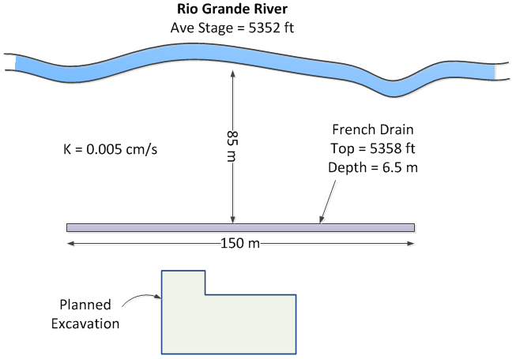
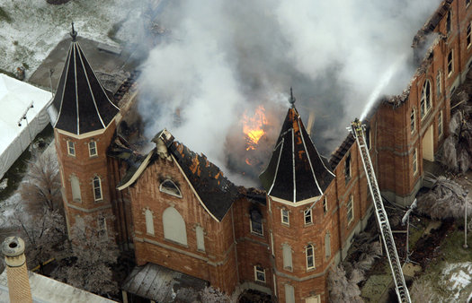
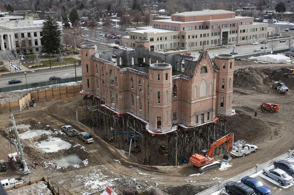
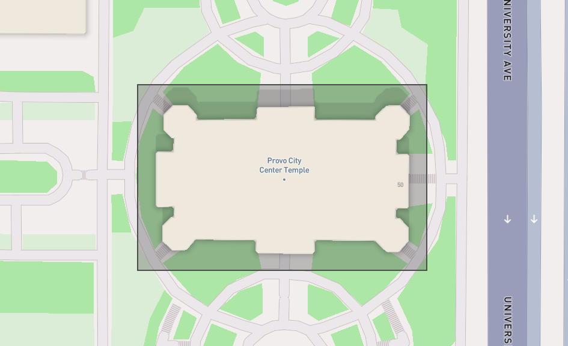

# Homework - Construction Dewatering

In this exercise, we will design a dewatering trench using the Dupuit analytical solution and we will design a 
dewatering system for the Provo City Center Temple excavation site using the Dewater web app.

## Exercise 1 - Dewatering Trench Design

The Los Pollos Hermanos Corporation is planning to build a new manufacturing facility near the Rio Grande River in the outskirts of Albuquerque, New Mexico. The facility will include a hermetically-sealed underground unit with state-of-the-art ventillation and chemical-processing equipment. In order to dewater the site during construction and to ensure that it stays dry while in operation, the company decides to build a french drain between the river and excavation as follows:

A pump will be attached to the drain and the water will be returned to the river. Calculate what capacity will be required (gpm) for the pump. To simplify your calculations, assume that there is a lower permeability layer at the elevation corresponding to the bottom of the excavation. Use a spreadsheet for your calculations.

!!! Note
    Be careful with the values for Ho and HD in the equation. They should be measured from the datum, which is the bottom of the trench. Don't use the elevations.

## Exercise 2 - Provo City Center Temple Dewatering

The Provo City Center Temple is a temple of The Church of Jesus Christ of Latter-day Saints in Provo, Utah. The 
temple is located on the site of the former Provo Tabernacle, which was destroyed by fire in December 2010, leaving 
only the outer brick facade intact.

The Church of Jesus Christ of Latter-day Saints announced during the October 2011 general conference that the structure 
woud be rebuilt as the 
Provo City Center Temple. This is an architect's rendering of the planned temple:

The engineers in charge of the reconstruction faced a difficult task. As a temple, the structure would need to have a basement to house a baptismal font. Furthermore, there was a need to ensure that the reconstructed building is supported by an adequate, modern foundation. This would have to be done without damaging the fragile brick facade. To this they designed an elaborate system of piles:

The excavation went down to a depth of 30 feet below the original ground surface. This presented another challenge because the water table in this region is shallow. In order to accomplish the construction, the site had to be dewatered. This is typically accomplished using a set of shallow wells where each well lowers the water table and creates a "cone of depression" surrounding the well. Multiples wells provide a combined effect resulting in an aggregate zone of drawdown.

Our objective in this exercise is to design a dewatering system using the Dewater web app we used for the
in-class exercise:

<a href="https://jonesgeo.com/dewater/" target="_blank"><b>Dewater: https://jonesgeo.com/dewater/</b></a>

**(a)  Setup Problem**

Before starting, download the following GEOJSON file:

GEOJSON File: [temple.geojson](files/temple.geojson) (right-click and select "Save Link As")

This represents the footprint of the excavation:

Click **Load GeoJSON** in step 1 of the app and select the file. The app zooms to the site and outlines the excavation. You will then create wells by clicking **Click to add wells** in step 3 and clicking the map at each well location. Start by creating 2 wells.

**(b)  Drawdown Calculations and Manual Design**

Assume the following parameters for the problem:

| Parameter | Value | units  |
|----------|-------|--------|
| Depth to the water table | 13.5 | ft |
| Depth to the bottom of the aquifer | 46 | ft |
| Excavation depth | 30 | ft |
| Extra depth below the bottom | 0 | ft |
| $k$      | 20 | ft/day |
| $R$      | 1300 | ft |
| Well radius, $r_w$ | 0.5 | ft |
| $Q$      | 100 | gpm |

These give an initial saturated thickness of 32.5 ft and a target head of 16 ft above the bottom of the aquifer.

Choose **Feet** for the length units at the top of the panel, ft/day for $k$, and gpm for the pumping rate. Then enter these values in steps 2 and 5. Set the flow to **Steady**; part (g) turns to time. The app calculates the water level at each point in a grid covering the site and draws the contours on the map. Use the display options in step 6 to look at the depth to water, the drawdown, or the water below the required level, and the cross sections in step 7 to see the water level through the excavation.

Now design a dewatering system under three conditions: 2 wells, 4 wells, and 6 wells. In each case,
assume that you can only place the wells outside of the temple footprint. You should change the location of the wells and the total pumping rate. With too few wells, you may find that no rate works: the app reports that the minimum design pumping rate would pump a well dry. If that happens, explain what it means and what it tells you about the number of wells. To move a well, drag it; to delete one, right-click it; **Clear wells** removes them all.

Save a copy of each of your designs: take a screenshot of the map showing the water level contours, and use **Save project** to keep the design itself. Open a Word document and write a short section for each of your three designs (including the contour plots) and discuss the results. Indicate which of the three designs you would suggest using for the actual project.

**(c) Rectangular Well System Design**

Next, use **Generate a ring of wells** in step 3 to place a line of wells around the perimeter of
the excavation based on an offset distance from the excavation boundary and a number of wells. The wells are spaced evenly, the same on opposite sides. Use an offset
of 65 ft and 26 wells.

**(d) Pumping Rate Optimization**

For the ring of wells, click **Find Qmin** in step 5 to find the minimum design pumping rate, $Q_{min}$, that will dewater the site with the well configuration described above. Save a copy of the contour plot showing the drawdown and include it in your report along with your pumping rate in gpm.

**(e) Design Curve**

Finally, compute the design curve in step 8 for a range of numbers of wells. Save a copy of the plot and include it in your report. Also indicate how many wells you would recommend using, based on the design curve.

**(f) Radius of Influence**

Repeat part (d) with the radius of influence from Sichardt's formula instead of the entered value of 1300 ft: in step 2, change **Radius of influence, R** to **Sichardt**, and find $Q_{min}$ again. Report the equivalent radius $r_e$, $R$, and the pumping rate in gpm, and compare them to your answer to part (d). Which value of $R$ would you trust for this site, and why?

**(g) Dewatering on a Deadline**

The contractor needs the site dry in 10 days. In step 2, set the flow to **Transient**, with a specific yield $S_y$ of 0.2 and 10 days to dewater.

1. With the ring of 26 wells from part (c), click **Find Qmin**. Report the starting rate in gpm and compare it to the steady rate from part (d). Open the **Pumping schedule** and report the rate needed to hold the water down after day 10.
2. Change the deadline to 5 days and click **Find Qmin** again. What does the app report? Explain why pumping harder can't get the site dry any sooner with these wells.
3. Go back to 10 days and compute the design curve against the number of wells in step 8. What is the fewest wells that can meet the deadline?
4. Add a cutoff wall in step 4 with a setback of 15 ft, a thickness of 3 ft, and $k_w$ = 3 × 10⁻⁴ ft/day. Find Qmin for the 26 wells, and compute the design curve against the number of wells again. Report the starting rate and the fewest wells, and compare them with your answers to steps 1 and 3.
5. Recommend a design for the 10-day deadline: the number of wells, the pump capacity, and whether to build the wall. Explain your reasoning.

## Submission

Make a zip archive of your spreadsheet for part 1 and your Word document for part 2. Submit the zip archive on Learning Suite.

!!! note "Do not put your name or NetID in the file"
    Learning Suite records who submitted each file, so your name is not needed
    inside the file itself. Leaving it out means your work can be graded
    anonymously, which keeps grading fair. This applies to scans and photos
    too — please don't write your name on the page.

## Grading Rubric

**Total: 38 points**

| Criteria | Points |
|----------|:------:|
| Exercise 1: Pump capacity calculation | 8 |
| Exercise 2a: Problem setup and file upload | 1 |
| Exercise 2b: Manual design - 2 wells | 3 |
| Exercise 2b: Manual design - 4 wells | 3 |
| Exercise 2b: Manual design - 6 wells | 3 |
| Exercise 2b: Design comparison and recommendation | 3 |
| Exercise 2c: Rectangular well system results | 2 |
| Exercise 2d: Optimized pumping rate | 3 |
| Exercise 2e: Design curve and well recommendation | 2 |
| Exercise 2f: Radius of influence from Sichardt | 2 |
| Exercise 2g: Deadline rate and pumping schedule | 2 |
| Exercise 2g: Fastest dewatering and fewest wells | 2 |
| Exercise 2g: Cutoff wall comparison | 2 |
| Exercise 2g: Recommendation | 2 |
