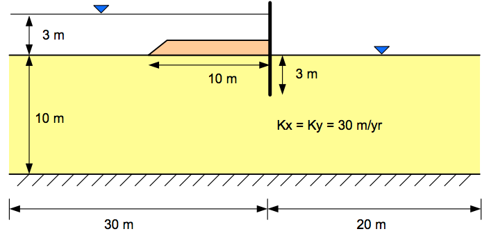
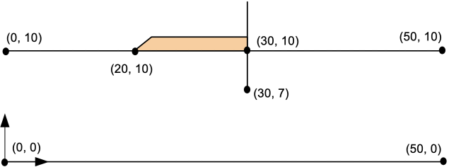
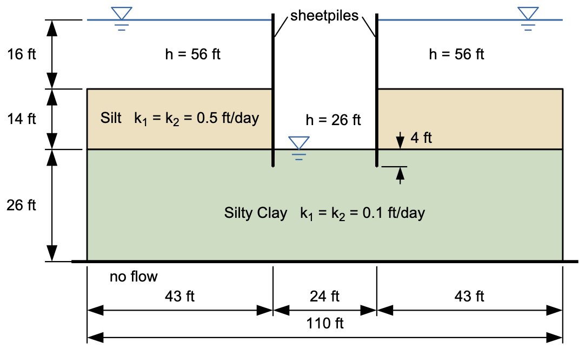
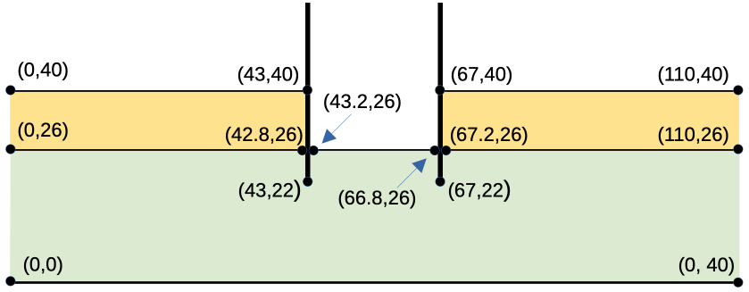

# Exercise - XSLOPE Seepage Analysis

For this exercise, we will perform a pair of seepage analyses in XSLOPE Studio for problems with confined (fully saturated) conditions. For each problem, start a new model with **File → New**, switch to **Seepage** mode, and enter the inputs: the global parameters, the materials, the profile lines, and the seepage boundary conditions. Then build the mesh with **Build Mesh** (linear triangles, tri3), run the analysis with **Run Seep**, and look at the solution. Save each model with **File → Save As**; the file is an XSLOPE input template.

### 1. Clay Blanket Sheetpile Problem

This problem corresponds to the clay-blanket sheetpile case that we analyzed in our flow net section:

Specify the material properties, define the geometry using a profile line, and assign boundary conditions. As you set up the problem, you will need to define a local coordinate system. Set up your coordinate system as follows:

Solution: [xslope_clay_blanket.xlsx](https://xslope.org/en/latest/seep/files/xslope_clay_blanket.xlsx)

### 2. Sea Trench Problem

The following problem is for a construction project in a harbor that requires that a section of the harbor bottom be exposed by pumping the water out of a trench formed by a pair of parallel sheetpile walls. The sheetpiles pass through an upper silt layer until they penetrate a lower silty clay layer with a lower permeability to a depth of 4 ft. 

{width="800"}

The properties of the soil layers are as follows:

| Soil Layer | K1  | K2  |
|:----------:|:---:|:---:|
|    Silt    | 0.5 | 0.5 |
| Silty Clay | 0.1 | 0.1 |

Since this is a fully saturated problem, the kr0 and h0 material parameters are ignored. The problem set up requires 
3 profile lines: 1 at the top of the silt layer on the left side, 1 at the top of the silt layer on the right, and 1 
at the top of the silty clay layer that goes all the way from the left side to the right side of the problem. This 
profile line includes a small gap at the location of each sheetpile penetration to create a no-flow boundary along 
the edge of the sheetpile. The first two profile lines will reference material 1 (Silt) and the third profile line 
will reference material 2 (Silty Clay).

As you build the problem input, you may wish to use the following coordinates:

Solution: [xslope_sea_trench.xlsx](https://xslope.org/en/latest/seep/files/xslope_sea_trench.xlsx)