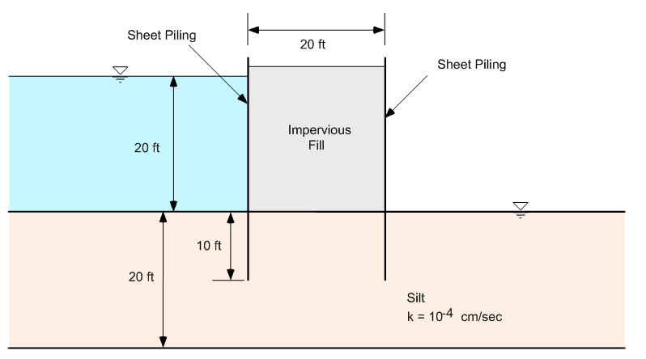
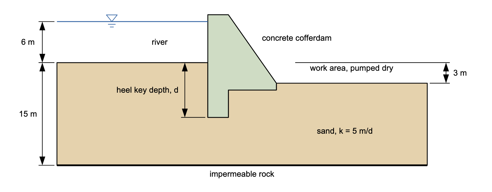

# Homework - Finite Element Seepage Analysis, Confined Conditions

For this assignment, you will build two finite element seepage models of sites with confined (fully saturated) conditions in XSLOPE Studio. Start each with **File → New** in **Seepage** mode, and save each as a separate file with **File → Save As**. Build the mesh with linear triangles (tri3).

## Problem 1 - Double Sheetpile

Redo the double sheetpile problem using XSLOPE:

Extend your mesh 40 ft both upstream and downstream from the sheetpiles (solve the entire problem, not just one half).

## Problem 2 - Concrete Cofferdam

The cross section below shows a concrete cofferdam built on 15 m of sand over impermeable rock. It holds back 6 m of river water so that a work area, excavated 3 m below the river bed, can be pumped dry. The concrete is impermeable, so all of the flow passes through the sand under the cofferdam, and a key at the upstream heel lengthens that flow path.

Build a mesh of just the sand. The concrete is not part of the model: the top of the sand follows the underside of the cofferdam, and no flow crosses an edge of the mesh unless you give it a boundary condition. Use k = 5 m/d in both directions. With y = 0 at the top of the rock and x = 0 at the upstream face of the cofferdam, the top of the sand is defined by these points, where d is the depth of the heel key below the river bed:

| Point                         |  x [m]  |  y [m]  |
|:-----------------------------:|:-------:|:-------:|
| River bed, left end           |   -60   |   15    |
| River bed at the cofferdam    |    0    |   15    |
| Bottom of the key, upstream   |    0    |  15 - d |
| Bottom of the key, downstream |    3    |  15 - d |
| Top of the key                |    3    |   11    |
| Toe of the cofferdam          |   10    |   11    |
| Work area floor at the toe    |   10    |   12    |
| Work area floor, right end    |   70    |   12    |

Water pumped out of the work area keeps the water level at the floor. Set up the problem in XSLOPE Studio and find the total flow rate for each of these heel key depths:

>>d = 6 m 
d = 8 m 
d = 10 m 
d = 12 m

For each depth, show two flow rates: one for a unit width and one for the total pumping rate (assume that the cofferdam is **150** m long in the transverse direction). The total flow rate is shown in the title of the solution plot. Write a paragraph summarizing your observations from the exercise. Put your solution in a Word document.

## Submission

Put the following files in a zip archive:

- XSLOPE input file and a PNG of the solution for Problem 1
- XSLOPE input file and a PNG of the solution for Problem 2 (for d = 8 m only)
- Word document with the table and paragraph for Problem 2

Upload the zip archive via Learning Suite.

!!! note "Do not put your name or NetID in the file"
    Learning Suite records who submitted each file, so your name is not needed
    inside the file itself. Leaving it out means your work can be graded
    anonymously, which keeps grading fair. This applies to scans and photos
    too — please don't write your name on the page.

## Grading Rubric

| Criteria                                                                             | Points |
|--------------------------------------------------------------------------------------|:------:|
| **Problem 1: Double Sheetpile**                                                      |        |
| XSLOPE seepage model set up correctly with proper geometry and mesh                  |   4    |
| Mesh extends 40 ft upstream and downstream from sheetpiles (entire problem solved)   |   2    |
| Boundary conditions correctly applied                                                |   3    |
| **Problem 2: Concrete Cofferdam**                                                    |        |
| XSLOPE seepage model of the sand set up with the geometry given                      |   4    |
| Boundary conditions correctly applied (river bed and work area floor)                |   3    |
| Table includes all 4 key depths (6, 8, 10, 12 m)                                     |   4    |
| Flow rates computed correctly for both unit width and the total pumping rate (150 m) |   5    |
| Total flow rates extracted from XSLOPE output correctly                              |   2    |
| Paragraph summarizing observations from the exercise                                 |   3    |
| **Total**                                                                            | **30** |
