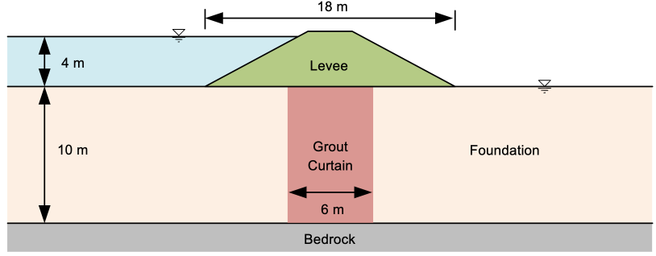
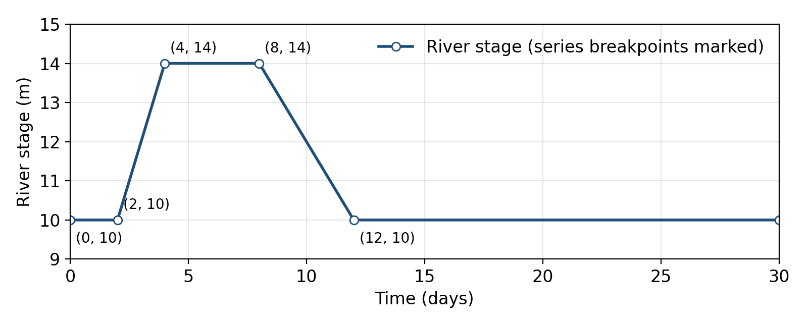

# Homework - Transient Seepage: A Levee in a Flood

In this assignment you will follow a river flood through a levee. Start from the levee you built in the unconfined seepage exercise, a levee on a permeable foundation with a grout curtain:

Starting file: [xslope_levee_full.xlsx](https://xslope.org/en/latest/seep/files/xslope_levee_full.xlsx)

The river is normally at the ground surface, elevation 10 m. In a flood it rises to 14 m in two days, stays there for four days, and falls back to 10 m over the next four days:

## Model Changes

Make these changes to the model in XSLOPE Studio and save it under a new name.

1. **Time unit.** In **Global parameters**, set the time unit to `day`. The conductivities are in m/day.
2. **Materials.** The levee is a compacted clay. Change its conductivities and add storage properties to all three materials:

    | Material | k1 (m/day) | k2 (m/day) | $S_s$ (1/m) | $S_y$ |
    |---|---|---|---|---|
    | Levee | 0.05 | 0.02 | 0.0001 | 0.05 |
    | Grout curtain | 0.2 | 0.2 | 0.0001 | 0.05 |
    | Foundation | 2 | 1 | 0.0001 | 0.20 |

3. **Schedule.** In **Transient**, name the first series `river` and enter the hydrograph: (0, 10), (2, 10), (4, 14), (8, 14), and (12, 10). Set the duration to 30 days and the save interval to 1 day.
4. **River boundary.** In **Seep BC**, change the river-side head to type `reservoir` with the value `river`. Keep its points running from the riverside ground up the levee face to elevation 14, so the face above the normal river level is no-flow until the flood reaches it.

Build the mesh with linear triangles (tri3), auto-size, 100 divisions.

## Analysis

1. **Steady flood.** Before the transient run, solve a steady model with the river held at the flood stage, 14 m: set the reservoir value to 14 for this run, then set it back to `river`. Record the total flow and the elevation of the water table inside the levee at x = 29 m.
2. **Transient flood.** Run the transient analysis. Step through the daily frames, and for each day from 0 to 20 record the river stage and the elevation of the water table at x = 29 m. Use the zoom tool to read it to the nearest 0.05 m.
3. **Plot.** In Excel, plot the water table at x = 29 m and the river stage against time on one chart, with the steady flood-stage value as a horizontal line.
4. **Discussion.** Answer these in a short write-up:
    - When does the water table in the levee peak, and how high does it get compared with the steady flood-stage value? Did the flood last long enough for the levee to reach steady state?
    - Compare the levee with the foundation. Look at the head in the foundation under the landside toe through the flood. Which responds faster, and why? Use $S_s$, $S_y$, and $k$ in your answer.
    - When the river has fallen back to 10 m on day 12, where is the water table in the levee? What does that mean for the riverside slope of the levee as the river falls?

## Submission

Put the following files in a zip archive:

- Your XSLOPE input file
- PNGs of the solution at day 8 (the end of the flood peak) and day 12 (the end of the recession)
- An Excel or Word file with your table of readings, the plot, and your write-up

Upload the zip archive via Learning Suite.

!!! note "Do not put your name or NetID in the file"
    Learning Suite records who submitted each file, so your name is not needed
    inside the file itself. Leaving it out means your work can be graded
    anonymously, which keeps grading fair. This applies to scans and photos
    too — please don't write your name on the page.

## Grading Rubric

| Criteria | Points |
|---|:---:|
| **Model** | |
| Time unit set to day; levee conductivities and storage properties entered for all three materials | 4 |
| `river` series and run settings entered correctly | 4 |
| River boundary changed to a reservoir B.C. driven by `river` | 3 |
| **Analysis** | |
| Steady flood-stage flow and water table at x = 29 m | 3 |
| Water table readings at x = 29 m, days 0 to 20 | 4 |
| Plot of the water table and river stage against time, with the steady value | 3 |
| PNGs of the solution at days 8 and 12 | 2 |
| **Discussion** | |
| Peak timing and height compared with steady state | 3 |
| Levee vs. foundation response explained with storage and conductivity | 2 |
| Water table at the end of the recession and what it means for the riverside slope | 2 |
| **Total** | **30** |
