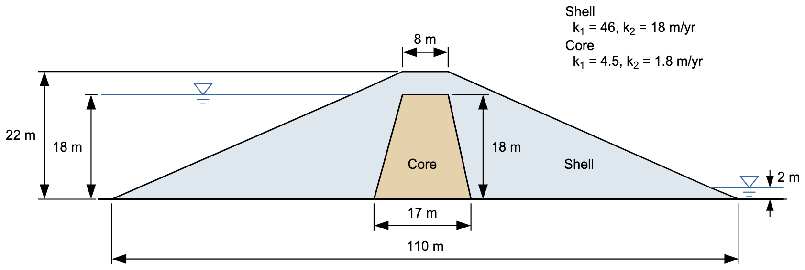
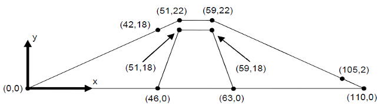
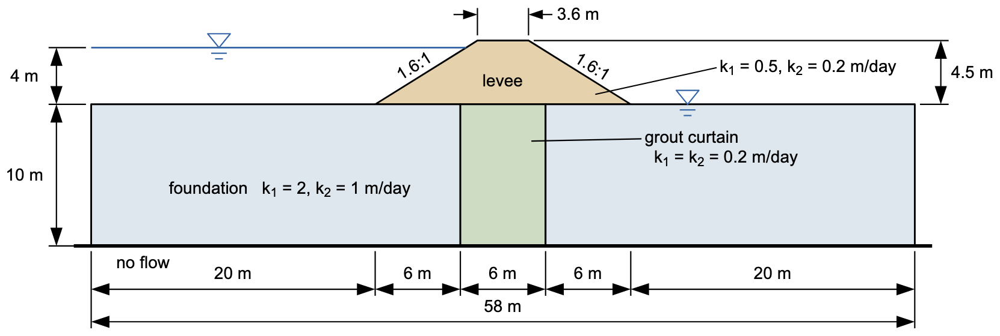
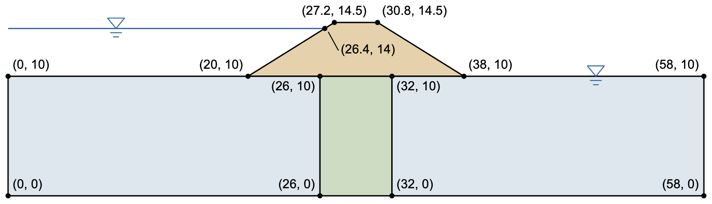

# Exercise - Unconfined Seepage Problems, Part 1

For this exercise, we will perform a pair of seepage analyses for sites with unconfined (partially saturated) conditions. Build each model in XSLOPE Studio: start with **File → New**, switch to **Seepage** mode, enter the materials, profile lines, and seepage boundary conditions, build the mesh with **Build Mesh** (linear triangles, tri3), and run the analysis with **Run Seep**. Save each model with **File → Save As**.

### 1. Earth Dam with Core

The problem corresponds to the following cross section:

Specify the material properties, define the geometry using a profile line, and assign boundary conditions. We will define a local coordinate system with the origin (x=0, y=0) at the toe of the dam on the left side of the figure. This results in the following set of points:

Solution: [xslope_earth_dam1.xlsx](https://xslope.org/en/latest/seep/files/xslope_earth_dam1.xlsx)

### 2. Levee with Grouted Foundation

For this problem we will revisit the levee from the flow net exercise, this time with a grout curtain in the foundation. We will assume that the levee is permeable and will simulate flow both in the levee and in the grouted foundation.

Assume that the following values for hydraulic conductivity:

|  Soil Layer   | K1 [m/day] | K2 [m/day] | $\alpha$   | kr0    | h0 |
|:-------------:|:----------:|:----------:|:----------:|:----------:|:----------:|
|     Levee     |    0.5     |    0.2     |    0       |   0.001 | -1 |
| Grout Curtain |    0.2     |    0.2     |    0       |   0.001 | -1 |
|  Foundation   |     2      |     1      |    0       |   0.001 | -1 |

Use the following coordinates to define the profile lines and boundary conditions:

Solution: [xslope_levee_full.xlsx](https://xslope.org/en/latest/seep/files/xslope_levee_full.xlsx)

