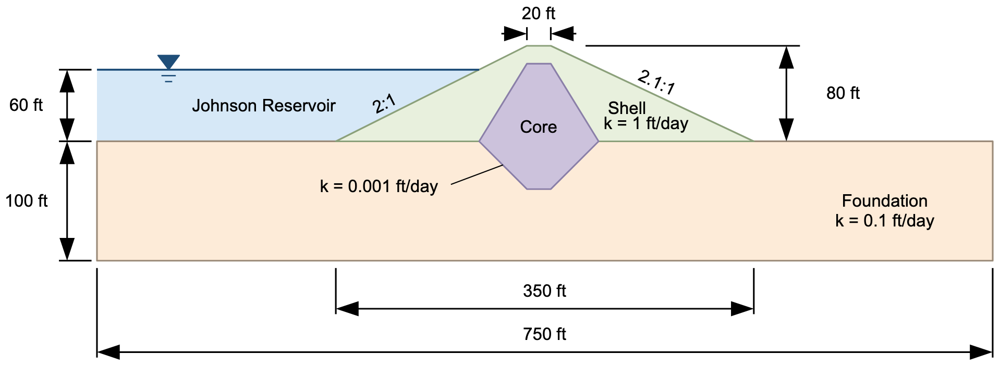
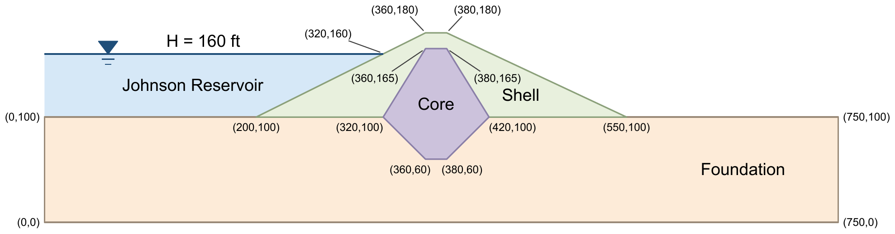
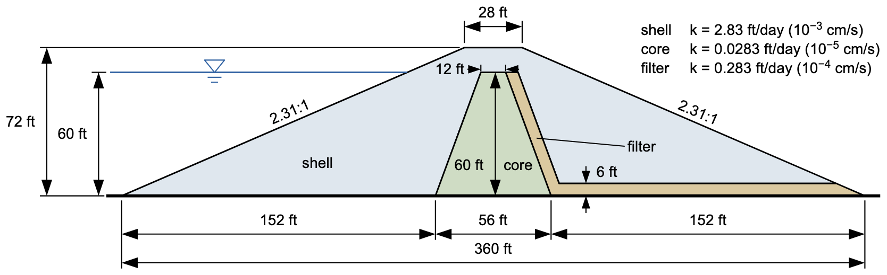

# Exercise - Unconfined Seepage Problems, Part 2

In this exercise, we will solve two more unconfined seepage problems: the Johnson Reservoir dam, with a low-permeability core, and a dam with a core, filter, and drain. Build each model in XSLOPE Studio: start with **File → New**, switch to **Seepage** mode, enter the materials, profile lines, and seepage boundary conditions, build the mesh with **Build Mesh** (linear triangles, tri3), and run the analysis with **Run Seep**. Save each model with **File → Save As**.

## Problem 1 - Johnson Reservoir

The Johnson Reservoir problem corresponds to the following cross section:

{width="900"}

Specify the material properties, define the geometry using a profile line, and assign boundary conditions. Use the following coordinates:

{width="900"}

Solution: [xslope_johnson_res.xlsx](https://xslope.org/en/latest/seep/files/xslope_johnson_res.xlsx)

## Problem 2 - Earth Dam with Core, Filter, and Drain

The Earth Dam with Core, Filter, and Drain problem corresponds to the following cross section:

{width="800"}

In this case, we will go through the process of deriving the geometry (point coordinates) of the cross section from 
the image. Enter the resulting profile lines, material properties, and boundary conditions in Studio.

Solution: [xslope_earthdam2.xlsx](https://xslope.org/en/latest/seep/files/xslope_earth_dam2.xlsx). 
