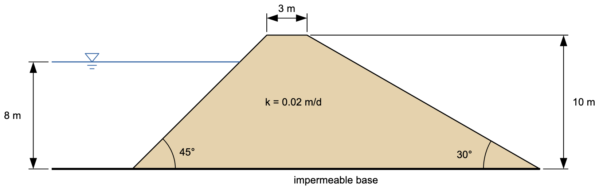

# Homework - Finite Element Seepage Analysis, Unconfined Conditions, Part 1

For this assignment, you will model the earth dam from the [analytical solutions exercise](../05_analytical/analytical_class.md) in XSLOPE Studio, compare the two solutions, and then see what a higher horizontal conductivity does to the flow. Start with **File → New** in **Seepage** mode, enter the cross section shown below, and save the model with **File → Save As**.

## Problem 1 - Earth Dam on an Impermeable Base

The dam sits on an impermeable base, with 8 m of water against the upstream face. Water seeping out of the downstream face drains freely.

{width="800"}

Use the following properties for the fill:

|  Soil Layer   | K1 [m/day] | K2 [m/day] | $\alpha$   | kr0    | h0 |
|:-------------:|:----------:|:----------:|:----------:|:----------:|:----------:|
|     Fill      |    0.02    |    0.02    |    0       |   0.001 | -1 |

Put the origin at the upstream toe, and select appropriate boundary conditions for the model.

Make a table comparing the following results from XSLOPE with the analytical solution in [earthdam_KEY.xlsx](../05_analytical/files/earthdam_KEY.xlsx):

- The flow rate per unit width of the dam.
- The height of the exit point above the downstream toe. In XSLOPE, this is where the phreatic surface meets the downstream face. For the analytical solution, it is L sin 30°.

Write a short paragraph explaining why the two solutions differ.

## Problem 2 - Compacted Fill

Fill is compacted in lifts, so it is usually more conductive horizontally than vertically. Keep K2 = 0.02 m/day, and run the model with each of the following values of K1:

>>K1 = 0.02 m/day (K1/K2 = 1) 
K1 = 0.08 m/day (K1/K2 = 4) 
K1 = 0.18 m/day (K1/K2 = 9)

Make a table showing the flow rate and the height of the exit point for each value of K1. Write a short paragraph describing how each one changes as K1 increases.

## Submission

Put the following files in a zip archive:

- XSLOPE input file and a PNG of the solution for Problem 1
- Word document with the tables and paragraphs for both problems

Upload the zip archive via Learning Suite.

!!! note "Do not put your name or NetID in the file"
    Learning Suite records who submitted each file, so your name is not needed
    inside the file itself. Leaving it out means your work can be graded
    anonymously, which keeps grading fair. This applies to scans and photos
    too — please don't write your name on the page.

## Grading Rubric

| Criteria                                                                 | Points |
|--------------------------------------------------------------------------|:------:|
| Geometry and fill properties entered correctly                           |   6    |
| Boundary conditions appropriately selected (head of 8 m upstream, exit face downstream) |   4    |
| Problem 1 table compares flow rate and exit point height with the analytical solution |   6    |
| Problem 1 paragraph explains the difference                              |   4    |
| Problem 2 table shows flow rate and exit point height for all three values of K1 |   6    |
| Problem 2 paragraph describes how the flow rate and exit point change with K1 |   4    |
| **Total**                                                                | **30** |
