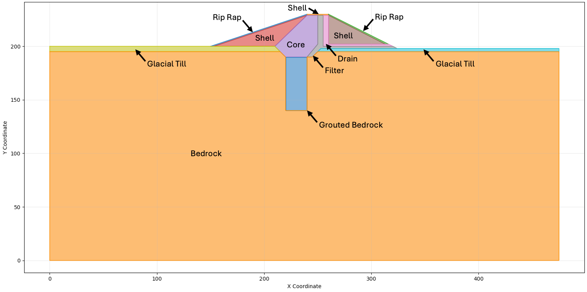
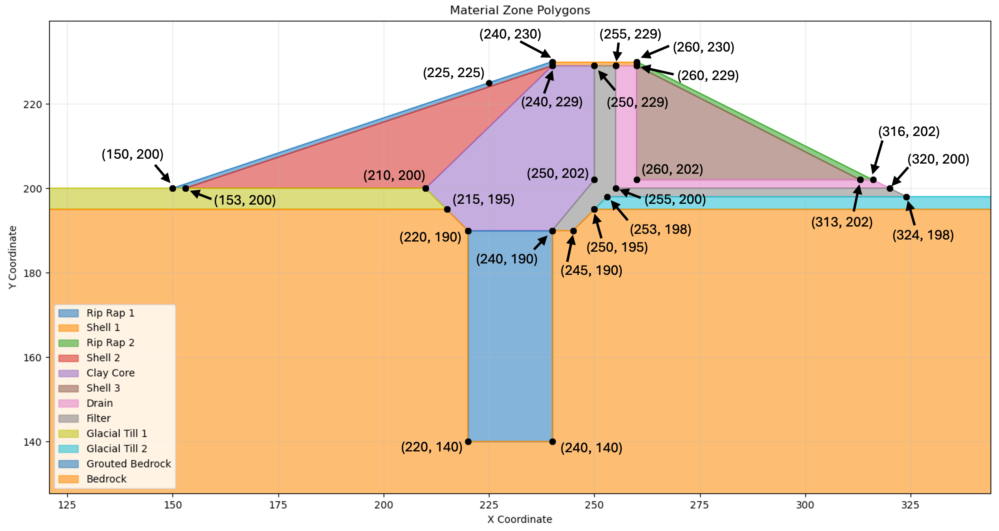
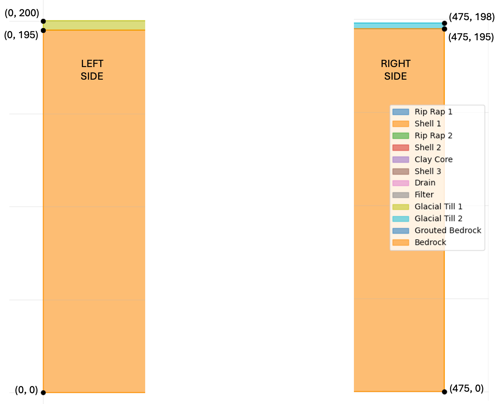

# Homework - Finite Element Seepage Analysis, Unconfined Conditions, Part 2

For this assignment, you will build a finite element seepage model of the **Lost Lake** dam in XSLOPE Studio. The geometry comes from a CAD drawing: download [lost_lake.dxf](files/lost_lake.dxf), import it with **File → Import DXF…**, switch to **Seepage** mode, and save the model with **File → Save As**.

The Lost Lake Dam includes a grout curtain, core, 
shell, riprap, filter, and a drain as shown below.

{width="1400"}

The water is impounded on the left side of the cross section at **H = 225 ft**. Water seeping out of the right side drains freely.

The material properties are as follows:

| Material        | kx [ft/yr] | Ky [ft/yr] | 
|-----------------|------------|-----------|
| Core            | 0.1        | 0.1       |
| Glacial Till    | 4000       | 2000      |
| Bedrock         | 2000       | 1000      |
| Rip Rap         | 100,000    | 100,000   |
| Shell           | 250        | 50        |
| Grouted Bedrock | 250        | 250        |
| Filter   | 1000       | 1000      |
| Drain    | 10,000     | 10,000    |

For each material, use:

>>$\alpha = 0.0$ $k_{r0} = 0.0001$ $h_0 = -1$

Use elements that are sufficiently small to capture the details in the thin zones. Select appropriate boundary conditions for the model.

## Problem Geometry

The DXF holds the geometry, so you only need these coordinates for the boundary conditions. The coordinates of the points making up the center part of the cross section are shown below.

The coordinates of the left and right sides of the cross section are shown below:

{width="800"}

## Tips

Here are some tips for setting up the problem:

1. The DXF has one closed polygon for each of the 12 zones, on a layer named for its material. The default mapping in the import wizard is correct: every layer is a material zone.
2. There are 12 zones but only 8 materials, because some zones share a material. The import sets up the 8 materials for you.
3. The import brings in the geometry and the material names only. Enter the hydraulic conductivities and the other properties in the Materials editor.
4. Check the zones against the cross section above before you go on.

## Submission

Create a PNG of the solution with 25 head contours and use base material = bedrock. Zip up your XSLOPE input file and a PNG of the solution plot and upload your zip archive via Learning Suite.

!!! Note
    You are allowed to work in pairs on this assignment if you wish. Just copy and upload the assignment when you are done and be sure to make a note who you worked with.

!!! note "Do not put your name or NetID in the file"
    Learning Suite records who submitted each file, so your name is not needed
    inside the file itself. Leaving it out means your work can be graded
    anonymously, which keeps grading fair. This applies to scans and photos
    too — please don't write your name on the page.

## Grading Rubric

| Criteria                                                             | Points |
|----------------------------------------------------------------------|:------:|
| DXF imported, with all 12 zones on the correct materials             |   8    |
| All 8 materials defined with correct hydraulic conductivity values (kx, ky) |   6    |
| Material parameters (α, kr0, h0) set correctly for all materials     |   4    |
| Boundary conditions appropriately selected (H=225 ft left, exit face right) |   6    |
| Mesh fine enough to capture the thin zones                           |   2    |
| PNG output shows head contours with base material = bedrock          |   4    |
| **Total**                                                            | **30** |
