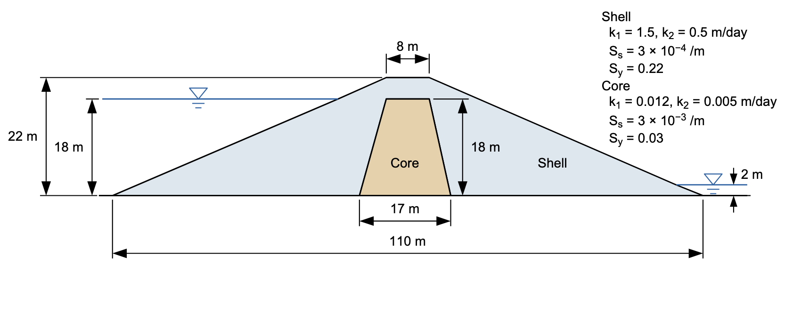

# Exercise - Transient Seepage: Reservoir Drawdown

In this exercise we build the reservoir drawdown from Tutorial SEEP-3 in XSLOPE Studio, run it, and then run it again with the reservoir drawn down four and a half times faster. The dam has a granular shell and a clay core, and the two zones drain at very different rates. The question is how much water the core is still holding when the pool reaches the bottom, and how that depends on the drawdown rate.

Start from the SEEP-3 starter file, which has the geometry, the two materials, and their storage properties, but no boundary conditions and no schedule:

Starter file: [xslope_earth_dam_drawdown_start.xlsx](https://xslope.org/en/latest/tutorials/files/xslope_earth_dam_drawdown_start.xlsx)

Open it in XSLOPE Studio with **File → Open** and switch to **Seepage** mode.

## Part 1 - Storage Properties

Open **Materials**, show the **Seepage** columns, and find $S_s$ and $S_y$ for the shell and the core. Compare them with the typical values from the lecture. For each zone, estimate how fast the water table can fall through it, $k_2/S_y$, and compare both with the rate the pool falls in this problem: 16 m in 45 days.

## Part 2 - The Steady Model at Full Pool

Build the three boundary conditions in **Seep BC**:

| Boundary | Type | Value | Points (x, y) |
|---|---|---|---|
| Reservoir | head | 18 | (0, 0), (42, 18) |
| Tailwater | head | 2 | (105, 2), (110, 0) |
| Exit face | | | (59, 22), (105, 2) |

Build the mesh with **Build Mesh**: linear triangles (tri3), auto-size, 64 divisions. Run the steady analysis with **Run Seep** and record the total flow. This solution is the full-pool state the transient run will start from.

## Part 3 - The Drawdown Schedule

Open **Transient** in the inputs tree and enter the schedule:

- Rename the first series from `t1` to `pool`, and enter three rows: (0, 18), (2, 18), and (47, 2).
- Duration: 360 days. Save interval: 60 days. Extra save times: 2, 15, 30, 47, and 80.

Then reopen **Seep BC**, select the reservoir head, set its **Type** to `reservoir`, and replace the value 18 with `pool`.

## Part 4 - Run and Read the Frames

Run the analysis again with **Run type** set to **Transient**. Step through the frames with the play bar. At day 47, when the pool reaches elevation 2, record the elevation of the water table (the phreatic surface) in the middle of the core, at x = 54.5 m, and in the upstream shell at x = 30 m. Use the zoom tool to read them to the nearest 0.1 m. Record the outflow from the plot title.

## Part 5 - A Faster Drawdown

Change the last row of the `pool` series to (12, 2), so the pool falls 16 m in 10 days, and add 12 to the extra save times. Run it again and record the same values at day 12, the end of this drawdown.

## Questions

1. Which zone kept up with the pool, and which did not? Explain with your $k_2/S_y$ estimates from Part 1.
2. How much higher than the pool did the water table in the core stand at the end of each drawdown?
3. The faster drawdown leaves more water in the core. Why does that matter for the stability of the upstream slope?

Solutions: [xslope_earth_dam_drawdown.xlsx](https://xslope.org/en/latest/tutorials/files/xslope_earth_dam_drawdown.xlsx) (45 days) and [xslope_earth_dam_drawdown_10day.xlsx](files/xslope_earth_dam_drawdown_10day.xlsx) (10 days)
