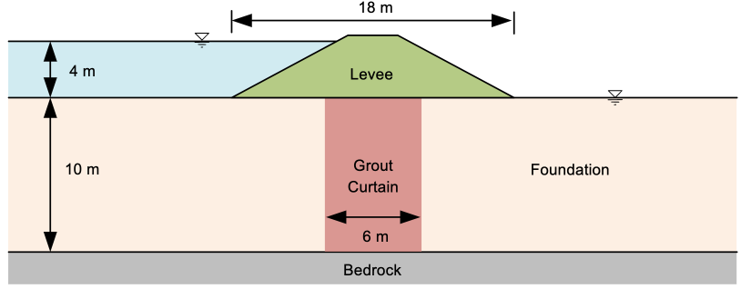
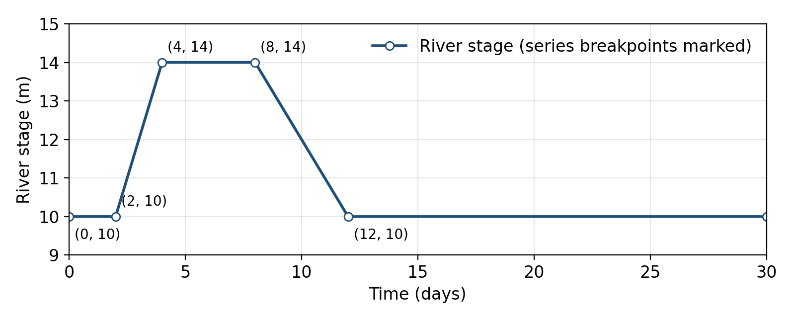

# Homework - Transient Seepage: A Levee in a Flood

In this assignment you will follow a river flood through a levee. Start from the levee you built in the unconfined seepage exercise, a levee on a permeable foundation with a grout curtain:

Starting file: [xslope_levee_full.xlsx](https://xslope.org/en/latest/seep/files/xslope_levee_full.xlsx)

The river is normally at the ground surface, elevation 10 m. In a flood it rises to 14 m in two days, stays there for four days, and falls back to 10 m over the next four days:

## Model Changes

Make these changes to the model in XSLOPE Studio and save it under a new name.

1. **Time unit.** In **Global parameters**, set the time unit to `day`. The conductivities are in m/day.
2. **Materials.** The levee is a compacted clay. Change its conductivities and add storage properties to all three materials:

    | Material | k1 (m/day) | k2 (m/day) | $S_s$ (1/m) | $S_y$ |
    |---|---|---|---|---|
    | Levee | 0.05 | 0.02 | 0.0001 | 0.05 |
    | Grout curtain | 0.2 | 0.2 | 0.0001 | 0.05 |
    | Foundation | 2 | 1 | 0.0001 | 0.20 |

3. **Schedule.** In **Transient**, name the first series `river` and enter the hydrograph: (0, 10), (2, 10), (4, 14), (8, 14), and (12, 10). Set the duration to 30 days and the save interval to 1 day.
4. **River boundary.** In **Seep BC**, change the river-side head to type `reservoir` with the value `river`. Keep its points running from the riverside ground up the levee face to elevation 14, so the face above the normal river level is no-flow until the flood reaches it.

Build the mesh with linear triangles (tri3), auto-size, 100 divisions.

## Analysis

Every number in this analysis is one Studio prints: the total flow in the title of a steady solution, and the inflow and outflow in the title of each transient frame. The outflow is the seepage that reaches the land side of the levee.

1. **Steady flood.** Before the transient run, solve a steady model with the river held at the flood stage, 14 m: set the reservoir value to 14 for this run, then set it back to `river`. Record the total flow and save a PNG of the solution.
2. **Transient flood.** Run the transient analysis. Step through the daily frames and, for each day from 0 to 20, record the river stage and the outflow from the frame title.
3. **Plot.** In Excel, plot the outflow and the river stage against time, with the steady flood-stage flow as a horizontal line.
4. **Pictures.** Save PNGs of the transient frames at day 8 (the end of the flood peak) and day 12 (the river back at normal stage).

## Discussion

Answer these in a short write-up:

- When does the outflow peak, and how close does it come to the steady flood-stage flow? Most of the seepage goes under the levee, through the foundation. Did the flood last long enough for that seepage to reach steady state? Does your day 8 picture say the same about the levee itself?
- Compare the phreatic surface in your day 8 picture with the one in the steady flood-stage picture. Where is it lower, and why? The head in the foundation, by contrast, is nearly the same in both pictures. Explain the difference between the levee and the foundation using $S_s$, $S_y$, and $k$.
- After day 12 the inflow is zero, but water is still flowing out on the land side. Where is that water coming from? Use your day 12 picture to say where the water table in the levee stands compared with the river, and what that means for the riverside slope of the levee as the river falls.

## Submission

Put the following files in a zip archive:

- Your XSLOPE input file
- PNGs of the steady flood-stage solution and of the transient frames at days 8 and 12
- An Excel or Word file with your table of outflows, the plot, and your write-up

Upload the zip archive via Learning Suite.

!!! note "Do not put your name or NetID in the file"
    Learning Suite records who submitted each file, so your name is not needed
    inside the file itself. Leaving it out means your work can be graded
    anonymously, which keeps grading fair. This applies to scans and photos
    too — please don't write your name on the page.

## Grading Rubric

| Criteria | Points |
|---|:---:|
| **Model** | |
| Time unit set to day; levee conductivities and storage properties entered for all three materials | 4 |
| `river` series and run settings entered correctly | 4 |
| River boundary changed to a reservoir B.C. driven by `river` | 3 |
| **Analysis** | |
| Steady flood-stage flow and PNG | 3 |
| Outflow from the frame titles, days 0 to 20 | 4 |
| Plot of the outflow and river stage against time, with the steady flow | 3 |
| PNGs of the transient frames at days 8 and 12 | 2 |
| **Discussion** | |
| Outflow compared with the steady flow; the seepage vs. the levee reaching steady state | 3 |
| Levee vs. foundation explained with storage and conductivity | 2 |
| Source of the outflow after day 12, and what it means for the riverside slope | 2 |
| **Total** | **30** |
