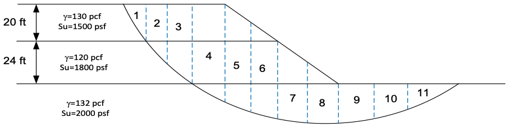
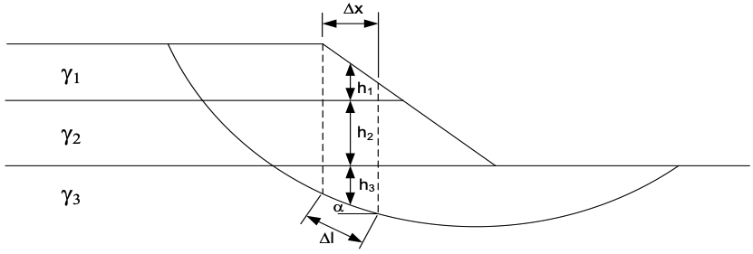
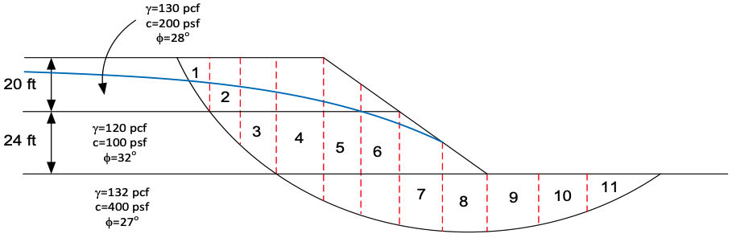
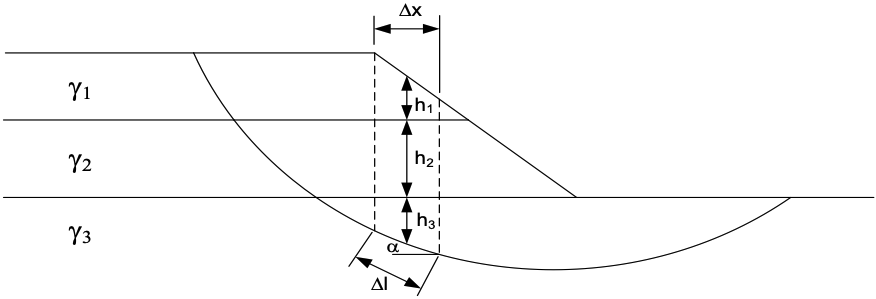

# Exercise - The Swedish Method and the Ordinary Method of Slices

Both parts of this exercise use the same slope and the same eleven slices. Part 1 analyzes it for undrained ($\phi=0$) conditions with the Swedish method, and Part 2 analyzes it for drained conditions, with effective stress strengths and a piezometric line, using the Ordinary Method of Slices (OMS).

## Part 1: The Swedish Method

The Swedish method of slices calculates the factor of safety of a slope under undrained ($\phi=0$) conditions. Consider a slope with a failure surface as shown below:

We can analyze each slice as follows:

The weight of the slice ($W$) is the sum of the height of each material in the slice multiplied by
the width of the slice and the unit weight of the material ($\gamma_i h_i \Delta x$).
The length along the base of the slice is $\Delta l = \Delta x / cos \alpha$. The overall factor of safety for the slope is then
calculated as:

>>$F = \dfrac{\sum{c\Delta l}}{\sum{W sin\alpha}}$

where:

>>$c$ = the undrained cohesion of the soil 
$\Delta l$ = the length of the slice along the failure surface 
$W$ = the weight of the slice 
$\alpha$ = the angle of the failure surface with the horizontal

Use the following spreadsheet to calculate the factor of safety for the slope. The slice widths ($\Delta x$), heights ($h_i$), slope angles ($\alpha$), unit weights ($\gamma$), and cohesions ($c$) are given in the spreadsheet. Fill in the remaining values and calculate the factor of safety.

Excel starter file: [swedish.xlsx](files/swedish.xlsx)

Excel solution file: [swedish_KEY.xlsx](files/swedish_KEY.xlsx)

## Part 2: The Ordinary Method of Slices

Now apply the Ordinary Method of Slices to the same slope for drained conditions, with an effective cohesion and friction angle in each layer and a piezometric line:

Once again, we analyze each slice using the following parameters:

The factor of safety for OMS, in its preferred form, is:

>>$F = \dfrac{\sum {\left[c'\Delta l + \left(W cos\alpha - u \Delta l cos^2\alpha\right)\tan\phi'\right]}}{\sum {W\sin\alpha}}$

where:

>>$c'$ = the effective cohesion at the base of the slice 
$\phi'$ = the friction angle at the base of the slice 
$\Delta l$ = the length of the base of the slice 
$W$ = the weight of the slice 
$\alpha$ = the angle of the slope at the base of the slice 
$u$ = the pore water pressure at the base of the slice

The pore pressure at the base of the slice is:

>>$u = \gamma_w \cdot h_w$

where:

>>$\gamma_w$ = the unit weight of water 
$h_w$ = the height of the water above the base of the slice

Download the Excel file below and use it to calculate the factor of safety for the slope.

Excel starter file: [oms.xlsx](files/oms.xlsx)

Excel solution file: [oms_KEY.xlsx](files/oms_KEY.xlsx)
