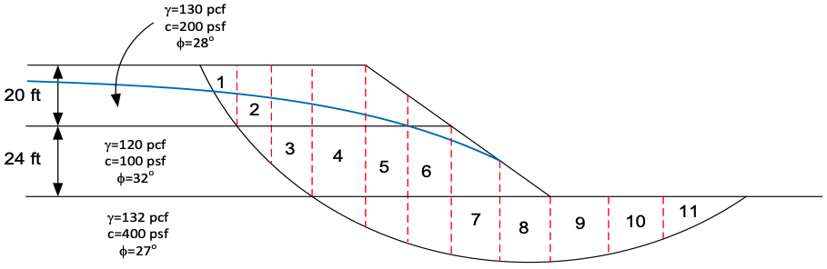
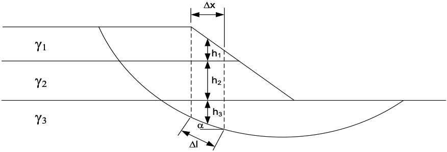

# Exercise - Simplified Janbu and Bishop's Simplified Method

Both parts of this exercise use the slope from the last class exercise, with its effective stress strengths and piezometric line, and the same eleven slices:

where:

>>$c'$ = the effective cohesion at the base of the slice 
$\phi'$ = the friction angle at the base of the slice 
$\Delta l$ = the length of the base of the slice 
$W$ = the weight of the slice 
$\alpha$ = the angle of the base of the slice 
$u$ = the pore water pressure at the base of the slice = $\gamma_w \cdot h_w$ 
$\gamma_w$ = the unit weight of water 
$h_w$ = the height of the water above the base of the slice

## Part 1: Simplified Janbu

Simplified Janbu finds the normal force on each base from vertical equilibrium of the slice, then the factor of safety from horizontal equilibrium of the whole sliding mass. The normal force is:

>>$N = \dfrac{W - \dfrac{1}{F}\left(c'\Delta l - u\Delta l\tan\phi'\right)\sin\alpha}{m_\alpha}, \qquad m_\alpha = \cos\alpha + \dfrac{\sin\alpha\tan\phi'}{F}$

and the uncorrected factor of safety is:

>>$F = \dfrac{\sum{\left[c'\Delta l + \left(N - u\Delta l\right)\tan\phi'\right]\cos\alpha}}{\sum{N\sin\alpha}}$

$F$ appears on both sides, so the calculation is iterative: enter a guess for $F$, compute the right side, and repeat until the two agree.

Then apply Janbu's correction factor:

>>$f_o = 1 + b_1\left[\dfrac{d}{L} - 1.4\left(\dfrac{d}{L}\right)^2\right], \qquad F_{corr} = f_o F$

where $L$ is the length of the line joining the two ends of the slip surface, $d$ is the greatest depth of the slip surface below that line, and $b_1$ is 0.67 for $c$ only ($\phi = 0$), 0.50 for $c$ and $\phi$, and 0.31 for $\phi$ only ($c = 0$). $d$ and $L$ are given in the spreadsheet.

Excel starter file: [janbu.xlsx](files/janbu.xlsx)

Excel solution file: [janbu_KEY.xlsx](files/janbu_KEY.xlsx)

## Part 2: Bishop's Simplified Method

Bishop's simplified method also finds the normal force from vertical equilibrium, but takes the factor of safety from moment equilibrium about the center of the circle:

>>$F = \dfrac{\sum {\left[\dfrac{c'\Delta l\cos\alpha + \left(W - u \Delta l\cos\alpha\right)\tan\phi'}{\cos\alpha + \left(\sin\alpha\tan\phi'\right)/F}\right]}}{\sum {W\sin\alpha}}$

The factor of safety ($F$) is on both sides, so the calculation must be done iteratively. Start with a guess for $F$ and update it until the difference between the calculated $F$ and the guess is less than a small tolerance (e.g., 0.0001).

Compare your results with the OMS result from the last class exercise.

Excel starter file: [bsp.xlsx](files/bsp.xlsx)

Excel solution file: [bsp_KEY.xlsx](files/bsp_KEY.xlsx)
