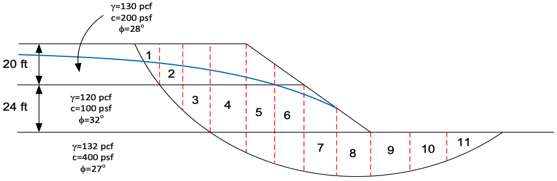
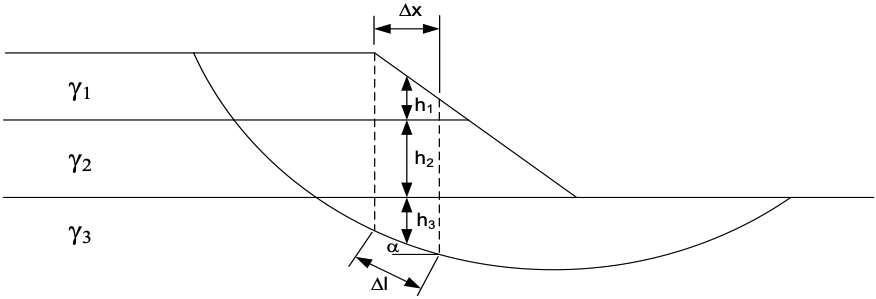

# Homework - Spencer's Method

For this assignment, you will use Spencer's method to analyze the stability of a slope in Excel. It is the same slope we analyzed in class with OMS, simplified Janbu, and Bishop's simplified method, with the same eleven slices:

Spencer's method assumes that all side forces are parallel, at an unknown inclination $\theta$, and finds both the factor of safety $F$ and $\theta$ by satisfying force and moment equilibrium. The side forces on each slice combine into one resultant, $Q$. On a plain slice, with only its weight, the equilibrium of the slice gives $Q$ for a trial $F$ and $\theta$:

>>$Q = \dfrac{W\sin\alpha - \dfrac{c'}{F}\Delta x\sec\alpha - \left(W\cos\alpha - u\,\Delta x\sec\alpha\right)\dfrac{\tan\phi'}{F}}{\cos(\alpha - \theta) + \sin(\alpha - \theta)\dfrac{\tan\phi'}{F}}$

where:

>>$c'$ = the effective cohesion at the base of the slice 
$\phi'$ = the friction angle at the base of the slice 
$\Delta x$ = the width of the slice, and $\Delta x\sec\alpha$ the length of its base 
$W$ = the weight of the slice 
$\alpha$ = the angle of the base of the slice 
$u$ = the pore water pressure at the base of the slice = $\gamma_w \cdot h_w$

The side forces are internal to the sliding mass, so for the whole mass the $Q$'s must add up to zero, in force and in moment:

>>$R_1 = \sum{Q} = 0$

>>$R_2 = \sum{Q\left(x_b\sin\theta - y_b\cos\theta\right)} = 0$

where $x_b$ and $y_b$ are the coordinates of the center of each slice base. They are given in the spreadsheet, measured from the toe end of the slip surface with $x$ positive toward the crest, so the equations read as in the lecture, which is written for a slope that faces left.

## Solving with Solver

Two equations and two unknowns, $F$ and $\theta$, call for Excel's Solver (Data > Solver; enable it first under File > Options > Add-ins if it isn't there):

1. Fill in $c'$ and $\phi'$ for each slice from the layer at its base, then $W$, $u$, $Q$, and $Q\left(x_b\sin\theta - y_b\cos\theta\right)$, using the trial $F$ and $\theta$ in the spreadsheet.
2. In Solver, set the objective to the cell for $R_1$, with a value of 0.
3. Change the cells for $F$ and $\theta$.
4. Add the constraint $R_2 = 0$, choose the GRG Nonlinear method, and solve. A starting point of $F = 1.5$ and $\theta = 0$ works.

Compare your $F$ with Bishop's from the class exercise.

Excel starter file: [spencer.xlsx](files/spencer.xlsx)

## Submission

Upload the completed Excel file to Learning Suite.

!!! note "Do not put your name or NetID in the file"
    Learning Suite records who submitted each file, so your name is not needed
    inside the file itself. Leaving it out means your work can be graded
    anonymously, which keeps grading fair. This applies to scans and photos
    too — please don't write your name on the page.

## Grading Rubric

**Total: 30 points**

| Criteria | Points |
|----------|:------:|
| Effective strength parameters on each slice | 3 |
| Slice weights and pore water pressures | 5 |
| $Q$ for each slice | 8 |
| Force and moment sums, $R_1$ and $R_2$ | 5 |
| Solver setup and a converged solution for $F$ and $\theta$ | 6 |
| Comparison with Bishop's simplified method | 1 |
| Documentation and work shown clearly | 2 |
