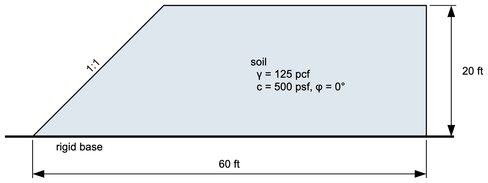
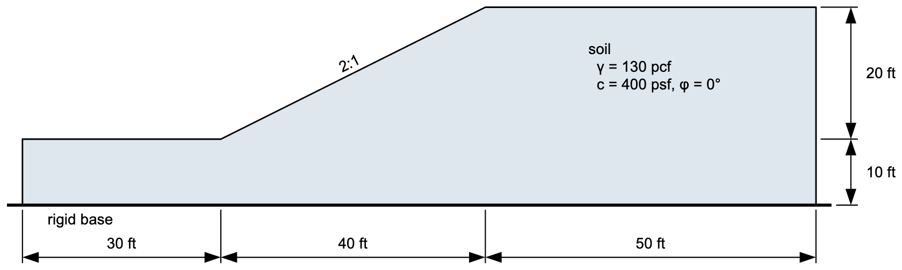
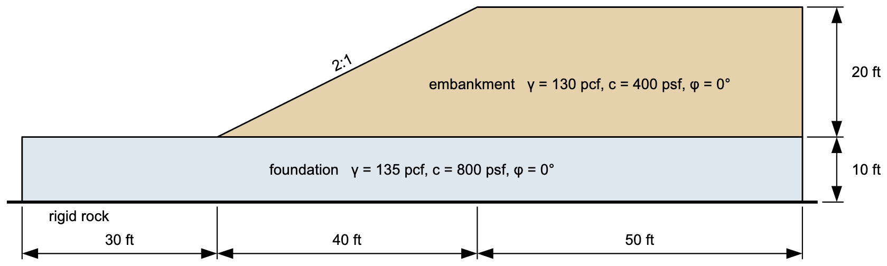
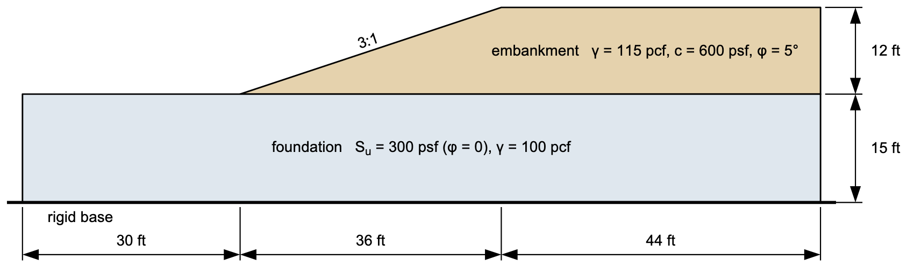

# Exercise - Stability Analysis with XSLOPE, Part 1

In this exercise, we will solve four slope stability problems in XSLOPE Studio. For each problem, start a new model with **File → New**, stay in **LEM** mode, and enter the inputs from the inputs tree: **Global parameters**, **Materials**, **Profile lines**, and **Circles**, plus anything else the problem needs. In the **Circles** editor, enter a starting circle or press **Generate starting circles…**. Then click **Run LEM…**, choose **Spencer** and **Auto search**, and read the search and solution views. Save each model with **File → Save As**; the file is an XSLOPE input template.

For each problem, explore the results using the variations suggested.

## Problem 1 - Simple Embankment

Put the toe at (0, 0). The model's base is at the level of the toe, so **Max depth** is 0.

{width="730"}

Run the search, and look at the warnings. Then try these variations:

a) Add a distributed load of 750 psf on the crest, from x = 25 ft to x = 35 ft. Where does the critical circle go? 
b) Remove the load and submerge the slope under 10 ft of water. Add a piezometric line across the section at elevation 30, and leave **Water loads** on `auto`, so XSLOPE derives the water load. The soil's strength is undrained, so its pore pressure stays `none`. Why does the factor of safety rise so much?

Solution: [xslope_simple_embankment.xlsx](files/xslope_simple_embankment.xlsx). F = 1.276 for the base case, 0.918 with the load, and 2.425 submerged.

## Problem 2 - Simple Slope with Foundation

Put the toe at (0, 0). This time the base is below the toe, so **Max depth** is −10.

{width="960"}

Solution: [xslope_simple_foundation.xlsx](files/xslope_simple_foundation.xlsx). F = 0.964.

## Problem 3 - Slope with Multiple Layers

Be careful to find the location of the critical circle.

{width="960"}

**Variation:** change the cohesion of the foundation from 800 psf to 500 psf, and then to 400 psf. How does the location of the critical circle change?

Solution: [xslope_simple_mult_layers.xlsx](files/xslope_simple_mult_layers.xlsx). F = 1.244 at 800 psf, 1.135 at 500 psf, and 0.964 at 400 psf.

## Problem 4 - Tension Cracks

Consider the following slope:

{width="960"}

The embankment has cohesion, so a solution with no crack puts tension at the top of the slope. That is unconservative, because the tension raises the factor of safety. To avoid it, we add a tension crack at the top of the slope. The depth of the crack is:

>>$z_c = \dfrac{2c_d}{\gamma\tan\left(45^\circ - \phi_d/2\right)}$

>>$c_d = \dfrac{c}{F}, \quad \tan\phi_d = \dfrac{\tan\phi}{F}$

The depth depends on the factor of safety, so guess F, compute the depth, run the search, and repeat until they agree.

1) Put the toe at (0, 0). Extend the foundation's profile line to x = −30 ft on the left, and both lines to x = 80 ft on the right. **Max depth** is −15.

2) Enter two starting circles, both at Xo = 18 and Yo = 24, one with Depth = 0 and one with Depth = −15.

3) Run the search. What do the warnings say? Look at the line of thrust and the base stresses at the crest.

4) Use this spreadsheet to compute the crack depth, starting from the factor of safety you just found or from your own guess: [tension_crack_calculations.xlsx](files/tension_crack_calculations.xlsx)

5) Enter the depth as **Tension crack depth** in **Global parameters** and run the search again. Put the new factor of safety in the spreadsheet, and repeat until the depth stops changing. What happened to the warnings?

6) The theoretical depth is an upper estimate. Try a crack of only 2 ft. Does the note about tension at the crest come back? How does the factor of safety compare?

7) Go back to the depth from step 5, and fill the crack by setting **Water in crack** to the same depth. How does the factor of safety compare to the dry crack?

Solutions: [tension_crack_calculations_KEY.xlsx](files/tension_crack_calculations_KEY.xlsx) and [xslope_tension.xlsx](files/xslope_tension.xlsx). F = 1.536 with no crack, 1.398 with a dry crack 7.9 ft deep, 1.484 with a 2 ft crack, and 1.330 with the 7.9 ft crack full of water.
