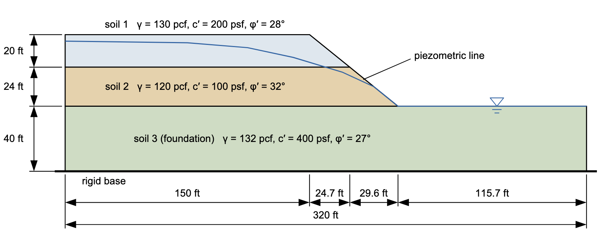
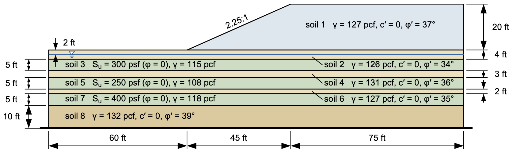
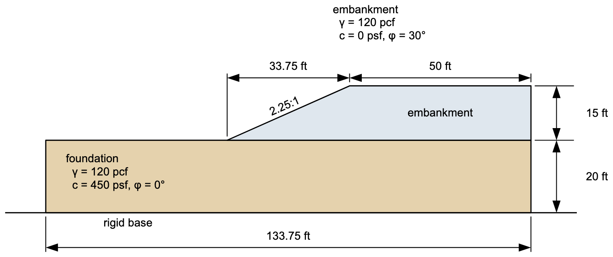
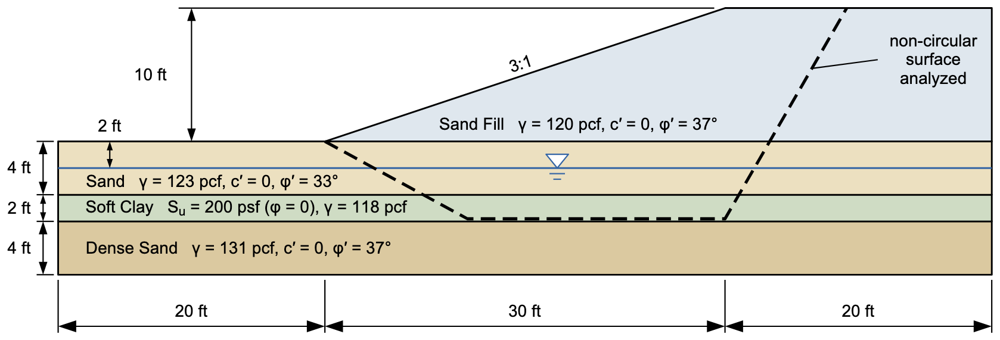
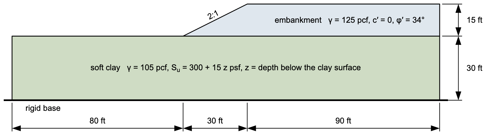
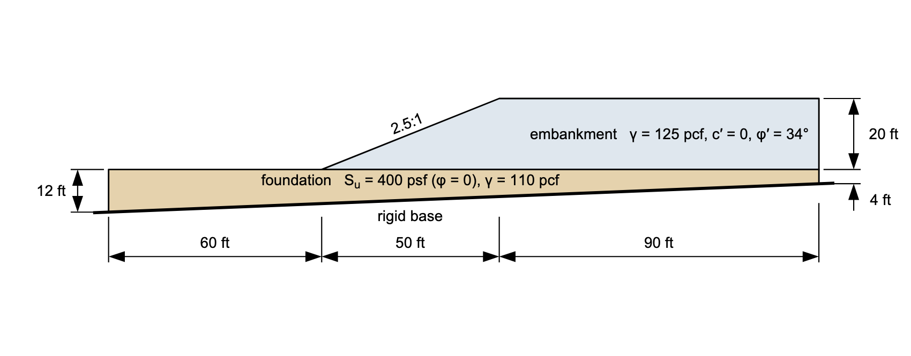

# Exercise - Stability Analysis with XSLOPE, Part 2

This class is practice. There are six problems here, and each one adds something the last lecture introduced. Build each model in XSLOPE Studio, starting with **File → New**, and run it with **Run LEM…**. Use Spencer's method unless the problem says otherwise.

## Problem 1 - The Spreadsheet Slope

This is the slope you solved in the spreadsheet exercises, with the same soils.

{width="950"}

You can copy the coordinates of the profile lines and the piezometric line from this spreadsheet: [method-of-slices-input.xlsx](files/method-of-slices-input.xlsx)

1) Build the model, with **Max depth** at 0. All three materials use `mc` with **u** = `piezo`. Enter the spreadsheet circle: Xo = 195, Yo = 150, Depth = 18.1.

2) With **Analysis** set to **Single surface**, run OMS, Bishop, Janbu, and Spencer, and compare them with your spreadsheets. Your spreadsheets read their heights and angles from a drawing, and XSLOPE computes them from the geometry. XSLOPE's OMS uses the basic form, N′ = W cos α − uΔl, so expect it to come in lower than your spreadsheet, which used the preferred form. How close are the others?

3) Now set **Analysis** to **Auto search**. What is the factor of safety, and where is the critical surface? Why does it go there? Compare the steepness of the lower face with the friction angle of soil 2, and look at where the water line meets the face.

4) Turn on **Ignore surficial (skin) failures**, and try a **Min slip depth** of 10, 20, and 30 ft. What does this tell you about the circle you checked by hand?

Solution: [xslope_method_slices_problem.xlsx](files/xslope_method_slices_problem.xlsx). On the spreadsheet circle, F = 1.303 for OMS, 1.577 for Bishop, 1.534 for Janbu, and 1.580 for Spencer. The search finds F = 0.765 on the lower face. With a minimum slip depth, F = 0.768 at 10 ft, 0.834 at 20 ft, and 1.047 at 30 ft.

## Problem 2 - Multi-Layer Foundation

{width="960"}

Put the toe at (0, 0), and extend the section 60 ft to the left of the toe and 75 ft to the right of the crest. The piezometric line is at elevation −2. The layers with $S_u$ take **u** = `none`, and the others take `piezo`.

1) Run a search from a starting circle at Xo = 22.5, Yo = 40, Depth = 0, and another from the same center with Depth = −17. Do they agree?

2) Turn on **Grid search**, and run it once more. Grid search needs no starting circle.

Solution: [xslope_eight_layers.xlsx](files/xslope_eight_layers.xlsx). F = 1.218 from Depth = 0, and 1.190 from Depth = −17 and from the grid search.

## Problem 3 - Two Minima

{width="870"}

Put the toe at (0, 0). Extend the foundation 50 ft to the left of the toe, and both lines 50 ft to the right of the crest.

1) Run a search from a starting circle at Xo = 11.25, Yo = 40, Depth = 0. What do you notice about the critical surface?

2) Calculate the infinite slope factor of safety for the embankment, $F = \tan\phi/\tan\beta$. How does it compare?

3) Now run a search from the same center with Depth = −20. How does this answer compare?

4) Put both circles in the **Circles** editor and run one search. Does it report both mechanisms?

5) Turn on **Grid search**. Then also turn on **Ignore surficial (skin) failures** with a **Min slip depth** of 5 ft. Which of these answers is the one you would design for?

Solution: [xslope_mult_min.xlsx](files/xslope_mult_min.xlsx). F = 1.299 from Depth = 0, the same as the infinite slope, and 1.376 from Depth = −20. One search from both circles reports 1.299. Grid search gives 1.324, and 1.376 with the 5 ft minimum.

## Problem 4 - A Weak Seam

{width="960"}

Put the toe at (0, 0). The piezometric line is at elevation −2. The soft clay takes **u** = `none`, and the sands take `piezo`.

a) Search for the critical circle, starting from Xo = 15, Yo = 30, Depth = −5. 
b) In the **Non-circular pts** editor, press **Generate from the weak zone…**. Run this surface with **Analysis** set to **Single surface** and **Surface** set to non-circular. Look at the points and their **Movement** values first. 
c) Run the same surface with **Auto search**. Where did the points go?

Solution: [xslope_noncircular.xlsx](files/xslope_noncircular.xlsx). F = 1.770 for the critical circle, 2.022 for the surface as generated, and 1.656 after the search.

## Problem 5 - Embankment on Soft Clay

The strength of this clay grows with depth, so use option `cp`. Set **c** = 300, **c/p** = 15, and **r-elev** = 0, the elevation of the top of the clay. Both materials take **u** = `none`.

{width="960"}

Put the toe at (0, 0).

a) Search for the critical circle, and note how deep it goes. 
b) Now replace the clay with a constant strength equal to its strength at mid-depth: option `mc`, c = 525 psf, φ = 0. Search again. How much does the factor of safety change, and why? Which way does the error go?

Solution: [xslope_soft_clay.xlsx](files/xslope_soft_clay.xlsx). F = 1.242 with the strength growing with depth, and 1.516 with the constant strength.

## Problem 6 - A Dipping Base

The base of this model isn't level, so **Max depth** can't describe it. Build the geometry from polygons in the **Polygons** editor. Leave **Profile lines** empty.

{width="930"}

Put the toe at (0, 0). The two polygons are:

| Polygon | Vertices |
|---------|:--------:|
| embankment | (0, 0), (50, 20), (140, 20), (140, 0) |
| foundation | (−60, 0), (140, 0), (140, −4), (−60, −12) |

a) Search for the critical circle, starting from Xo = 25, Yo = 44, Depth = −10. 
b) Turn on **Composite surfaces**, which lets a circle follow the base, and search again. What changed in the shape of the surface?

Solution: [xslope_dipping_base.xlsx](files/xslope_dipping_base.xlsx). F = 1.198 without composite surfaces, and 1.169 with them.
