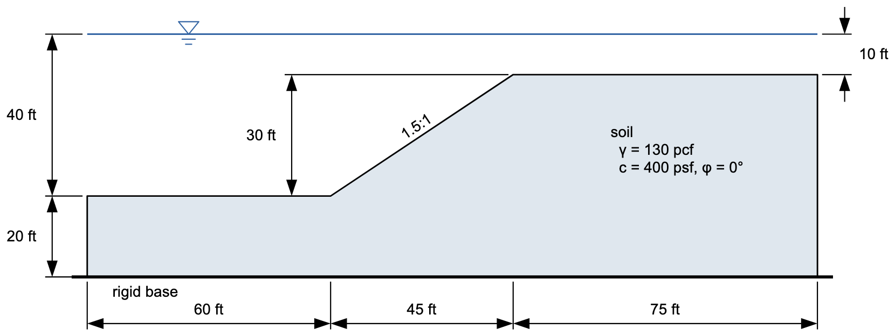
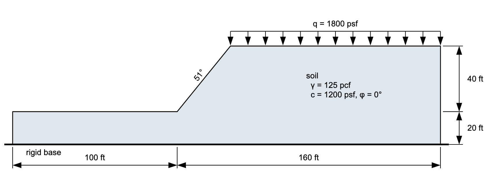
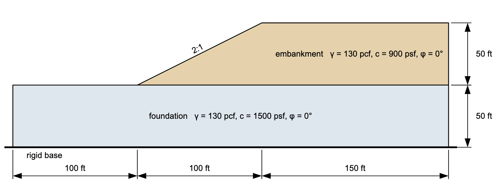

# Homework - XSLOPE LEM, Part 1

Solve the following problems in XSLOPE Studio. For each problem, start a new model with **File → New** in **LEM** mode, and perform an automated search using Spencer's method.

(a) Submerged slope.

Use a total unit weight, and let XSLOPE derive the water load: enter the pool as a piezometric line across the section at elevation 40, 10 ft above the top of the slope, and leave **Water loads** on `auto`.

{width="800"}

(b) Slope with surcharge.

{width="800"}

(c) Slope with two materials.

{width="800"}

## Submission

For each of the three problems, save the model with **File → Save As**, and use the **Save…** button above the plot to save a PNG of the solution with the minimum factor of safety. Zip up your files into a single zip archive. Upload your zip archive via Learning Suite.

!!! note "Do not put your name or NetID in the file"
    Learning Suite records who submitted each file, so your name is not needed
    inside the file itself. Leaving it out means your work can be graded
    anonymously, which keeps grading fair. This applies to scans and photos
    too — please don't write your name on the page.

## Grading Rubric

| Criteria                                                                              | Points |
|---------------------------------------------------------------------------------------|:------:|
| **Problem (a): Submerged Slope**                                                     |        |
| XSLOPE model set up correctly with proper geometry                                   |   3    |
| Total unit weight used (not buoyant unit weight)                                     |   3    |
| External water modeled with a piezometric line and automatic water loads             |   3    |
| Automated search using Spencer's method executed correctly                           |   1    |
| Minimum factor of safety identified and reported with PNG                            |   1    |
| **Problem (b): Slope with Surcharge**                                                |        |
| XSLOPE model set up correctly with proper geometry                                   |   3    |
| Surcharge load correctly applied                                                     |   3    |
| Automated search using Spencer's method executed correctly                           |   1    |
| Minimum factor of safety identified and reported with PNG                            |   2    |
| **Problem (c): Slope with Two Materials**                                            |        |
| XSLOPE model set up correctly with proper geometry                                   |   3    |
| Two materials defined with correct properties and interface                          |   3    |
| Automated search using Spencer's method executed correctly                           |   2    |
| Minimum factor of safety identified and reported with PNG                            |   2    |
| **Total**                                                                             | **30** |
