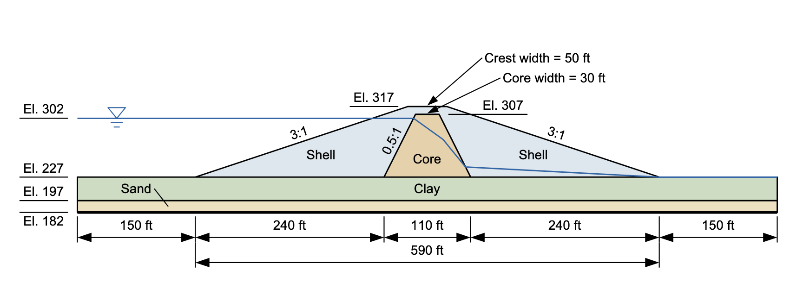
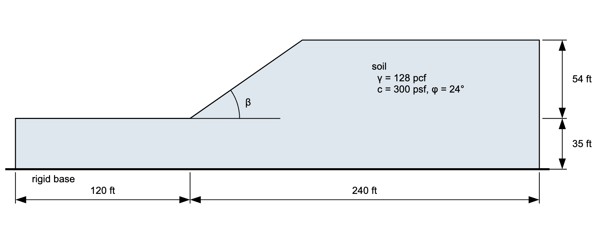

# Homework - XSLOPE LEM, Part 2

In this homework, we will use XSLOPE Studio to find the critical factor of safety against slope failure for two problems. Use Spencer's method for both.

## Problem 1: Earth Dam Problem from Textbook

Use XSLOPE to solve for the critical factor of safety against slope failure for the following problem based on a circular failure surface (compare to page 121 in your textbook):

You will need to calculate the proper coordinates for your profile lines. Extend the problem 150 ft to the left and the right of the upstream and downstream toes of the dam. Use the given elevations for the y coordinates and let x=0 at the upstream toe of the dam. Use the base of the sand layer (y=182 ft) as **Max depth**.

The material properties are as follows:

|  Mat   | γ (pcf) | c' (psf) | $\phi$' (degrees) |
|:------:|:-------:|:--------:|:-----------------:|
| Shell  |   125   |    0     |        34         |
|  Core  |   122   |   100    |        26         |
|  Clay  |   123   |    0     |        24         |
|  Sand  |   127   |    0     |        32         |

The coordinates of the piezometric line are as follows:

| x (ft) | y (ft) |
|:------:|:------:|
|  -150  |  302   |
| 277.5  |  302   |
|  315   |  275   |
| 343.5  |  240   |
|  590   |  227   |
|  740   |  227   |

The reservoir is a load on the upstream face. With **Water loads** on `auto`, XSLOPE derives it from the piezometric line.

Use a circular failure surface. Perform two searches: one for the upstream side and one for the downstream side. The side that is analyzed depends on the location of your starting circle. Save a copy of the solution for each side.

## Problem 2: Slope Design Problem

For this problem, we will find the slope angle ($\beta$) that gives a critical factor of safety of 1.4, within a tolerance of 0.01.

Set up the problem with the origin (0, 0) at the toe of the slope, and extend it 120 ft to the left of the toe and 240 ft to the right. For the starting circle, use the **Intercept** option, with the circle passing through the toe.

The **Parametric** tool sweeps material properties and the seismic coefficient, and the slope angle is geometry, so you will do this sweep by hand:

1) Run a search at $\beta$ = 25, 27.5, 30, 32.5, and 35 degrees. For each angle, edit the crest point in the **Profile lines** editor, at x = 54 / tan $\beta$.

2) Plot the factor of safety against $\beta$, and interpolate to find the angle that gives 1.4.

3) Run that angle, and adjust it until the factor of safety is within 0.01 of 1.4.

Save a copy of the final solution and your chart.

## Submission

For Problem 1, save both models with **File → Save As**, and use the **Save…** button above the plot to save a PNG of each solution. For Problem 2, save the final model, a PNG of its solution, and your chart. Zip up your files into a single zip archive. Upload your zip archive via Learning Suite.

!!! note "Do not put your name or NetID in the file"
    Learning Suite records who submitted each file, so your name is not needed
    inside the file itself. Leaving it out means your work can be graded
    anonymously, which keeps grading fair. This applies to scans and photos
    too — please don't write your name on the page.

## Grading Rubric

### Problem 1: Earth Dam (20 pts)

| Criteria                                                                              | Points |
|---------------------------------------------------------------------------------------|:------:|
| Profile line coordinates calculated correctly in spreadsheet                         |   3    |
| Problem domain extends 150 ft left and right of upstream/downstream toes             |   1    |
| Coordinate system set up correctly (x=0 at upstream toe, given elevations for y)     |   1    |
| All four materials defined with correct properties (c', φ', γ)                       |   3    |
| Piezometric line coordinates entered correctly                                        |   2    |
| Reservoir load on the upstream face, from the piezometric line (automatic water loads) |   5    |
| Upstream side analysis performed and minimum FOS identified                          |   2    |
| Downstream side analysis performed and minimum FOS identified                        |   2    |
| Input files and PNG solution plots for both sides submitted                          |   1    |

### Problem 2: Slope Design (10 pts)

| Criteria                                                                              | Points |
|---------------------------------------------------------------------------------------|:------:|
| Profile line coordinates set up correctly with origin at toe of slope                |   2    |
| Problem domain extends 120 ft left and 240 ft right of the toe                       |   1    |
| Material properties defined correctly                                                 |   1    |
| Search run at each of the five angles                                                 |   2    |
| Target FOS of 1.4 achieved within tolerance of 0.01                                   |   2    |
| FS vs beta chart                                                                      |   1    |
| Input file, final solution, and chart submitted                                       |   1    |

### Total: 30 pts
