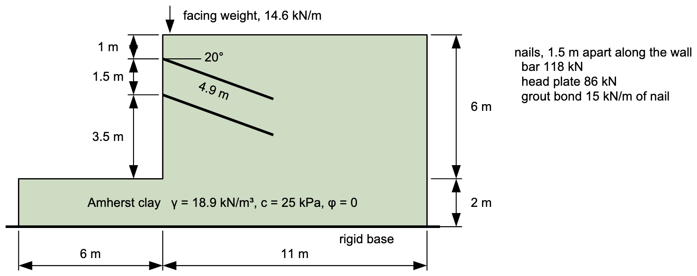

# Exercise - A Soil Nail Wall That Failed

This soil nail wall was a full-scale field test in the soft clay at Amherst, Massachusetts: a 6 m vertical cut held by two rows of nails. It failed. Sheahan and Ho (2003) analyzed it with planes through the toe, and the problem is one of Slide's verification problems. In this exercise you will build the wall in XSLOPE Studio and see whether limit equilibrium predicts the failure.

{width="890"}

Each nail is a steel bar grouted in a drilled hole, 4.9 m long at 20° below horizontal, with a plate on the shotcrete facing at its head. The nails are 1.5 m apart along the wall. One nail's bar holds 118 kN, its head plate 86 kN, and the grout bond 15 kN per meter of nail. The facing's weight, 14.6 kN/m, acts at the top of the face 0.3 m behind it.

Build the model in XSLOPE Studio, starting with **File → New**, and run it with **Run LEM…**. Use Spencer's method.

1) Build the section without the nails. Put the toe at (0, 0), set **Max depth** to −2, and enter the facing weight as a line load at (0.3, 6), acting straight down. The clay takes option `mc` with φ = 0, and **u** = `none`.

2) The published analyses check planes through the toe. In the **Non-circular pts** editor, enter the critical one, which rises at 44.5° from the toe to the top of the cut. Carry each end a little past the ground, as in this table:

| X (m) | Y (m) |
|------:|------:|
| −0.3 | 0.21 |
| 0 | 0 |
| 6.106 | 6 |
| 6.406 | 6.21 |

Run it with **Analysis** set to **Single surface** and **Surface** set to non-circular. What is the factor of safety of the cut with no nails? Could it have been excavated without them?

3) Add the two rows of nails in the **Reinforcement lines** editor, each from its head on the face (end 1) to its tip (end 2). Set **Type** to Nail, which gives Axial and Active. Enter each nail's own values with **Spacing** = 1.5, so XSLOPE divides them by the spacing:

- **Tmax**: the bar, 118 kN.
- **Tend1**: the head plate, 86 kN. **Tend2**: 0, since the tip is free.
- **Lp1** and **Lp2**: the length of bond that develops the bar's 118 kN. Work it out from the bond strength.

Run the plane again. How does the factor of safety compare with Sheahan and Ho's 0.887?

4) Open the crossing table under the solution plot. What limits the force in each nail where the plane crosses it? Why doesn't the head plate's 86 kN matter? Compare the nail's length with your Lp.

5) Set **Appl** to Passive on both nails and run the plane once more. How much does it change, and why so little?

6) Set **Appl** back to Active. Run **Auto search** on the non-circular surface, and then a circular search with **Grid search** on. Which mechanism is critical?

7) Make both nails 8 m long, keeping their heads and their 20° angle, and repeat the plane and the two searches. What did the longer nails buy, and what still limits them?

Solution: [xslope_nail_wall.xlsx](files/xslope_nail_wall.xlsx). Without nails the plane gives F = 0.846. With the nails, Lp = 118/15 = 7.87 m, and F = 0.893 on the plane, against 0.887 from Sheahan and Ho. Both crossings are limited by pullout from end 2: each nail is shorter than its development length, so the bond behind the plane can't develop even the plate's 86 kN. Passive gives 0.899. The non-circular search gives 0.891, and the circular grid search 0.855. With 8 m nails, F = 1.005 on the plane and in the non-circular search, and 0.917 in the grid search; pullout from end 2 still limits both nails.

Sources: Sheahan, T. C., and Ho, C. L. (2003). "Simplified trial wedge method for soil nailed wall analysis." *Journal of Geotechnical and Geoenvironmental Engineering*, 129(2), 117–124. The problem is Slide's verification problem 47 and XSLOPE's [VP47](https://xslope.org/en/latest/verification/rocscience/#vp47).
