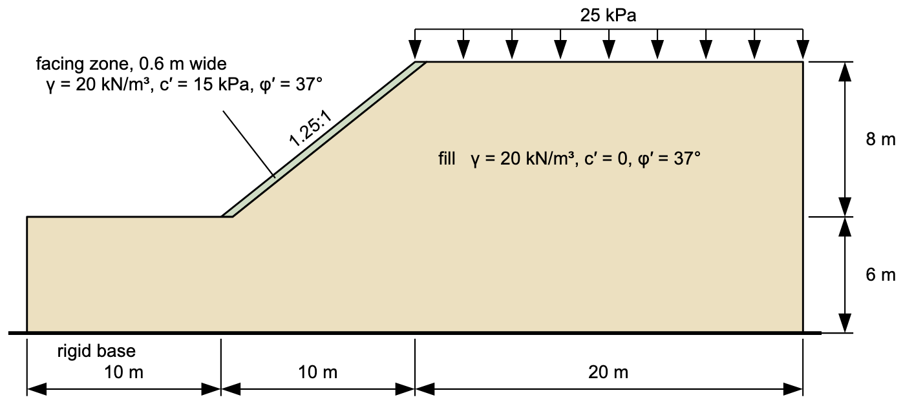

# Homework - Reinforced Slope Design

The objective of this assignment is to design geogrid reinforcement for a slope that is both safe and economical. You will choose the number of geogrid layers, their elevations, and their length. Use XSLOPE Studio and Spencer's method.

{width="800"}

The slope is an 8 m fill at 1.25H:1V with a 25 kPa surcharge on the crest. A 0.6 m zone along the face has some cohesion; the fill behind it has none. The model has been prepared for you, with everything but the reinforcement:

[xslope_geogrid_hw.xlsx](files/xslope_geogrid_hw.xlsx)

Open it in XSLOPE Studio with **File → Open**.

**(a) Slope analysis**

Find the critical factor of safety for the slope without reinforcement, using a circular surface. Run a search from the starting circle in the file, and another with **Grid search** on. Save a PNG of the critical solution.

**(b) Reinforcement design**

Design the reinforcement in the **Reinforcement lines** editor. Each layer is a horizontal line from the slope face into the fill. You can use up to 10 layers at any elevations, but keep every layer the same length, so you have three design variables:

1. The number of layers
2. The elevation of each layer
3. The length of the layers

Use these values for each layer:

| Parameter | Value |
|-----------|-------|
| Type | Geosynthetic |
| Tmax | 12 kN/m |
| Lp1 and Lp2 | 1.2 m |
| Spacing | 1 (values per meter of slope) |
| Cost | $1,000 per meter of layer |

Your design must satisfy these constraints:

* The critical factor of safety must be at least 1.5, with **Grid search** on as well as from the starting circle, so a surface that passes behind or under the layers is checked too.
* The total cost should be as low as you can make it.

The total cost is the cost per meter times the number of layers times the layer length. Record your calculation of the cost and the factor of safety for each design you try in a short table, so the grader can follow how you got to your final design.

Save the model of your final design and a PNG of its critical solution.

## Submission

Save your final model with **File → Save As**, and use the **Save…** button above the plot to save a PNG of the solution for parts (a) and (b). Put the two PNGs, the model, and your table of designs (a spreadsheet or a PDF) in a single zip archive, and upload it to Learning Suite.

!!! note "Do not put your name or NetID in the file"
    Learning Suite records who submitted each file, so your name is not needed
    inside the file itself. Leaving it out means your work can be graded
    anonymously, which keeps grading fair. This applies to scans and photos
    too — please don't write your name on the page.

## Grading Rubric

**Total: 30 points**

| Criteria | Points |
|----------|:------:|
| Part A: Unreinforced factor of safety, from the starting circle and with Grid search | 7 |
| Part B: The final design gives F ≥ 1.5, with and without Grid search | 9 |
| Part B: The design is economical | 9 |
| Part B: The table of designs and the cost calculation are correct | 5 |
