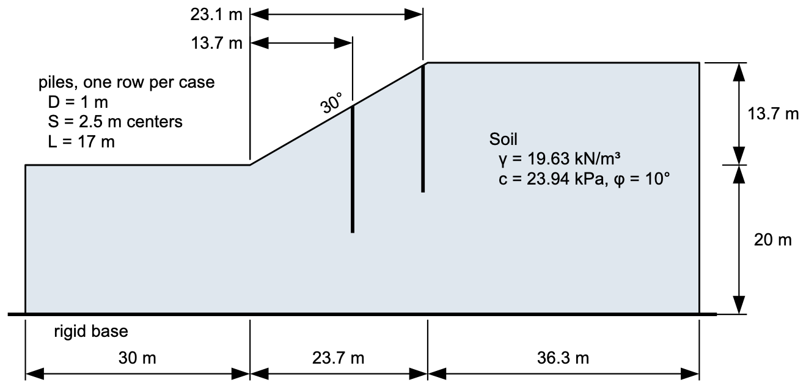

# Exercise - Piles in a Slope

Hassiotis, Chameau, and Gunaratne (1997) used this slope as the example for their design method for stabilizing piles. It is 13.7 m high at 30°, in a single soil, on a rigid base 20 m below the toe. Their row is 1.0 m piles at 2.5 m centers, 17 m long, which the drawing shows at two places on the slope. In this exercise you will put the row in the slope in XSLOPE Studio and let XSLOPE compute its force by Ito and Matsui, then find out what the design depends on.

{width="750"}

Build the model in XSLOPE Studio, starting with **File → New**, and run it with **Run LEM…**. Use Spencer's method throughout.

1) Build the slope without piles. Put the left end of the section at (0, 20), so the toe is at (30, 20) and the crest at (53.73, 33.7), and set **Max depth** to 0. The soil takes option `mc` with **u** = `none`. Search from a starting circle at Xo = 41.86, Yo = 47.4, Depth = 14. What is the factor of safety?

2) Add the row 13.7 m from the toe in the **Piles** editor: one line from its head on the slope at (43.7, 27.91) to its tip at (43.7, 10.91). Leave **H** blank, so XSLOPE computes it by Ito and Matsui on every trial surface, and enter **D** = 1.0 and **S** = 2.5. **Appl** is Active. Search again. Where does the critical circle go, compared with the pile tips? Read the **Log**: how much force does the row give that circle?

3) Run the piles down to the rigid base, with the tip at (43.7, 0), and search again. What is the factor of safety now, and what force does the Log report for one pile and per meter of slope?

4) Keep the piles running to the base, and move the row to 4, 8, 18, and 23.1 m from the toe, its head on the slope each time. Where on the slope is the row most effective? Why does it do less near the toe and near the crest?

5) Put the row back at 13.7 m, and try spacings of 2, 3, 4, and 5 m. How does the factor of safety change? Ito and Matsui's method is meant for spacings of about 2 to 8 diameters: which of these fall inside it?

6) So far the piles can carry any force the soil puts on them. Set the spacing back to 2.5 m, and give the row a bending capacity, **Mcap** = 1,290 kN·m. That is the rough first estimate FHWA's drilled shaft manual (GEC 10) gives for a 1.0 m shaft with 1% longitudinal steel. Search again. What governs now, according to the Log, and what happened to the factor of safety?

7) Turn on **Grid search** and run once more. Does it find anything the starting circle missed?

Solution: [xslope_pile_slope.xlsx](files/xslope_pile_slope.xlsx), the row at 13.7 m running to the base, with its bending capacity. Without piles, F = 1.105. With the 17 m row, the search finds F = 1.329 on a circle that passes under the pile tips, and the Log reports no pile force: the piles don't go deep enough. Run to the base, the row gives F = 1.855, with 981 kN per pile, or 392 kN/m. The row does the most at mid-slope: F = 1.232, 1.422, 1.855, 1.453, and 1.238 at 4, 8, 13.7, 18, and 23.1 m from the toe. Closer piles push harder: F = 1.939, 1.855, 1.628, 1.433, and 1.344 at spacings of 2, 2.5, 3, 4, and 5 m, all within 2 to 8 diameters. With Mcap = 1,290 kN·m, bending governs: Ito and Matsui give 2,455 kN on one pile, the pile can carry 321 kN, and F falls to 1.224. Grid search finds the same circle.

Source: Hassiotis, S., Chameau, J. L., and Gunaratne, M. (1997). "Design method for stabilization of slopes with piles." *Journal of Geotechnical and Geoenvironmental Engineering*, 123(4), 314–323. The slope is also XSLOPE's [pile-stabilized slope sample](https://xslope.org/en/latest/lem/samples/#7-pile-stabilized-slope-hassiotis-et-al-1997).
