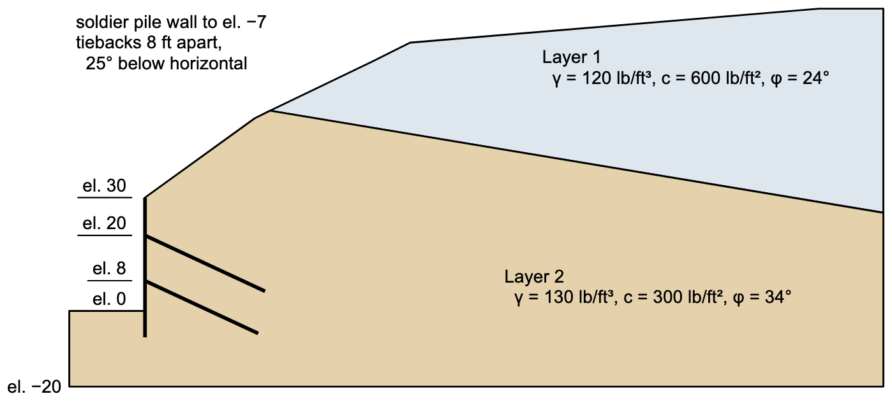

# Homework - Soldier Pile and Tieback Wall

This wall is the example in the manual for SNAILZ, Caltrans's program for soil nail and tieback walls, and Rocscience reproduces it as problem 49 of the Slide2 verification manual. A 30 ft cut at the toe of a two-layer slope is held by a soldier pile wall with two rows of grouted tiebacks. In this homework you will model both kinds of support in XSLOPE Studio, the tiebacks as reinforcement lines and the soldier piles as a pile line, and compare your results with the two programs. The data are in feet and pounds, as published.

{width="800"}

There is no water table. The model has been prepared for you, with everything but the tiebacks and the soldier piles:

[xslope_soldier_wall.xlsx](files/xslope_soldier_wall.xlsx)

Open it in XSLOPE Studio with **File → Open**, and run it with **Run LEM…**. The non-circular surface table holds the manual's slip surface, a wedge from the toe of the wall at (0, 0) through (37, 33.6) to the ground near (60, 66). Run it as a **Single surface**, **Non-circular**, by Janbu (Corrected) and by Spencer's method. SNAILZ analyzes wedges by force equilibrium, so Janbu's method is the closer comparison. The model is set to 60 slices.

**(a) The cut without support**

What is the factor of safety on the manual's surface by each method?

**(b) The tiebacks**

Each tieback starts at its head on the wall at x = 0 and runs 25° below horizontal. The tiebacks in each row are 8 ft apart along the wall.

| Row | Head elevation (ft) | Length (ft) | Tensile capacity (lb) |
|:---:|:-------------------:|:-----------:|:---------------------:|
| Upper | 20 | 35 | 120,345 |
| Lower | 8 | 33 | 164,217 |

The grout bond develops 13,572 lb per foot of tieback. How long a bond does each tieback need to develop its full tensile capacity? What force per foot of wall can each row give?

Add the two rows in the **Reinforcement lines** editor:

| Parameter | Value |
|-----------|-------|
| End 1 (the head) | (0, 20) and (0, 8) |
| End 2 | x = L cos 25°, y = head − L sin 25°, where L is the length |
| Type | Tieback |
| Tmax | the tensile capacity, in lb |
| Spacing | 8 |
| Lp1 | 0, since the wall holds the head of each tieback: its bearing plate is as strong as the steel, so the full force is available right at the face |
| Lp2 | the bond length you computed |

Run the manual's surface by both methods. What is the factor of safety? Read the **Log**: what limits the force each row gives the surface?

**(c) The soldier piles**

Slide2 models the soldier piles as a pile line on the face of the wall that resists 5,900 lb of shear per foot of wall wherever a slip surface crosses it. Add them in the **Piles** editor as one line from (0, 30) to (0, −7), with **H** = 5900, **S** = 1, and **Appl** Active.

Run the manual's surface by both methods. Slide2 reports F = 1.479 by Janbu (Corrected), and SNAILZ reports 1.52. How do your results compare?

**(d) Which support does more?**

Delete the tieback rows, keep the soldier piles, and run the manual's surface by Janbu (Corrected). Put a table of F by Janbu (Corrected) for four cases: no support, tiebacks only, soldier piles only, and both. Which support does more for this surface, and why? Try Spencer's method on the soldier piles alone too: what does XSLOPE report?

**(e) Searches**

Put both supports back. Run a non-circular search (**Auto search**) from the manual's surface by Spencer's method, and then a circular search with **Grid search** on. Do either of them find a surface more critical than the manual's? Save a PNG of the critical solution from the non-circular search.

## Submission

Save your model with both supports with **File → Save As**, and use the **Save…** button above the plot to save a PNG of the solution for part (e). Put the PNG, the model, and your answers to the questions (a PDF) in a single zip archive, and upload it to Learning Suite.

!!! note "Do not put your name or NetID in the file"
    Learning Suite records who submitted each file, so your name is not needed
    inside the file itself. Leaving it out means your work can be graded
    anonymously, which keeps grading fair. This applies to scans and photos
    too — please don't write your name on the page.

## Grading Rubric

**Total: 30 points**

| Criteria | Points |
|----------|:------:|
| Part A: Factor of safety without support, by both methods | 3 |
| Part B: Bond lengths, force per foot of wall, F with the tiebacks, and what limits each row | 8 |
| Part C: F with both supports, compared with Slide2 and SNAILZ | 6 |
| Part D: The table of four cases, which support does more, and Spencer on the piles alone | 7 |
| Part E: Both searches, and whether either finds a more critical surface | 6 |

Sources: California Department of Transportation (Caltrans). *SNAIL / SNAILZ Program for Soil-Nailed Wall Analysis, Reference Manual*. Caltrans, Sacramento. Rocscience Inc. [*Slide2 Slope Stability Verification Manual*](https://www.rocscience.com/help/slide2/verification-theory/verification-manuals), problem 49.
