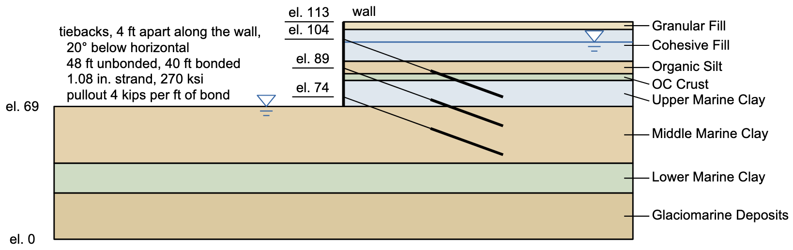

# Homework - Tieback Wall

Pockoski and Duncan (2000) compared eight slope stability programs on a set of reinforced slopes. Their Slope No. 4 is a 44 ft excavation held by a wall with three rows of tiebacks, in layered fill and marine clay. In this homework you will analyze it in XSLOPE Studio and compare your results with theirs. The data are in feet and pounds, as published. Use Spencer's method unless a step says otherwise.

{width="850"}

| Layer | Top (el., ft) | γ (lb/ft³) | c (lb/ft²) | φ (°) |
|-------|:-------------:|:----------:|:----------:|:-----:|
| Granular Fill | 113 | 120.4 | 0 | 30 |
| Cohesive Fill | 109 | 114.7 | 0 | 30 |
| Organic Silt | 92.5 | 110.2 | 900 | 0 |
| OC Crust | 86 | 117.8 | 2,485 | 0 |
| Upper Marine Clay | 82.5 | 117.8 | 1,670 | 0 |
| Middle Marine Clay | 69 | 117.8 | 960 | 0 |
| Lower Marine Clay | 39.5 | 117.8 | 1,085 | 0 |
| Glaciomarine Deposits | 24 | 147.1 | 1,500 | 0 |

The wall is at x = 200 ft. The water table is at the ground in front of the wall (el. 69) and at el. 102.5 behind it. The model has been prepared for you, with everything but the tiebacks, and with a starting circle tangent to the top of the glaciomarine deposits:

[xslope_tieback_wall.xlsx](files/xslope_tieback_wall.xlsx)

Open it in XSLOPE Studio with **File → Open**, and run it with **Run LEM…**.

**(a) The excavation without tiebacks**

Run a search from the starting circle. What is the critical factor of safety? Save a PNG of the solution.

**(b) The capacity of a tieback**

Each tieback is a 1.08 in. diameter strand of 270 ksi steel, 48 ft unbonded and 40 ft bonded, and the grout bond allows a pullout of 4 kips per foot of bond. What tensile force can the strand carry, and what pullout force can the bond carry? The smaller is the tieback's capacity, Tmax.

**(c) The tiebacks**

Add the three rows in the **Reinforcement lines** editor. Each runs from its head on the wall at x = 200, 20° below horizontal, for 88 ft:

| Parameter | Value |
|-----------|-------|
| End 1 (the head) | (200, 104), (200, 89), and (200, 74) |
| End 2 | 88 ft from the head: x = 200 + 88 cos 20°, y = head − 88 sin 20° |
| Type | Tieback |
| Tmax | your answer to (b), in lb |
| Spacing | 4 |
| Lp1 | 0, so the head holds the full force at the wall |
| Lp2 | 40, the bond length, along which the grout develops the force |

Search again from the starting circle. What is the factor of safety? Pockoski and Duncan report F = 1.14 by Spencer's method in UTEXAS4 and SLOPE/W and 1.15 in Slide, and give 1.12 to 1.16 as their best estimate. Save a PNG of the solution.

**(d) What the tiebacks do**

Read the **Log**. Which rows cross the critical circle, and what force does each give it per foot of wall? Compare that with the 40,000 lb per foot of wall a row can hold (Tmax divided by the spacing). Why did the tiebacks raise the factor of safety so little between (a) and (c)?

**(e) Other methods**

Put the critical circle from (c) in the **Circles** editor and run it as a **Single surface** by Bishop's method, Morgenstern-Price, and the Ordinary Method of Slices. Pockoski and Duncan report 1.14 to 1.15 by Bishop's method, 1.14 by Morgenstern-Price (SLOPE/W), and 1.12 to 1.13 by the Ordinary Method. How do your results compare?

**(f) Grid search**

Turn on **Grid search** and run once more. Does it find anything more critical than your search from the starting circle?

**(g) Longer tiebacks**

Lengthen the unbonded part of every row to 68 ft and then to 88 ft, keeping the 40 ft bond at the far end, and search again each time. What is the factor of safety for each length, and what does the Log say now about the force each row gives the critical circle? What would you tell the designer?

Save your model from (g) with the 88 ft unbonded length.

## Submission

Save your model with **File → Save As**, and use the **Save…** button above the plot to save a PNG of the solutions for parts (a) and (c). Put the two PNGs, the model, and your answers to the questions (a PDF) in a single zip archive, and upload it to Learning Suite.

!!! note "Do not put your name or NetID in the file"
    Learning Suite records who submitted each file, so your name is not needed
    inside the file itself. Leaving it out means your work can be graded
    anonymously, which keeps grading fair. This applies to scans and photos
    too — please don't write your name on the page.

## Grading Rubric

**Total: 30 points**

| Criteria | Points |
|----------|:------:|
| Part A: Factor of safety without tiebacks | 3 |
| Part B: Strand and bond capacities, and Tmax | 4 |
| Part C: Factor of safety with the tiebacks, compared with the published values | 6 |
| Part D: The force each row gives the critical circle, and why the tiebacks help so little | 6 |
| Part E: The other methods, compared with the published values | 4 |
| Part F: Grid search | 2 |
| Part G: Longer tiebacks, and the recommendation | 5 |

Source: Pockoski, M., and Duncan, J. M. (2000). *Comparison of Computer Programs for Analysis of Reinforced Slopes.* Center for Geotechnical Practice and Research, Virginia Tech, Blacksburg, VA. Slope No. 4.
