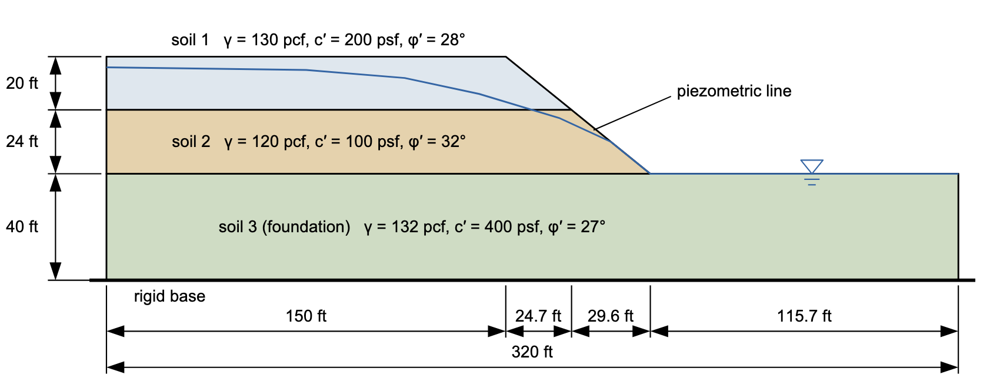
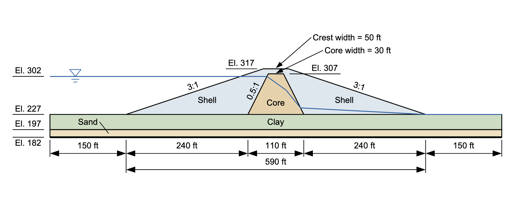

# Exercise - Seepage/Slope Stability Integration

In this exercise you will go back to two slopes you have already solved with a piezometric line, take their pore pressures from a finite element seepage analysis instead, and compare the factors of safety. Both analyses run in one XSLOPE Studio file. In **Seepage** mode, you build the mesh and run the seepage analysis. Then you set **u** to `seep` for each material, and the stability analysis in **LEM** mode reads its pore pressures from the seepage solution.

## Problem 1 - The Spreadsheet Slope

This is the slope you solved by hand in the method of slices spreadsheets ([Ordinary Method of Slices](../02_limiteq1/limiteq1_class.md), [Janbu and Bishop](../03_limiteq2/limiteq2_class.md), and [Spencer](../03_limiteq2/limiteq2_hw.md)) and in XSLOPE in Problem 1 of [Stability Analysis with XSLOPE, Part 2](../04_xslope/xslope_class2.md), with the same soils and the same piezometric line.

{width="950"}

Open this file in XSLOPE Studio with **File → Open**. It is the solution model from that XSLOPE exercise, with the piezometric line and the spreadsheet circle:

[xslope_spreadsheet_slope.xlsx](files/xslope_spreadsheet_slope.xlsx)

### Part a - Piezometric line

Run Spencer's method twice: once with **Analysis** set to **Single surface**, on the spreadsheet circle, and once with **Auto search**. Note both factors of safety and where the critical surface is.

### Part b - Seepage analysis

1. In **Global parameters**, set the time unit to `day`.

2. In the **Materials** editor, set **u** to `seep` for all three soils and enter their seepage properties:

    | Material | k1 = k2 (ft/day) | α | kr0 | h0 |
    |:--------:|:----------------:|:-:|:------:|:--:|
    | soil 1 | 0.5 | 0 | 0.0001 | −1 |
    | soil 2 | 1 | 0 | 0.0001 | −1 |
    | soil 3 | 0.01 | 0 | 0.0001 | −1 |

3. Switch to **Seepage** mode. In **Seep BC**, give the left edge, from (0, 0) to (0, 80), a specified head of 80 ft, where the piezometric line starts. Make the slope face and the ground beyond the toe an exit face, from (150, 84) through (174.7, 64) and (204.3, 40) to (320, 40). The right edge and the base carry no flow.

4. Build the mesh with the default settings, and run the seepage analysis. Where does the phreatic surface meet the slope face? The piezometric line meets it at el. 52.

5. Switch to **LEM** mode, and run the spreadsheet circle and the search again. How do the factors of safety compare with part a, and why?

Solution: [xslope_spreadsheet_slope_SEEP_solution.xlsx](files/xslope_spreadsheet_slope_SEEP_solution.xlsx). On the spreadsheet circle, F = 1.580 with the piezometric line and 1.726 with the seepage solution. The search finds 0.765 with the line, on the lower face, and 0.972 with the seepage, on a longer surface from just behind the crest (x = 146) to the toe. The seepage solution's phreatic surface meets the face at el. 46, 6 ft below the piezometric line, so the line was conservative here. Dry, the same search finds 1.133, so the water is what takes this slope below 1, and the higher water of the piezometric line takes it further.

## Problem 2 - The Earth Dam

This is the dam you analyzed with a piezometric line in Problem 1 of the [XSLOPE LEM, Part 2](../04_xslope/xslope_hw2.md) homework, Example 2 in Section 6.13.6 of the textbook (pp. 121–123, Figs. 6.41 to 6.43). Under this dam, the foundation sand carries water from the reservoir to the downstream side, where it has to come up through the clay to get out. A single piezometric line can't represent that.

{width="950"}

Open this file, the model of the downstream side from that homework, with the piezometric line and two starting circles:

[xslope_earth_dam_down.xlsx](files/xslope_earth_dam_down.xlsx)

### Part a - Piezometric line

Run an **Auto search** by Spencer's method. Note the factor of safety and how deep the critical circle goes.

### Part b - Seepage analysis

1. In **Global parameters**, set the time unit to `min`. The book gives the conductivities in ft/min.

2. In the **Materials** editor, set **u** to `seep` for all four materials and enter their seepage properties:

    | Material | k1 = k2 (ft/min) | α | kr0 | h0 |
    |:--------:|:----------------:|:-:|:-----:|:--:|
    | Shell | 1 × 10⁻² | 0 | 0.001 | −5 |
    | Core | 1 × 10⁻⁶ | 0 | 0.001 | −5 |
    | Clay | 1 × 10⁻⁵ | 0 | 0.001 | −5 |
    | Sand | 1 × 10⁻³ | 0 | 0.001 | −5 |

    h0 is −5 ft here instead of the −1 you have used before. The change from saturated to unsaturated conductivity has to spread over about one element, and on a dam this size, at the default mesh, −1 is too sharp for the seepage solution to converge.

3. Switch to **Seepage** mode. In **Seep BC**, give the reservoir a specified head of 302 ft, on the upstream ground and face from (−150, 227) through (0, 227) to (225, 302). Give the ground beyond the downstream toe, from (590, 227) to (740, 227), a specified head of 227 ft, for tailwater at the ground surface. Make the downstream face, from (320, 317) to (590, 227), an exit face. Leave the two side edges and the base with no boundary condition, so no water crosses them.

4. Build the mesh with the default settings, and run the seepage analysis. Look at the head contours under the downstream toe. Is the head in the sand higher or lower than the ground surface there? Which way is the water flowing through the clay?

5. Switch to **LEM** mode, and run the **Auto search** by Spencer's method again. What does it find?

6. Turn on **Grid search** and run it again.

7. Turn **Grid search** off, turn on **Ignore surficial (skin) failures**, and run the search with a **Min slip depth** of 10, 20, and 30 ft. Compare these factors of safety with part a.

Solution: [xslope_earth_dam_down_SEEP_solution.xlsx](files/xslope_earth_dam_down_SEEP_solution.xlsx).

With the piezometric line, the search finds F = 1.558 on a circle tangent to el. 197, the bottom of the clay. The book gets 1.57.

In the seepage solution, the head in the sand under the downstream toe is about 240.6 ft, 13.6 ft above the ground, and it falls to 235.7 ft at el. 208, in the clay, so water is flowing up through the clay to the toe. At el. 208 the pore pressure is 27 ft of water, against 19 ft below a piezometric line at the ground.

With those pore pressures, the search from the starting circles shrinks to a sliver less than a foot long at the toe, with F = 0.121: the water coming up leaves almost no effective stress right at the surface. Grid search finds 1.099 on a slough about 18 ft long at the toe, close to the book's 1.11 for shallow circles there. With a minimum slip depth of 10, 20, and 30 ft, F = 1.230, 1.296, and 1.320. The deepest of these is 15% below the 1.558 from the piezometric line. The book finds 1.37 for circles tangent to el. 197 with seepage, against 1.57 with the line.
