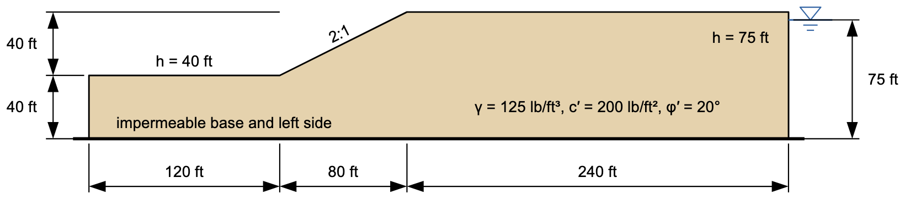

# Homework - Seepage/Slope Stability Integration

This slope is Example 1 in Section 6.13.6 of the textbook (p. 120, Figs. 6.39 and 6.40). The authors found its pore pressures with a finite element seepage analysis and then computed the factor of safety with them two ways: straight from the seepage solution, and from a piezometric line traced along the solution's zero-pressure line. Both gave F = 1.14. Rocscience reproduces the example as problem 71 of the Slide2 verification manual. In this homework you will repeat the analysis in XSLOPE Studio. The data are in feet and pounds, as published.

{width="900"}

Record your answers on this answer sheet, which has a section for each part:

[seep_slope_hw_answers.docx](files/seep_slope_hw_answers.docx)

**(a) The seepage analysis**

Start with **File → New** in **Seepage** mode, and set the time unit to `day` in **Global parameters**. Build the cross section shown above: the ground runs from (0, 40) to (120, 40), up the 2:1 face to (200, 80), and on to (440, 80), over a base at el. 0. The soil is the same throughout:

| Parameter | Value |
|-----------|-------|
| γ | 125 lb/ft³ |
| c′ | 200 lb/ft² |
| φ′ | 20° |
| k1 and k2 | 1 ft/day |
| α, kr0, h0 | 0, 0.001, −1 |

The total heads are measured from the base: 40 ft on the ground beyond the toe, from (0, 40) to (120, 40), and 75 ft on the right side, from (440, 0) to (440, 80). The slope face, from (120, 40) to (200, 80), is free to drain, so make it an exit face. The base, the left side, and the crest carry no flow, so they need no boundary condition.

Build the mesh with the default settings (quadratic triangles, auto-size, 100 divisions), and run the seepage analysis. What is the flow rate? At what elevation does the phreatic surface meet the slope face? Compare your phreatic surface with the book's zero-pressure line in Fig. 6.40, and use the **Save…** button above the plot to save a PNG of the solution.

The book gives no hydraulic conductivity. Change k1 and k2 to 10 ft/day and run the seepage again. Which of your two answers changes, and which doesn't? Why? Then set k1 and k2 back to 1 ft/day and run it once more.

Enter your answers in part (a) of the answer sheet.

**(b) The factor of safety from the seepage solution**

Set **u** to `seep` for the soil, switch to **LEM** mode, and add a starting circle with Xo = 190, Yo = 140, and Depth = 20. Run an **Auto search** by Spencer's method. What is the factor of safety? Compare it with the book's 1.14 and with Slide2's 1.141. Save a PNG of the critical solution, and save the model with **File → Save As**.

Enter your answers in part (b) of the answer sheet.

**(c) The factor of safety from a piezometric line**

The book also traced the zero-pressure line of its seepage solution and used it as a piezometric line. These are its points, as Slide2 reads them from the figure:

| x (ft) | y (ft) |
|:------:|:------:|
| 0 | 40 |
| 120 | 40 |
| 127.4 | 43.2 |
| 147.4 | 46.2 |
| 181.7 | 50.7 |
| 232.3 | 56.7 |
| 326.8 | 65.7 |
| 440 | 75 |

Enter them as a piezometric line, set **u** to `piezo`, and run the same search. What is the factor of safety? Compare it with part (b) and with the book's 1.14. Where does the line meet the slope face, compared with your phreatic surface in part (a)? Save this model under a new name.

Enter your answers in part (c) of the answer sheet.

**(d) Why they agree**

In class, the piezometric line and the seepage analysis gave very different factors of safety for the earth dam. Why do they agree for this slope? Think about which way the water flows beneath the toe in each case.

Enter your answer in part (d) of the answer sheet.

## Submission

Put the following files in a zip archive:

- The model from part (b), with **u** = `seep`
- The model from part (c), with the piezometric line
- The answer sheet, with your pictures, saved as a PDF

Upload the zip archive via Learning Suite.

!!! note "Do not put your name or NetID in the file"
    Learning Suite records who submitted each file, so your name is not needed
    inside the file itself. Leaving it out means your work can be graded
    anonymously, which keeps grading fair. This applies to scans and photos
    too — please don't write your name on the page.

## Grading Rubric

**Total: 30 points**

| Criteria | Points |
|----------|:------:|
| Part A: Model, materials, and boundary conditions as given | 5 |
| Part A: Flow rate and exit point, at both conductivities, and what k changes | 6 |
| Part B: Factor of safety from the seepage solution, compared with the book and Slide2 | 7 |
| Part C: Factor of safety from the piezometric line, compared with part (b) and the book | 6 |
| Part D: Why the two agree here and not for the earth dam | 6 |

Source: Duncan, J. M., Wright, S. G., and Brandon, T. L. (2014). *Soil Strength and Slope Stability*, 2nd ed., Wiley, Section 6.13.6. Rocscience Inc. [*Slide2 Slope Stability Verification Manual*](https://www.rocscience.com/help/slide2/verification-theory/verification-manuals), problem 71.
