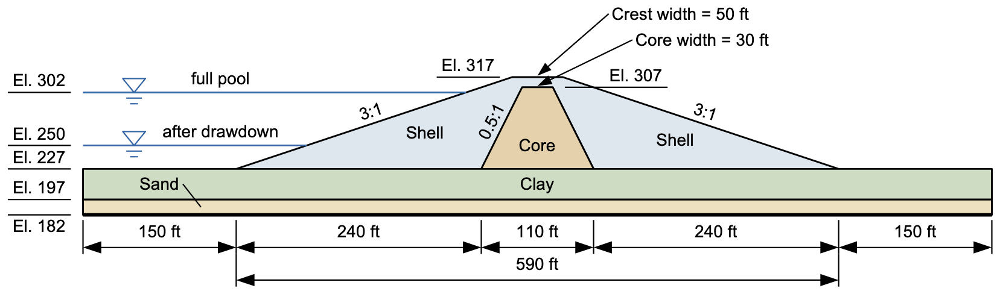

# Exercise - Rapid Drawdown Analysis with XSLOPE

In this exercise you will run a rapid drawdown analysis on the upstream side of the earth dam from Problem 1 of the [XSLOPE LEM, Part 2](../04_xslope/xslope_hw2.md) homework, where you analyzed both sides with a piezometric line, and from Problem 2 of the [seepage/slope stability exercise](../07_seep_slope/seep_slope_class.md), where you gave its downstream side a seepage analysis. The reservoir is drawn down from El. 302 to El. 250. You will describe the water before and after the drawdown two ways, first with two steady seepage solutions and then with a transient seepage run, and compare the factors of safety. For the details of the method, see the [XSLOPE rapid drawdown documentation](https://xslope.org/en/latest/lem/rapid/){:target="_blank"}.

{width="950"}

Open this file in XSLOPE Studio with **File → Open**:

[xslope_earth_dam_up.xlsx](files/xslope_earth_dam_up.xlsx)

It is the solution model from Problem 2 of the seepage/slope stability exercise, set up for the upstream side:

- The two starting circles are on the upstream side.
- The piezometric line is gone, since the seepage solutions replace it.
- The conductivities are in ft/day instead of ft/min, so the drawdown schedule in part b can be in days.
- The materials have the storage properties that the transient run in part b needs.
- **Seep BC** Set 1 is the full pool from that exercise, with the reservoir at El. 302 and tailwater at the ground beyond the downstream toe.

## Part a - Two steady seepage solutions

1. In the **Materials** editor, enter the $K_c = 1$ envelopes of the two materials that don't drain during the drawdown:

    | Material | d (psf) | ψ (deg) |
    |:--------:|:-------:|:-------:|
    | Core | 300 | 20 |
    | Clay | 100 | 18 |

    Leave **d** and **psi** at 0 for the shell and the sand, which declares them free-draining. Compare their conductivities with those of the core and the clay. Why can they be treated that way?

2. Switch to **Seepage** mode and open **Seep BC**. On the **Set 2 (rapid drawdown)** tab, press **Add head** twice, and describe the dam after the drawdown with the same three boundaries Set 1 has, with the reservoir at El. 250. Each table of points below is laid out like the editor's, x then y, so you can copy its values and paste them in.

    *Head 1, the lowered pool*, with **Head value (ft)** 250:

    | x | y |
    |:---:|:---:|
    | -150 | 227 |
    | 0 | 227 |
    | 69 | 250 |

    *Head 2, the tailwater*, with **Head value (ft)** 227:

    | x | y |
    |:---:|:---:|
    | 590 | 227 |
    | 740 | 227 |

    *Exit face*:

    | x | y |
    |:---:|:---:|
    | 320 | 317 |
    | 590 | 227 |

3. Build the mesh with the default settings, and click **Run → Run Seep…**. Because the file has two boundary sets, one steady run solves both: **Seep · Solution** is the full pool, and **Seep · Solution 2** is the lowered pool. Compare the two phreatic surfaces.

4. Switch to **LEM** mode, and click **Run → Run LEM…**. Leave **Method** on Spencer, **Analysis** on **Auto search**, and **Number of slices** at 40, and tick **Rapid drawdown**. When the search converges, the Log gives the factor of safety of each stage on the critical circle. Which stage governs, and where is the critical circle?

5. Run it again with **Rapid drawdown** unticked. This run reads only Set 1's solution, with drained strengths throughout: it is the dam at full pool, before the drawdown. How much of the factor of safety does the drawdown take away?

6. Save the model with **File → Save As**.

## Part b - A transient seepage run

Set 2 describes the dam long after the drawdown, once it has finished draining and the water inside has settled to the lowered pool. In this part the pool falls at 1 ft/day, and stage 2 reads the pore pressures on the day it reaches El. 250.

1. Save the model under a new name. Open **Seep BC**, and on the **Set 2 (rapid drawdown)** tab remove both heads and the exit face's points. The schedule below gives the lowered pool, so Set 2 isn't needed.

2. In **Seepage** mode, click **Transient** in the Inputs dock. Rename the first series `pool`, and enter the schedule: full pool for 5 days, then 52 ft of drawdown over 52 days.

    | time | pool |
    |:----:|:----:|
    | 0 | 302 |
    | 5 | 302 |
    | 57 | 250 |

    Set **Duration** to 400 days and **Save interval** to 100 days. Set **Stage 1 time** to 0, the full pool, and **Stage 2 time** to 57, the day the pool reaches El. 250.

3. Open **Seep BC**, select Head 1 on Set 1, set its **Type** to `reservoir`, and type `pool` in place of its head value. The reservoir boundary now follows the schedule.

4. Click **Run → Run Seep…**, set **Run type** to **Transient (time-dependent)**, and click **Run**. On the **Seep · Transient** tab, step to t = 57 and compare the frame with the steady **Seep · Solution 2** from part a. Where is the water still higher than in Solution 2?

5. Switch to **LEM** mode and run **Run → Run LEM…** again, with the same settings as part a. The dialog now shows the two stage times. Which stage governs? How does the factor of safety compare with part a's two results, the full pool and the two steady solutions, and why is it lower than the two steady solutions give?

Solutions: [xslope_earth_dam_up_STEADY_solution.xlsx](files/xslope_earth_dam_up_STEADY_solution.xlsx) and [xslope_earth_dam_up_TRANSIENT_solution.xlsx](files/xslope_earth_dam_up_TRANSIENT_solution.xlsx).

**Part a.** The shell (14.4 ft/day) and the sand (1.44 ft/day) are 100 to 10,000 times more pervious than the clay (0.0144 ft/day) and the core (0.00144 ft/day). Any pore pressure that shearing generates in them drains away as fast as it is generated, so they keep their drained strengths, computed with the pore pressures the seepage solution gives them in each stage. The full-pool solution carries 3.22 ft³/day per ft and the lowered pool 0.942.

With **Rapid drawdown** ticked, the search finds F = 1.228:

| Stage | F |
|:-----:|:-:|
| 1, full pool, drained | 2.282 |
| 2, drawn down, undrained | 1.234 |
| 3, drawn down, drained | **1.228** |

The critical circle starts on the upstream face just above the toe (x = 3), runs along the bottom of the clay (el. 197), and comes out on the downstream face just past the crest (x = 331). Stage 3 governs, but only just. On two core slices near the crest the drained strength came out lower than the undrained strength and replaced it. Of the circle's 39 slices, 26 have their bases in the clay, 9 in the core, and 4 in the shell.

With **Rapid drawdown** unticked, the dam at full pool has F = 1.904, on a shallower circle from x = −8 to x = 284. Stage 1's 2.282 is higher because it is computed on the drawdown's critical circle, not this one. The drawdown takes the factor of safety from 1.90 to 1.23. It removes the water that pressed on the upstream face, while the core and the clay keep the strength the full pool gave them.

**Part b.** The water in the upstream shell has nearly followed the pool down: its head at (150, 240) is 255.5 ft, about 6 ft above the 249.9 ft it settles at once the dam has finished draining (Solution 2). The clay and the sand under the upstream slope have come about two-thirds of the way down, from 286 to 294 ft at full pool to 260 to 262 ft, against the 245 to 248 ft they settle at. The sand is pervious, but the clay seals it from the reservoir, so its head can come down only as fast as the clay lets its water out. The core hasn't moved: 279 ft in the middle, as at full pool, against 240 ft in Solution 2.

The search finds F = 1.165:

| Stage | F |
|:-----:|:-:|
| 1, full pool, drained | 2.199 |
| 2, drawn down, undrained | 1.249 |
| 3, drawn down, drained | **1.165** |

The circle is nearly the same, from x = −17 on the ground in front of the toe to x = 330, along the bottom of the clay. Stage 2 is about the same as in part a, because it sets the strengths of the core and the clay from the stage 1 stresses, and their pore pressures at t = 57 don't enter it. Stage 3 checks the drained strength at those pore pressures. With the clay and the core still holding much of the full pool's head, the drained strength came out lower than the undrained strength on 13 of the 26 clay slices, along the upstream half of the circle, and on 6 of the 9 core slices.

Across the three runs, the factor of safety goes from 1.904 at full pool to 1.228 with the two steady solutions and 1.165 with the transient run. The second steady solution assumes the dam has finished draining by the time the pool reaches El. 250. At 1 ft/day the clay, the sand, and the core haven't, and the transient run gives the pore pressures they actually have on the day the pool reaches El. 250.
