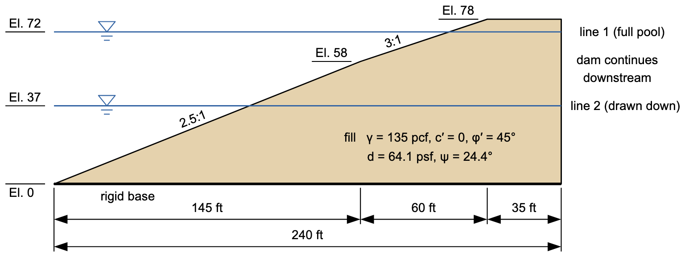

# Homework - Rapid Drawdown Analysis

Pilarcitos Dam is a homogeneous earthfill dam that slid on its upstream face when its reservoir was drawn down. Duncan, Wright, and Wong (1990) used it, with Walter Bouldin Dam, to test the three-stage method from the lecture, and computed F = 1.05 for the drawdown. Rocscience reproduces their analysis as problem 97 of the Slide2 verification manual. In this homework you will repeat it in XSLOPE Studio. The paper gives only the dam's upstream slope and crest, so the section ends partway across the crest, at x = 240. The slide was on the upstream face, well clear of that cut. The section sits on a rigid base, with elevations measured from the base, and the reservoir is drawn down from El. 72 to El. 37.

{width="880"}

Record your answers on this answer sheet, which has a section for each part:

[rapid_hw_answers.docx](files/rapid_hw_answers.docx)

**(a) The drawdown analysis**

Start with **File → New** in **LEM** mode, and build the section shown above. Each table of points below is laid out like Studio's editors, x then y, so you can copy its values and paste them in.

The dam is one material, so its section is one profile line, from the upstream toe up the 2.5:1 and 3:1 faces and along the crest, over a rigid base at El. 0 (**Max depth** = 0):

| x | y |
|:---:|:---:|
| 0 | 0 |
| 145 | 58 |
| 205 | 78 |
| 240 | 78 |

The material, with d and ψ its $K_c = 1$ envelope:

| Parameter | Value |
|-----------|-------|
| γ | 135 lb/ft³ |
| c′ | 0 |
| φ′ | 45° |
| d | 64.1 lb/ft² |
| ψ | 24.4° |
| u | `piezo` |

Enter the two piezometric lines, each across the whole section. *Line 1*, the full pool:

| x | y |
|:---:|:---:|
| 0 | 72 |
| 240 | 72 |

*Line 2 (rapid drawdown)*, after the drawdown:

| x | y |
|:---:|:---:|
| 0 | 37 |
| 240 | 37 |

Leave **Water loads** on `auto` in **Global parameters**, so that XSLOPE makes the reservoir's load on the face from each line. Add a starting circle with Xo = 90, Yo = 95, and Depth = 20.

Click **Run → Run LEM…**. Leave **Method** on Spencer, **Analysis** on **Auto search**, and **Number of slices** at 40, and tick **Rapid drawdown**. What is the factor of safety of each stage on the critical circle, and what is the rapid drawdown factor of safety? Compare it with Duncan, Wright, and Wong's 1.05 and Slide2's 1.043. Save a PNG of the critical solution, and save the model with **File → Save As**.

Enter your answers in part (a) of the answer sheet.

**(b) Which stage governs**

Which stage governs? Stage 2 gives the fill the undrained strength that the full pool's consolidation stresses gave it, and stage 3 replaces that strength with the drained strength wherever the drained strength is lower. Where on the critical circle would you expect the drained strength to be the lower one, and why? Think about where the effective stresses are low, and compare the two envelopes there.

Enter your answer in part (b) of the answer sheet.

**(c) A drained analysis at the low pool**

Save the model under a new name. In **Piezometric lines**, give Line 1 the points of Line 2 (paste Line 2's table from part (a)), and remove Line 2's points. Untick **Rapid drawdown** and run the same search. This is a drained analysis at the low pool: it assumes that the water in the dam came down with the pool. What is the factor of safety? Compare it with part (a). The dam slid. Which analysis agrees with that, and why does the other one miss it?

Enter your answers in part (c) of the answer sheet.

## Submission

Put the following files in a zip archive:

- The model from part (a), with the two piezometric lines
- The model from part (c), with the line at El. 37
- The answer sheet, with your picture, saved as a PDF

Upload the zip archive via Learning Suite.

!!! note "Do not put your name or NetID in the file"
    Learning Suite records who submitted each file, so your name is not needed
    inside the file itself. Leaving it out means your work can be graded
    anonymously, which keeps grading fair. This applies to scans and photos
    too — please don't write your name on the page.

## Grading Rubric

**Total: 30 points**

| Criteria | Points |
|----------|:------:|
| Part A: Model as given (section, material, both piezometric lines, starting circle) | 5 |
| Part A: Factor of safety of each stage and the rapid drawdown factor of safety, compared with the paper and Slide2 | 7 |
| Part B: Which stage governs, and where and why the drained strength is lower | 8 |
| Part C: Drained factor of safety at the low pool, compared with part (a), and why it misses the failure | 10 |

Sources: Duncan, J. M., Wright, S. G., and Wong, K. S. (1990). "Slope stability during rapid drawdown." *Proceedings of the H. Bolton Seed Memorial Symposium*, Vol. 2, BiTech, Vancouver, 253–272. Duncan, J. M., Wright, S. G., and Brandon, T. L. (2014). *Soil Strength and Slope Stability*, 2nd ed., Wiley, Chapter 9. Rocscience Inc. [*Slide2 Slope Stability Verification Manual*](https://www.rocscience.com/help/slide2/verification-theory/verification-manuals), problem 97.
