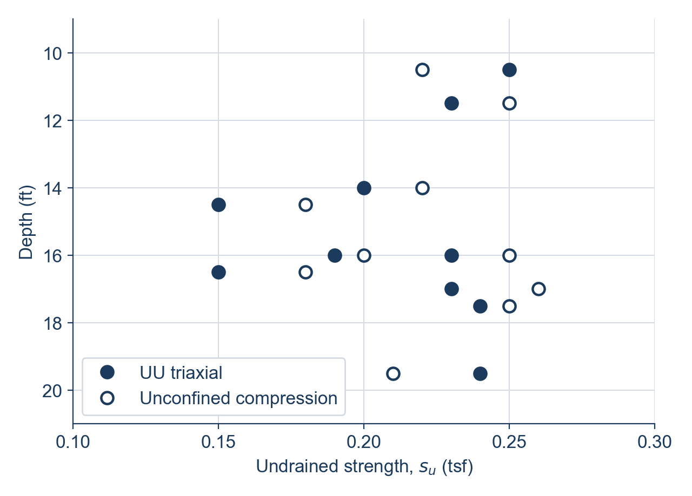
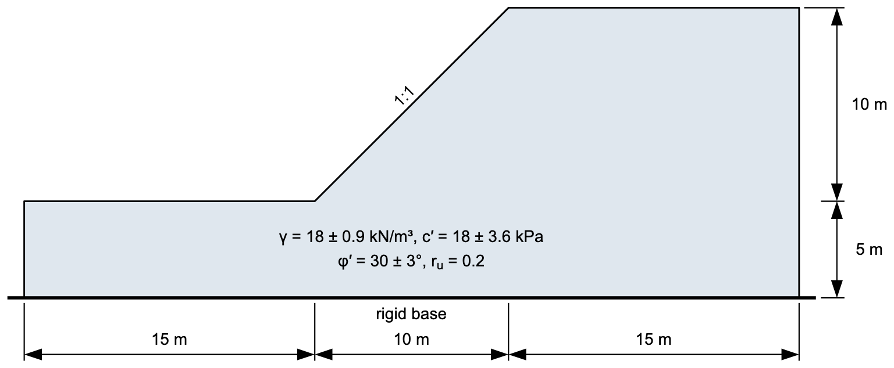
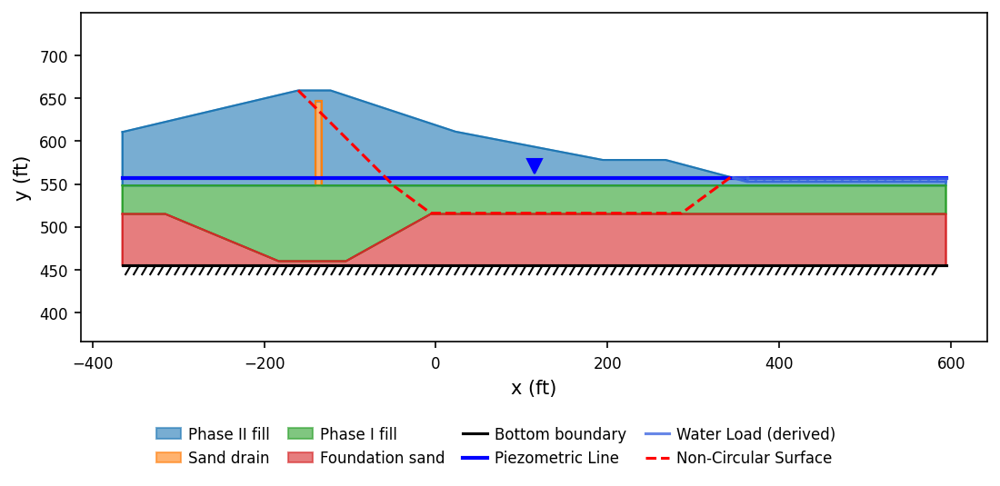

# Exercise - Reliability Analysis

In this exercise you will compute a probability of failure by hand, and then run XSLOPE's Taylor series and Monte Carlo on two published problems. [Tutorial LEM-11](https://xslope.org/en/latest/tutorials/lem11_reliability/){:target="_blank"} shows the **Reliability** dialog step by step.

## Problem 1 - Bay Mud Strength by Hand

These are 20 undrained strengths of San Francisco Bay Mud (Duncan, Wright, and Brandon 2014, Table 13.3).

{width="615"}

Excel starter file: [reliability_calc.xlsx](files/reliability_calc.xlsx) 
Python starter file:  (upload [bay_mud_data.csv](files/bay_mud_data.csv) when it asks)

1. Compute the mean, the standard deviation, and the COV. Is the COV inside Table 13.4's range for undrained strength?

2. Estimate σ from the range (highest minus lowest) with the 3σ rule (range/6) and with N = 4 (range/4). Which is closer to step 1?

3. Duncan (2000) found F = 1.17 and $COV_F$ = 16% for the LASH trench, cut in this Bay Mud. Compute $\beta_{LN}$ and $P_f$:

    $$\beta_{LN} = \dfrac{\ln\left(F_{MLV}\big/\sqrt{1 + COV_F^2}\right)}{\sqrt{\ln\left(1 + COV_F^2\right)}}, \qquad P_f = 1 - \Phi(\beta_{LN})$$

    In Excel, $\Phi(\beta)$ is `NORM.S.DIST(β, TRUE)`.

Solution: [reliability_calc_KEY.xlsx](files/reliability_calc_KEY.xlsx) and 

**1.** Mean 0.2165 tsf, σ = 0.0331 tsf, COV = 15.3%, near the low end of Table 13.4's 13% to 40%.

**2.** The range is 0.11 tsf: 0.0183 tsf by the 3σ rule and 0.0275 tsf by N = 4. Twenty values span only 3.3σ, not 6σ, so the 3σ rule underestimates σ. N = 4 is closer, and more conservative.

**3.** $\beta_{LN}$ = 0.908 and $P_f$ = 18.2%, Duncan's 18%.

## Problem 2 - A Homogeneous Slope

Li and Lumb's (1987) slope, which Hassan and Wolff (1999) used to test reliability analysis, and XSLOPE's verification problem [VP36](https://xslope.org/en/latest/verification/rocscience/#vp36){:target="_blank"}. Each property is its most likely value ± its standard deviation.

{width="878"}

Open this file in XSLOPE Studio: [xslope_li_lumb_slope.xlsx](files/xslope_li_lumb_slope.xlsx)

1. Click **Run → Run LEM…** with **Method** set to Bishop's Simplified. What is F?

2. Click **Run → Reliability…**, set **LEM method** to Bishop's Simplified, and click **Run** with the Taylor series. What are β and $P_f$ for a normal and for a lognormal F? Why do they differ?

3. Which property contributes most to $\sigma_F$ (the ΔF table in the Log pane)?

4. Hassan and Wolff found F = 1.334 and β = 2.336. How do your results compare?

Solution:

**1.** F = 1.334, Hassan and Wolff's 1.334.

**2.** $\sigma_F$ = 0.164. Lognormal: $\beta_{LN}$ = 2.284, $P_f$ = 1.12%. Normal: $\beta_N$ = 2.030, $P_f$ = 2.12%. The Taylor series gives only the mean and σ of F, so $P_f$ depends on the shape assumed, and at a $P_f$ this small the two shapes' tails differ most.

**3.** ΔF is 0.283 for c, 0.150 for φ, and 0.071 for γ: c carries 74% of $\sigma_F^2$, φ 21%, and γ 5%.

**4.** $\beta_{LN}$ is 2% below their 2.336. A $P_f$ near 1% is typical of a conventional design at F ≈ 1.33.

## Problem 3 - When the Taylor Series Can't Run

Wolff and Harr's (1987) analysis of Clarence Cannon Dam, on the slip surface they chose: XSLOPE's verification problem [VP34](https://xslope.org/en/latest/verification/rocscience/#vp34){:target="_blank"}.

{width="845"}

Open this file in XSLOPE Studio: [xslope_cannon_dam.xlsx](files/xslope_cannon_dam.xlsx)

1. In **Materials**, with **Reliability** shown, what is the Phase I fill's φ ± σ? Click **Run → Reliability…** with the Taylor series. What does the dialog say?

2. Change **Method** to `Monte Carlo`, untick **Search for the critical surface at the mean values** (the file's surface is Wolff and Harr's), and click **Run** (about two minutes). What is $P_f$?

3. Why can Monte Carlo run when the Taylor series can't? Wolff and Harr got 4.55% and Slide2 0.355%. Why so far apart?

Solution:

**1.** φ = 6.34° ± 7.87° (a COV of 124%), so φ − σ = −1.53°. The **Run** button stays gray: the Taylor series needs a solve at φ − σ, and a negative friction angle has no meaning.

**2.** $P_f$ = 1.64% (162 of the 9,893 realizations that solved), with a mean F of 2.529 and $\sigma_F$ = 0.806.

**3.** Monte Carlo draws φ from its distribution and cuts negative draws off at zero. With a COV of 124%, a fifth of the distribution lies below zero, and how each analysis treats that part moves the answer more than the method does. A friction angle known only to ±8° can't support a precise probability of failure.

Sources: Duncan, J. M. (2000). "Factors of safety and reliability in geotechnical engineering." *Journal of Geotechnical and Geoenvironmental Engineering*, 126(4), 307–316. Duncan, J. M., Wright, S. G., and Brandon, T. L. (2014). *Soil Strength and Slope Stability*, 2nd ed., Wiley, Chapter 13. Hassan, A. M., and Wolff, T. F. (1999). "Search algorithm for minimum reliability index of earth slopes." *Journal of Geotechnical and Geoenvironmental Engineering*, 125(4), 301–308. Li, K. S., and Lumb, P. (1987). "Probabilistic design of slopes." *Canadian Geotechnical Journal*, 24(4), 520–535. Wolff, T. F., and Harr, M. E. (1987). "Slope design for earth dams." *Reliability and Risk Analysis in Civil Engineering 2, Proceedings of ICASP5*, Vancouver, 725–732.
