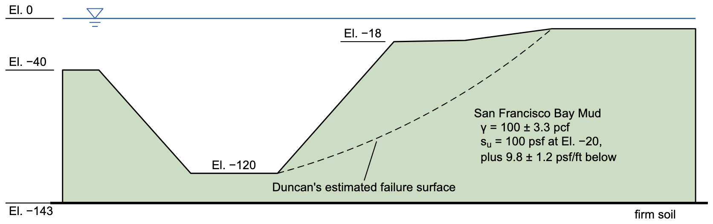
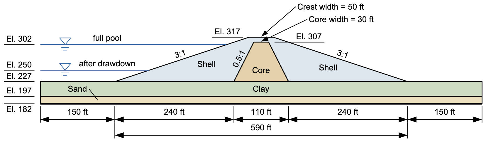

# Homework - Reliability Analysis

In this homework you will repeat Duncan's (2000) reliability analysis of the LASH trench, the slope from the lecture, and then compute the probability of failure of the earth dam from the rapid drawdown exercise. Both are run in XSLOPE Studio. [Tutorial LEM-11](https://xslope.org/en/latest/tutorials/lem11_reliability/){:target="_blank"} shows each step.

Record your answers on this answer sheet, which has a section for each part:

[reliability_hw_answers.docx](files/reliability_hw_answers.docx)

## Problem 1 - The LASH Trench

In August 1970, a trench about 100 ft deep was being dredged underwater in San Francisco Bay for the Port of San Francisco's LASH (Lighter Aboard Ship) terminal. Experience said that underwater slopes in the Bay Mud could be cut at 1:1, and analyses gave a 1:1 slope a factor of safety of 1.25. Cutting the slopes at 0.875:1 saved about $200,000, and with the average strength profile its factor of safety was 1.17. A 250 ft length of the trench failed, and then another 200 ft. Duncan (2000) later analyzed the slope by the Taylor series and found a probability of failure of 18%. Rocscience reproduces his analysis as problem 29 of the Slide2 verification manual, and XSLOPE as its verification problem [VP29](https://xslope.org/en/latest/verification/rocscience/#vp29){:target="_blank"}.

The section below is the trench as it was excavated, from XSLOPE's model of the problem, under water to El. 0 and on firm soil at El. −143. The dashed line is the failure surface Duncan estimated from the soundings made after the failure.

{width="950"}

**(a) The factor of safety on Duncan's surface**

Start with **File → New** in **LEM** mode, set **Units** to Imperial in **Global parameters**, and leave **Water loads** on `auto`, so that XSLOPE makes the water's load on the ground from the piezometric line. Each table of points below is laid out like Studio's editors, x then y, so you can copy its values and paste them in.

The section is one profile line, with **Max depth** = -143:

| x | y |
|:---:|:---:|
| -28 | -40 |
| 0 | -40 |
| 71 | -120 |
| 138 | -120 |
| 228 | -18 |
| 283 | -17 |
| 350 | -8 |
| 461 | -8 |

The Bay Mud, entered in the **Materials** list view with **Reliability** shown, so that the **± σ** boxes appear:

| Parameter | Value | ± σ |
|-----------|-------|:---:|
| γ | 100 lb/ft³ | 3.3 |
| option | `cp` | |
| c | 100 lb/ft² | |
| c/p | 9.8 | 1.2 |
| r-elev | -20 | |
| φ | 0 | |
| u | `none` | |

With the `cp` option the undrained strength is c at the elevation r-elev and grows by c/p lb/ft² for each foot below it, so it is 100 lb/ft² at El. −20 and 1,080 lb/ft² at the bottom of the trench. The total unit weight of 100 lb/ft³ under water gives a buoyant unit weight of 100 − 62.4 = 37.6 lb/ft³, close to Duncan's 38, and its σ of 3.3 lb/ft³ is his. A φ = 0 analysis uses no pore pressures on the slip surface, so **u** is `none`: the piezometric line only places the water.

Enter the water surface as the piezometric line:

| x | y |
|:---:|:---:|
| -28 | 0 |
| 461 | 0 |

Add Duncan's estimated failure surface as the starting circle: Xo = -6.59, Yo = 410.23, and Depth = -139.35.

Click **Run → Run LEM…**, set **Analysis** to **Single surface**, and leave **Method** on Spencer and **Number of slices** at 40. What is the factor of safety on Duncan's surface? Compare it with his 1.17. Save the model with **File → Save As**.

Enter your answers in part (a) of the answer sheet.

**(b) The Taylor series**

Click **Run → Reliability…**, leave **Method** on `Taylor series (TSPM)` and **LEM method** on Spencer, and untick **Search for the critical surface at each solve (MLV and MLV ± σ)**, so that all five solves use Duncan's surface, as he did. Click **Run**. Enter $F^+$, $F^-$, and ΔF for each input, and $\sigma_F$, $COV_F$, and the two reliability indexes and probabilities of failure. Compare them with Duncan's (2000) Table 5:

| Input | $F^+$ | $F^-$ | ΔF |
|-------|:-----:|:-----:|:--:|
| Undrained strength | 1.33 | 1.02 | 0.31 |
| Buoyant unit weight, 38 ± 3.3 lb/ft³ | 1.08 | 1.28 | 0.20 |

with $\sigma_F$ = 0.18, $COV_F$ = 16%, and a probability of failure of 18%. Which input contributes more to $\sigma_F$? A unit weight seldom matters much in a reliability analysis. Why does it matter here?

Your $F^+$ and $F^-$ for the strength are closer to $F_{MLV}$ than Duncan's. By what fraction does a change of one σ(c/p) change the strength at the bottom of the trench? Duncan's $F^+$ and $F^-$ are about 14% above and 13% below his $F_{MLV}$. What does that say about the strength lines he used for $F^+$ and $F^-$?

Save a PNG of the **LEM · Reliability** view.

Enter your answers in part (b) of the answer sheet.

**(c) Monte Carlo**

Open **Run → Reliability…** again, change **Method** to `Monte Carlo`, untick **Search for the critical surface at the mean values**, and leave **MC samples** at 10000. Click **Run**; it takes about half a minute. What are the mean factor of safety, its standard deviation, and the probability of failure? How do they compare with the Taylor series? Which method assumes less?

Enter your answers in part (c) of the answer sheet.

## Problem 2 - The Earth Dam Drawn Down

Go back to the earth dam whose upstream side you drew down from El. 302 to El. 250 in the [rapid drawdown exercise](../08_rapid/rapid_class.md). Start from your model from part a of that exercise, with the core's and the clay's d and ψ and the two boundary sets, or from its posted solution:

[xslope_earth_dam_up_STEADY_solution.xlsx](../08_rapid/files/xslope_earth_dam_up_STEADY_solution.xlsx)

{width="950"}

**(a) The standard deviations**

In **Materials**, with **Reliability** shown, enter each standard deviation in the **± σ** box beside its value. The values below are the model's, each with the standard deviation to enter:

| Material | γ (lb/ft³) | c (lb/ft²) | φ (deg) | d (lb/ft²) | ψ (deg) |
|----------|:----------:|:----------:|:-------:|:----------:|:-------:|
| Shell | 125 ± 7 | 0 | 34 ± 6 | | |
| Core | 122 ± 6 | 100 ± 40 | 26 ± 5 | 300 ± 120 | 20 ± 4 |
| Clay | 123 ± 7 | 0 | 24 ± 5 | 100 ± 40 | 18 ± 4 |
| Sand | 127 ± 7 | 0 | 32 ± 6 | | |

A c of 0 has no standard deviation. Why do only the core and the clay get standard deviations on d and ψ? (Their σ's are read only in a rapid drawdown analysis.)

**(b) The factor of safety**

In **Seepage** mode, build the mesh with the default settings and click **Run → Run Seep…**, which solves both boundary sets. In **LEM** mode, click **Run → Run LEM…**, leave **Method** on Spencer, **Analysis** on **Auto search**, and **Number of slices** at 40, and tick **Rapid drawdown**. What is the factor of safety? It should match your result from the rapid drawdown exercise. Save the model with **File → Save As**.

**(c) The Taylor series**

Click **Run → Reliability…**, leave **Method** on `Taylor series (TSPM)`, **LEM method** on Spencer, and **Search for the critical surface at each solve (MLV and MLV ± σ)** ticked, and tick **Rapid drawdown**. Every one of the 27 solves is now a search for the critical circle of a three-stage drawdown, so the run takes about 15 minutes. Enter $F_{MLV}$, $\sigma_F$, $COV_F$, and the two reliability indexes and probabilities of failure. Which three inputs contribute most to $\sigma_F$? If you could test one material more, which would it be?

**(d) Monte Carlo**

Change **Method** to `Monte Carlo`, leave **Search for the critical surface at the mean values** ticked and **MC samples** at 10000, and keep **Rapid drawdown** ticked. The run searches once and then solves the drawdown on that circle 10,000 times, in about six minutes. What are the mean factor of safety, its standard deviation, and the probability of failure? How many realizations came out below F = 1? How does Monte Carlo compare with the Taylor series? In Tutorial LEM-11 the mean factor of safety came out above $F_{MLV}$. Why is it below $F_{MLV}$ here? (Think about what stage 3 does to each slice's strength.) Save a PNG of the **Reliability · MC** view.

**(e) Is the dam safe enough?**

The Corps of Engineers asks for a factor of safety of 1.0 to 1.2 after a rapid drawdown, and its target reliability indexes from the lecture run from 3 (above average) down to 2 (poor) and 1.5 (unsatisfactory). Is the upstream slope acceptable after a rapid drawdown? What would you do next?

Enter your answers in parts (a) to (e) of Problem 2 on the answer sheet.

## Submission

Put the following files in a zip archive:

- The LASH model from Problem 1
- The earth dam model from Problem 2, with the standard deviations
- The answer sheet, with your pictures, saved as a PDF

Upload the zip archive to Canvas.

!!! note "Do not put your name or NetID in the file"
    Canvas records who submitted each file, so your name is not needed
    inside the file itself. Leaving it out means your work can be graded
    anonymously, which keeps grading fair. This applies to scans and photos
    too — please don't write your name on the page.

## Grading Rubric

**Total: 30 points**

| Criteria | Points |
|----------|:------:|
| Problem 1a: LASH model as given and the factor of safety on Duncan's surface, compared with his | 4 |
| Problem 1b: Taylor series table and results, compared with Duncan's; which input contributes more and why; the strength lines | 7 |
| Problem 1c: Monte Carlo results compared with the Taylor series | 4 |
| Problem 2a-b: Standard deviations entered, why only the core and clay get σ(d) and σ(ψ), and the factor of safety | 4 |
| Problem 2c: Taylor series results and the three largest contributors | 4 |
| Problem 2d: Monte Carlo results, compared with the Taylor series, and why the mean is below $F_{MLV}$ | 4 |
| Problem 2e: Whether the slope is acceptable, and what to do next | 3 |

Sources: Duncan, J. M. (2000). "Factors of safety and reliability in geotechnical engineering." *Journal of Geotechnical and Geoenvironmental Engineering*, 126(4), 307–316. Duncan, J. M., and Buchignani, A. L. (1973). "Failure of underwater slope in San Francisco Bay." *Journal of the Soil Mechanics and Foundations Division*, ASCE, 99(SM9), 687–703. Duncan, J. M., Wright, S. G., and Brandon, T. L. (2014). *Soil Strength and Slope Stability*, 2nd ed., Wiley, Chapter 13. Rocscience Inc. [*Slide2 Slope Stability Verification Manual*](https://www.rocscience.com/help/slide2/verification-theory/verification-manuals), problem 29.
