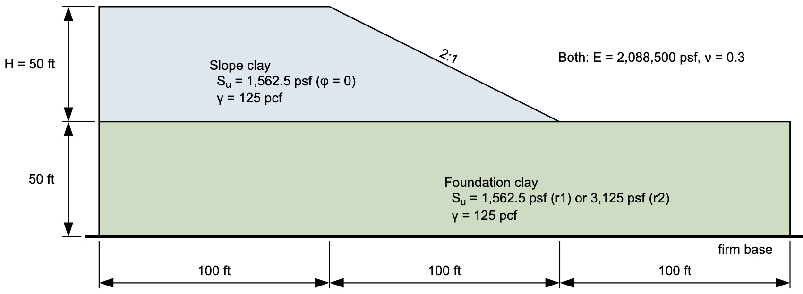
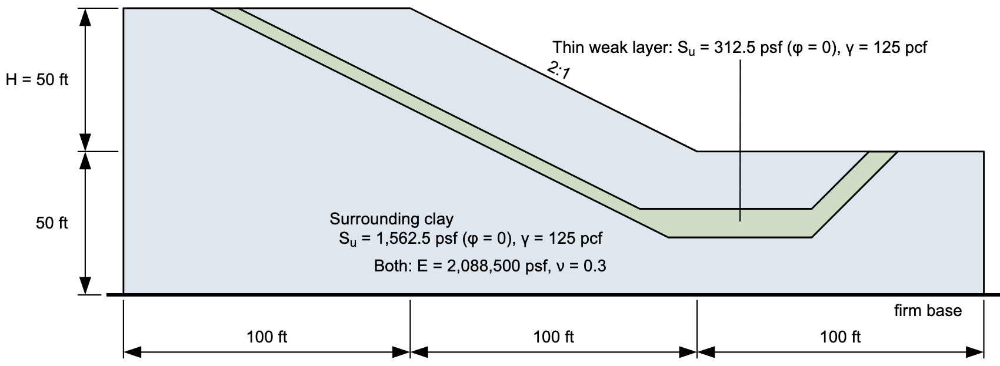

# Exercise - Strength Reduction

In this exercise you will run strength reduction in XSLOPE Studio on two of Griffiths and Lane's (1999) problems and compare it with limit equilibrium. [Tutorial FEM-1](https://xslope.org/en/latest/tutorials/fem01_strength_reduction/){:target="_blank"} shows **Build Mesh** and **Run FEM** step by step. Every file below gives the soil no tensile strength (t_cut = 0), as the lecture recommends.

## Problem 1 - A Foundation That Moves the Mechanism

Griffiths and Lane's Example 4: an undrained clay slope 50 ft high at 2:1, on a clay foundation 50 ft thick over a firm base. In r1 the foundation is as strong as the slope; in r2 it is twice as strong.

{width="971"}

Open these files in XSLOPE Studio: [xslope_gl_example4_r1.xlsx](files/xslope_gl_example4_r1.xlsx) and [xslope_gl_example4_r2.xlsx](files/xslope_gl_example4_r2.xlsx)

1. Open r1 and switch the mode strip to **FEM**. Click **Run → Build Mesh…**, set **Target element size** to 6, and click **Build**. Click **Run → Run FEM…** and **Run**. What is F? Where does the shear band go?

2. Repeat step 1 with r2. What is F, and where does the band go now?

3. Switch to **LEM** and click **Run → Run LEM…** with Spencer and **Auto search**, on each file. How do the factors of safety and circles compare with step 1 and 2?

4. In r2, open **Circles** and replace the starting circle with one at the toe, tangent to the top of the foundation. Enter the row below, or paste it straight into the worksheet:

    | Xo | Yo | Option | Depth | Xi | Yi | R |
    |:--:|:--:|:------:|:-----:|:--:|:--:|:-:|
    | 200 | 150 | Depth | 50 | | | |

    Run LEM again. What is F now, and why did the first search miss it?

Solution:

**1.** F = 1.426 (Griffiths and Lane 1.45). The band runs from the crest down to the firm base and along it: with the foundation no stronger than the slope, the deepest mechanism is the weakest.

**2.** F = 1.996 (Griffiths and Lane 2.03). The band runs from the crest to the toe and never enters the foundation: the stronger foundation pushes the mechanism up into the slope.

**3.** r1: Spencer 1.471, on a circle tangent to the firm base, 3% above strength reduction. r2: 2.665, on a circle through the foundation, a third above strength reduction.

**4.** F = 2.022, on a toe circle in the slope, within 1.3% of strength reduction. The file's starting circle was deep, and the search found the best circle near it, a local minimum. The band showed where to look.

## Problem 2 - A Weak Layer a Circle Can't Follow

Griffiths and Lane's Example 3: the same slope, all in one clay, cut by a thin weak layer whose strength is a fifth of the clay's.

{width="971"}

Open this file in XSLOPE Studio: [xslope_gl_example3.xlsx](files/xslope_gl_example3.xlsx)

1. In **LEM**, click **Run → Run LEM…** with Spencer, **Auto search**, and **Surface** set to **Circular**. What is F?

2. Switch to **FEM**, build a mesh at a target size of 6, and run it. What is F, and where is the band?

3. Back in **LEM**, run Spencer again with **Surface** set to **Non-circular** (the file carries a starting surface). What is F?

4. Which number would you design on? How would you have known, without the strength reduction run?

Solution:

**1.** F = 1.244. The search can only try circles, and no circle follows the layer.

**2.** F = 0.479, less than half the circle's. The band runs down the weak layer and out along its flat bottom.

**3.** F = 0.462, within 4% of strength reduction, on a surface along the layer. Griffiths and Lane's own wedge analyses gave 0.45 to 0.50.

**4.** About 0.46 to 0.48: the slope fails. A circle search alone overestimates F by more than two and a half times here. Without strength reduction you would have to suspect the layer and search noncircular surfaces through it; strength reduction found the mechanism without being told where the layer was.

## Problem 3 - Linear Elements

1. Open r1 from Problem 1 again in **FEM**. Click **Run → Build Mesh…**, set **Element type** to **Linear triangles (tri3)** and **Target element size** to 6, and build. Run FEM. What is F? Compare it with step 1 of Problem 1.

Solution:

**1.** F = 1.645, 15% above the quadratic triangles' 1.426, on the same 1,542 elements. Linear triangles lock: an undrained clay deforms at constant volume, and a mesh of constant-strain triangles can't, so it is too stiff to form the band. Use a quadratic element.

Sources: Griffiths, D. V., and Lane, P. A. (1999). "Slope stability analysis by finite elements." *Géotechnique*, 49(3), 387–403.
