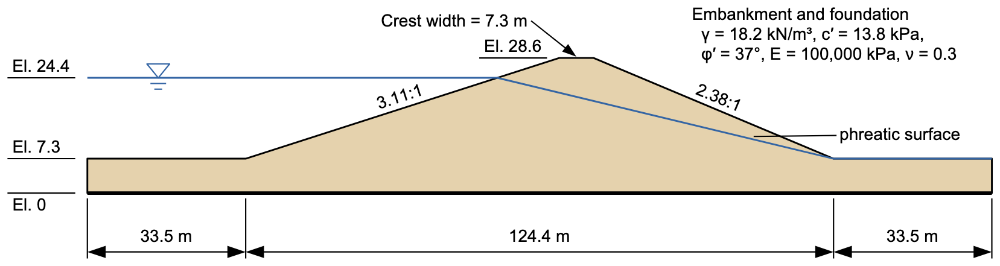
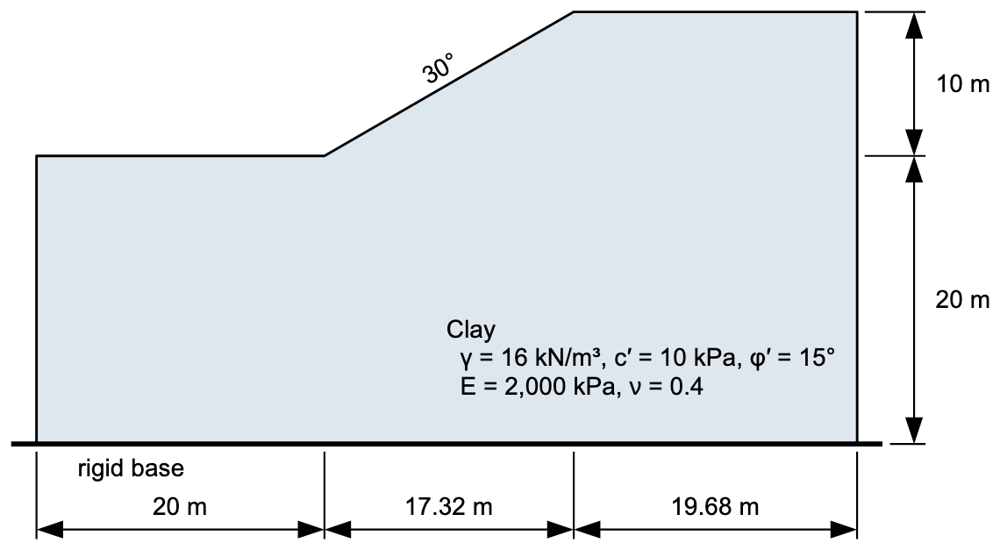

# Homework - Strength Reduction

In this homework you will build two slopes in XSLOPE Studio and solve each by limit equilibrium and by strength reduction: an earth dam with its reservoir full and before filling, and a slope solved on three meshes. [Tutorial FEM-1](https://xslope.org/en/latest/tutorials/fem01_strength_reduction/){:target="_blank"} shows each step.

Record your answers on this answer sheet, which has a section for each part:

[fem_hw_answers.docx](files/fem_hw_answers.docx)

## Problem 1 - Griffiths and Lane's Earth Dam

Griffiths and Lane (1999) analyzed an earth dam section (their Example 6) with homogenized properties, with the reservoir full and before it was filled. The dam is 21.3 m high on a 7.3 m foundation, and the reservoir stands 17.1 m above the foundation. With the reservoir full, the phreatic surface runs in a straight line from where the reservoir meets the upstream face to the downstream toe.

{width="946"}

**(a) The model**

Start with **File → New** in **LEM** mode and set **Units** to SI in **Global parameters**. Each table of points below is laid out like Studio's editors, x then y, so you can copy its values and paste them in.

The dam and its foundation are one material, so the section is one profile line, over a rigid base at El. 0 (**Max depth** = 0):

| x | y |
|:---:|:---:|
| 0 | 7.3 |
| 33.5 | 7.3 |
| 99.83 | 28.6 |
| 107.13 | 28.6 |
| 157.9 | 7.3 |
| 191.4 | 7.3 |

The material:

| Parameter | Value |
|-----------|-------|
| γ | 18.2 kN/m³ |
| c′ | 13.8 kPa |
| φ′ | 37° |
| t_cut | 0 |
| E | 100,000 kPa |
| ν | 0.3 |
| u | `piezo` |

Enter the phreatic surface as the piezometric line:

| x | y |
|:---:|:---:|
| 0 | 24.4 |
| 86.751 | 24.4 |
| 157.9 | 7.3 |
| 191.4 | 7.3 |

Leave **Water loads** on `auto`, so that XSLOPE makes the reservoir's load on the upstream face from the line. Add a starting circle with Xo = 130, Yo = 60, and Depth = 7.3. Save the model with **File → Save As**.

**(b) The reservoir full**

Click **Run → Run LEM…** with Spencer and **Auto search**. What is the factor of safety, and which face does the critical circle cut?

Switch the mode strip to **FEM**. Click **Run → Build Mesh…**, set **Target element size** to 2, and build. Click **Run → Run FEM…** and **Run**. What is the factor of safety? Compare both with Griffiths and Lane's 1.9 by strength reduction and 1.90 by limit equilibrium. Save a PNG of the shear strain at failure.

Enter your answers in part (b) of the answer sheet.

**(c) Before filling**

Save the model under a new name, and in **Materials** change **u** to `none`. Build the mesh again and run FEM. What is the factor of safety? Compare it with Griffiths and Lane's 2.4.

Which face fails, full and empty? Filling the reservoir lowers the factor of safety by about a quarter, though the water pushes on the upstream face. Why?

Enter your answers in part (c) of the answer sheet.

## Problem 2 - Torggler's Slope and the Mesh

Torggler (2016) analyzed a 10 m slope at 30° in a soft clay by strength reduction in PLAXIS, as the first problem of a study of piles in slopes, and found a factor of safety of 1.111. XSLOPE runs it as one of its verification problems.

{width="651"}

**(a) The model**

Start with **File → New** in **LEM** mode, with **Units** set to SI. The section is one profile line, over a rigid base at El. 0 (**Max depth** = 0):

| x | y |
|:---:|:---:|
| 0 | 20 |
| 20 | 20 |
| 37.32 | 30 |
| 57 | 30 |

The material:

| Parameter | Value |
|-----------|-------|
| γ | 16 kN/m³ |
| c′ | 10 kPa |
| φ′ | 15° |
| t_cut | 0 |
| E | 2,000 kPa |
| ν | 0.4 |
| u | `none` |

Add a starting circle with Xo = 28.66, Yo = 40, and Depth = 20, and save the model.

**(b) Limit equilibrium**

Click **Run → Run LEM…** with Spencer and **Auto search**. What is the factor of safety?

Enter your answer in part (b) of the answer sheet.

**(c) Strength reduction at three mesh sizes**

Switch to **FEM**. Build a mesh at a target element size of 2 m and run FEM; note the number of elements and the factor of safety. Repeat at 1 m and at 0.7 m. The 0.7 m run takes a few minutes.

What did refining the mesh change, and why? Which size would you use? Save a PNG of the shear strain at failure on your finest mesh, beside Spencer's critical circle. How do your numbers compare with Spencer's and with Torggler's 1.111?

Enter your answers in part (c) of the answer sheet.

## Submission

Put the following files in a zip archive:

- The earth dam models from Problem 1, full and before filling
- Torggler's slope from Problem 2
- The answer sheet, with your pictures, saved as a PDF

Upload the zip archive to Canvas.

!!! note "Do not put your name or NetID in the file"
    Canvas records who submitted each file, so your name is not needed
    inside the file itself. Leaving it out means your work can be graded
    anonymously, which keeps grading fair. This applies to scans and photos
    too — please don't write your name on the page.

## Grading Rubric

**Total: 30 points**

| Criteria | Points |
|----------|:------:|
| Problem 1a: Earth dam model as given | 4 |
| Problem 1b: Spencer and strength reduction with the reservoir full, compared with Griffiths and Lane, and the shear strain | 6 |
| Problem 1c: Strength reduction before filling, which face fails, and why filling lowers F | 6 |
| Problem 2a-b: Torggler's slope as given, and Spencer's factor of safety | 4 |
| Problem 2c: Strength reduction at the three mesh sizes, what refining changed and why, the size you would use, and the comparison | 10 |

Sources: Griffiths, D. V., and Lane, P. A. (1999). "Slope stability analysis by finite elements." *Géotechnique*, 49(3), 387–403. Torggler, T. (2016). [*Numerical Studies of Embedded Beam Row in Safety Analysis in PLAXIS 2D*](https://diglib.tugraz.at/download.php?id=5891c94c5ba8d&location=browse){:target="_blank"}. MSc thesis, Graz University of Technology.
