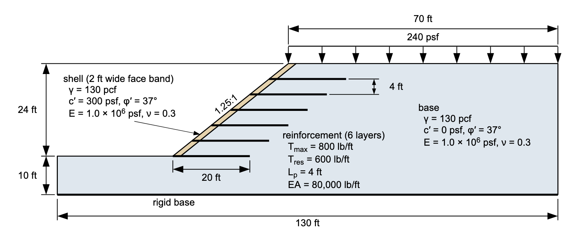

# Exercise - Strength Reduction with Structures

In this exercise you will run strength reduction in XSLOPE Studio on two slopes with structures in them, a geogrid-reinforced slope and a sheet pile wall, and read the forces in the structures. [Tutorial FEM-2](https://xslope.org/en/latest/tutorials/fem02_reinforcement/){:target="_blank"} and [Tutorial FEM-4](https://xslope.org/en/latest/tutorials/fem04_piles/){:target="_blank"} show each step.

## Problem 1 - A Geogrid-Reinforced Slope

The reinforced slope from the Soil Reinforcement lecture: a 24 ft sand fill at 1.25:1 with six geogrid layers, each with a tensile capacity of 800 lb/ft and a residual capacity of 600 lb/ft.

{width="971"}

Open this file in XSLOPE Studio: [xslope_reinforced_slope.xlsx](files/xslope_reinforced_slope.xlsx)

1. In **LEM**, click **Run → Run LEM…** with Spencer and **Auto search**. What is F?

2. Switch the mode strip to **FEM**. Click **Run → Build Mesh…**, untick **Auto-size from geometry**, set **Target element size** to 2, untick **Refine thin zones**, and click **Build**. Click **Run → Run FEM…** and **Run** (a few minutes). What is F? Compare it with step 1.

3. Click **1D Details…**, set **Field state** to **Last converged**, and select **Line 5**. What is the largest force in the layer, and how far from the face is it?

4. Open **Reinforcement** and set **Tres** to 0 on all six lines, so that a layer carries nothing once it reaches its capacity. Run FEM again. What is F, and why is it lower than in step 2?

Solution:

**1.** F = 1.589.

**2.** F = 1.535, 3% below Spencer. With the geogrid in the slope, the two methods give about the same F.

**3.** About 764 lb/ft, 11 ft from the face. The force is small at the face, largest near the middle of the layer, and small again at the buried end. Limit equilibrium applies one force at the point where the circle crosses the layer.

**4.** F = 1.457. A layer that reaches its capacity now drops to zero instead of to 600 lb/ft, and its load passes to the other layers and the soil.

## Problem 2 - A Sheet Pile Wall

A 20 ft clay slope at 1:1 with a steel sheet pile wall at mid-slope, its tip fixed in the rigid base. The file has a PZ-27 section, with a moment capacity of 152,000 lb·ft/ft. You will first run it with a lighter section.

{width="971"}

Open this file in XSLOPE Studio: [xslope_pile_wall.xlsx](files/xslope_pile_wall.xlsx)

1. Open **Piles** in the **Inputs** dock, press **Table view**, set **Mcap** to 60000, and click **OK**. Switch to **FEM**. Click **Run → Build Mesh…**, untick **Auto-size from geometry**, set **Target element size** to 2, and click **Build**. Run FEM. What is F, and where does the shear strain band go?

2. Click **1D Details…**, set **Field state** to **Last converged**, and select the wall. What is the largest bending moment, and where is it? Compare it with Mcap.

3. With the wall's resistance H entered (49,000 lb/ft, the passive resistance of the soil below the slip surface), Spencer's method gives F = 1.704, and its critical circle passes over the head of the wall. Compare it with step 1. Why does limit equilibrium miss the failure through the wall?

4. Set **Mcap** back to 152000 and run FEM again. What is F, and where does the band go now?

Solution:

**1.** F = 1.621. The band runs from the slope behind the wall, through the wall, and out at the toe: the wall bends over and the soil fails with it.

**2.** 60,000 lb·ft/ft at the tip, 20 ft below the head, equal to Mcap. The wall has yielded at its fixed tip.

**3.** Spencer's F is 5% higher. Limit equilibrium does not compute the bending moment in the wall, so it cannot tell that the wall yields at its tip. The H it is given is large enough that circles through the wall have a high F, and the critical circle goes over the head.

**4.** F = 1.730. The band now runs from the head of the wall up to the crest: the soil above the wall slides out over its head. The largest moment is about 84,000 lb·ft/ft at the tip, 55% of Mcap, so the wall does not yield, and Spencer's 1.704 is within 2%.
