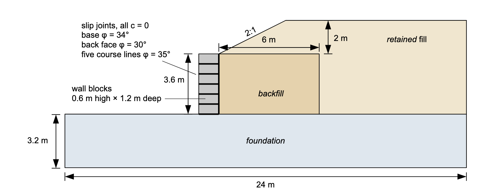
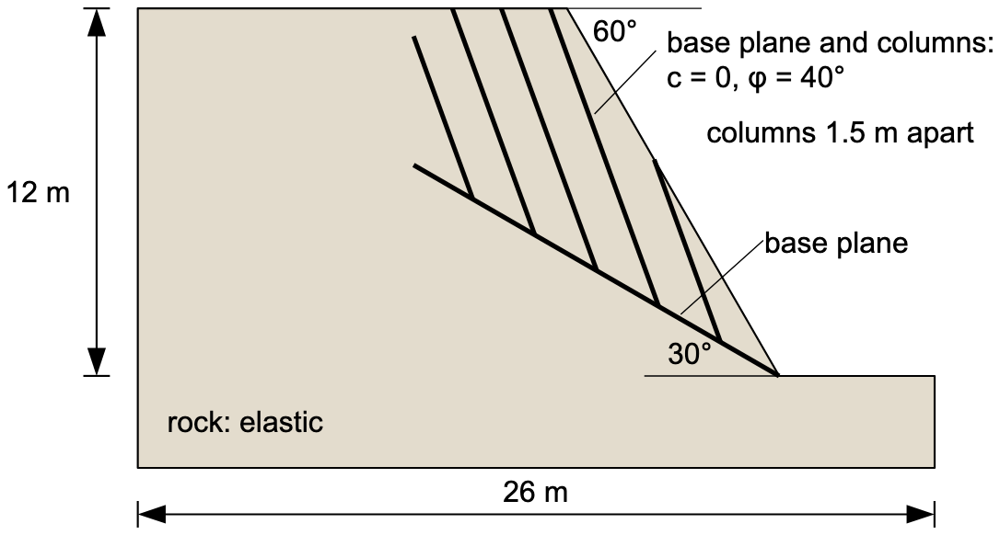
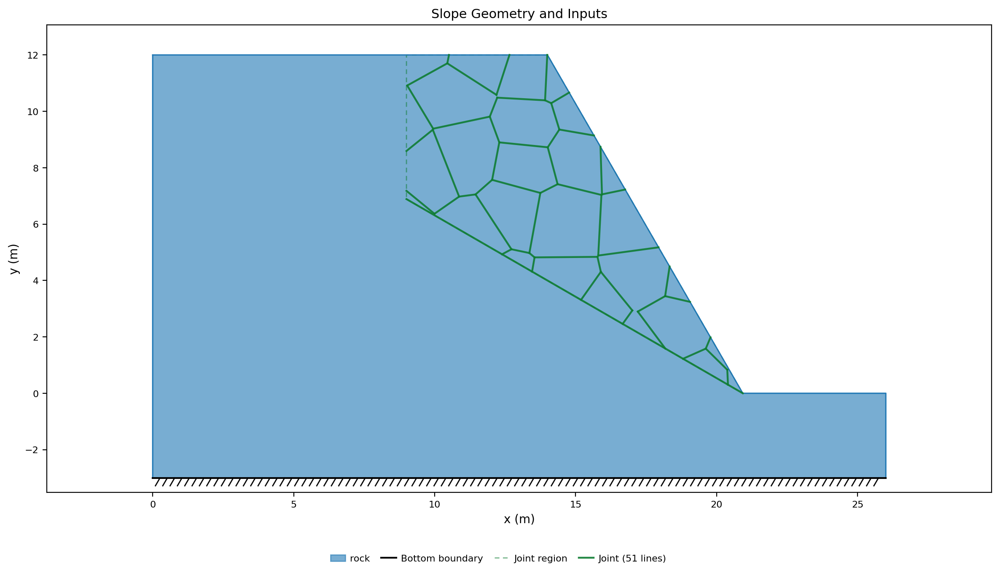

# Homework - Strength Reduction with Structures

In this homework you will run strength reduction on models with joints in them: a dry-stacked block wall, and a rock face cut by joints in two different patterns. [Tutorial FEM-3](https://xslope.org/en/latest/tutorials/fem03_block_wall_joints/){:target="_blank"} and [Tutorial FEM-5](https://xslope.org/en/latest/tutorials/fem05_rock_slope_joints/){:target="_blank"} show each step.

Record your answers on this answer sheet, which has a section for each problem:

[fem2_hw_answers.docx](files/fem2_hw_answers.docx)

## Problem 1 - A Block Wall

A wall of six dry-stacked concrete blocks, 3.6 m high, retaining granular fill. Each contact is a joint with no cohesion: the base, the back face against the fill, and the five joints between courses.

{width="971"}

Open this file in XSLOPE Studio: [xslope_block_wall.xlsx](files/xslope_block_wall.xlsx)

**(a)** Switch to **FEM**. Click **Run → Build Mesh…**, set **Target element size** to 0.8, untick **Refine thin zones**, and click **Build**. Click **Run → Run FEM…**, set **Max iterations per trial** to 100,000, leave **Failure criterion** on **Hybrid**, and click **Run**. The run takes about seven minutes. What is F? Save a PNG of the deformed wall at failure.

**(b)** Click **1D Details…** and set **Field state** to **Last converged**. What is the largest slip on the back face, on the base, and on the course joints?

**(c)** Which contact slipped most? Would a check of sliding on the base alone have caught this? Why?

Enter your answers in Problem 1 of the answer sheet.

## Problem 2 - A Jointed Rock Face

A 12 m rock face at 60°. A base plane dips 30° from 5 m behind the crest to the toe, and the rock above it is cut by joints. You will run the same slope with two joint patterns: a set of columns 1.5 m apart, and an irregular blocky mass. Every joint, the base plane included, has no cohesion and a friction angle of 40°. The rock is elastic.

The columns:

{width="700"}

The blocky mass, as XSLOPE draws its inputs:

{width="971"}

Open these files in XSLOPE Studio: [xslope_rock_columns.xlsx](files/xslope_rock_columns.xlsx) and [xslope_rock_blocks.xlsx](files/xslope_rock_blocks.xlsx)

**(a)** Open the columns. Switch to **FEM**, build a mesh at a target size of 1.5, then run FEM with **Max iterations per trial** at 100,000 and **Failure criterion** on **Hybrid** (about two minutes). What is F? Set **Field state** to **Last converged** and save a PNG of the deformed blocks.

**(b)** Repeat (a) with the blocky mass (about five minutes).

**(c)** The two factors of safety are close. Which rock mass topples and which slides? How do the deformed blocks and the joint states show it?

Enter your answers in Problem 2 of the answer sheet.

## Submission

Put the following files in a zip archive:

- The block wall model from Problem 1
- The answer sheet, with your pictures, saved as a PDF

Upload the zip archive to Canvas.

!!! note "Do not put your name or NetID in the file"
    Canvas records who submitted each file, so your name is not needed
    inside the file itself. Leaving it out means your work can be graded
    anonymously, which keeps grading fair. This applies to scans and photos
    too — please don't write your name on the page.

## Grading Rubric

**Total: 30 points**

| Criteria | Points |
|----------|:------:|
| Problem 1a: F and the picture of the deformed wall | 6 |
| Problem 1b: The largest slip on each contact | 6 |
| Problem 1c: Which contact slipped most, and why a base sliding check misses it | 6 |
| Problem 2a-b: F and the picture of the deformed blocks, for each pattern | 6 |
| Problem 2c: Which mass topples and which slides, and how the pictures show it | 6 |
